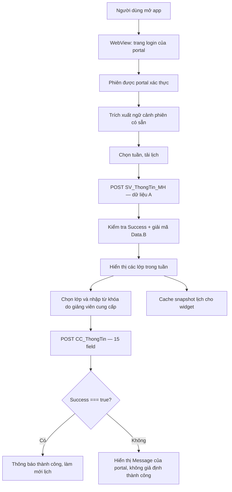

# CMC Check-in — Tài liệu tái dựng iOS & Flutter (bản đối chiếu README + HAR)

> **Phiên bản tài liệu:** 2.0 — 15/10/2026  
> **Nguồn đầu vào:** `README.md` (bản mô tả và mã tham khảo, 3.899 dòng) và `iu.cmcu.edu.vn.har` (bản ghi lưu lượng trình duyệt, 211 entry).  
> **Đối tượng:** lập trình viên SwiftUI/WidgetKit, Flutter/Android/iOS, QA, người kiểm tra bảo mật và người phụ trách phát hành.  
> **Phạm vi:** tài liệu thiết kế và triển khai một *client cá nhân* đọc lịch học và gửi từ khóa điểm danh đến cổng sinh viên; **không** cung cấp backend riêng hoặc khả năng vượt qua quy tắc điểm danh.

## Cách đọc và mức độ tin cậy

Tài liệu hợp nhất hai loại bằng chứng vốn có mức độ tin cậy khác nhau:

- **[HAR — quan sát thực tế]**: đường dẫn, phương thức, thứ tự trường, kiểu response, trạng thái HTTP và trạng thái nghiệp vụ được ghi trong **một phiên** truy cập cổng sinh viên ngày 15/10/2026. Đây là bằng chứng cho phiên đó, **không** chứng minh portal sẽ giữ nguyên API trong tương lai.
- **[README gốc]**: hành vi, design system, luồng WebView, mã mẫu Swift và Dart được cung cấp trong tài liệu đầu vào. README gốc tự mô tả là dựa vào Android/Kotlin và file JavaScript portal; trong lượt này không có repository Android để độc lập kiểm chứng các đoạn mã đó.
- **[Đối chiếu]**: chi tiết cùng xuất hiện trong README và HAR, như endpoint lịch, hàm nghiệp vụ, `iM`, 15 trường điểm danh và cấu trúc `Data.B`.
- **[Đề xuất triển khai]**: các bổ sung nhằm hoàn chỉnh widget, kiểm thử, build, bảo mật, trải nghiệm và xử lý lỗi; **không** được trình bày như bằng chứng đã có từ portal.

**Chú ý:** Các đoạn SwiftUI/Flutter bên dưới là **mã tham khảo từ README gốc**, chưa được build trong phiên biên soạn này. Không hiểu cụm “đầy đủ code” ở tiêu đề cũ là bảo đảm compile hoặc đã chạy production. Các module WidgetKit và quy trình kiểm thử được bổ sung ở chương 11–16; phải biên dịch và chạy test trên dự án thật trước khi phát hành.

### Mục lục

1. [Phạm vi, mục tiêu và giới hạn](#1-app-làm-gì-không-làm-gì)
2. [Kiến trúc tổng thể](#2-kiến-trúc-tổng-thể)
3. [Hợp đồng API và mã hóa](#3-hợp-đồng-api)
4. [Đăng nhập, session và token](#4-phiên-đăng-nhập--token)
5. [Luồng nghiệp vụ](#5-luồng-nghiệp-vụ)
6. [Mô hình dữ liệu](#6-mô-hình-dữ-liệu)
7. [Design system](#7-design-system)
8. [Màn hình và hành vi](#8-màn-hình--hành-vi-ui)
9. [Mã tham khảo SwiftUI](#9-bản-swiftui)
10. [Mã tham khảo Flutter](#10-bản-flutter)
11. [WidgetKit và tích hợp widget đa nền tảng](#11-widgetkit-và-tích-hợp-widget-đa-nền-tảng)
12. [Kiểm thử tự động và nghiệm thu](#12-kiểm-thử-tự-động-và-nghiệm-thu)
13. [Build, cấu hình và phát hành](#13-build-cấu-hình-và-phát-hành)
14. [Bảo mật và quyền riêng tư](#14-bảo-mật-và-quyền-riêng-tư)
15. [Đối chiếu nền tảng và backlog](#15-đối-chiếu-nền-tảng-và-backlog)
16. [Troubleshooting và vận hành](#16-troubleshooting-và-vận-hành)
17. [Phụ lục A — Bằng chứng HAR đã khử thông tin cá nhân](#17-phụ-lục-a--bằng-chứng-har-đã-khử-thông-tin-cá-nhân)
18. [Phụ lục B — Contract test, fixture và quy tắc thay đổi API](#18-phụ-lục-b--contract-test-fixture-và-quy-tắc-thay-đổi-api)

## Bảng tổng kết những thay đổi chính so với README gốc

| Chủ đề | README gốc | Kết quả đối chiếu/bổ sung |
|---|---|---|
| Độ phủ | Mục lục có 16 chương, nhưng file kết thúc ở chương 10 | Bổ sung chương 11–18; giữ nguyên nội dung code nguồn làm tham khảo |
| Gọi API lịch | POST một field `A`, giải mã `Data.B` | **[Đối chiếu]** HAR xác nhận cách đóng gói này; response lịch đã giải mã là mảng **9 dòng** trong phiên mẫu |
| Gọi API điểm danh | POST form 15 field, không mã hóa `A` | **[Đối chiếu]** HAR xác nhận đủ 15 field **đúng thứ tự** |
| Thành công | Dùng `Success` và `Message` | **[HAR]** Request điểm danh có HTTP `200` nhưng `Success: false` vì phía giảng viên chưa mở điểm danh lúc đó |
| Xác thực request | Mô tả Bearer + Cookie như header bắt buộc của mọi request | **[HAR]** Hai POST nghiệp vụ quan sát không chứa hai header đó; JS portal có nhánh thêm Bearer **khi token tồn tại**. Không áp đặt kết luận chung từ một phiên |
| Response | `{Success, Message, Data}` | **[HAR]** Response còn xuất hiện `Pager`, `Id`; client phải bỏ qua những trường chưa dùng |
| Quy trình đăng nhập | Mô tả Microsoft sign-in | **[HAR]** Quan sát cả trang đăng nhập portal (`login.aspx`), form POST của portal và chặng chuyển hướng Microsoft; app không tự tạo form hay đọc mật khẩu |
| Widget, QA, release | Chưa có nội dung thực tế | Bổ sung contract snapshot, mã SwiftUI mẫu cho widget, checklist QA, cấu hình và troubleshooting |
| Dữ liệu nhạy cảm | Chưa có chỉ dẫn riêng cho HAR đầu vào | Quy định không commit HAR gốc hoặc ghi log mật khẩu, authorization code, token, cookie, IP và thông tin người học |

## Sơ đồ luồng quan sát được



---
## 1. App làm gì, không làm gì

**CMC Check-in là client di động của cổng sinh viên trường** (`https://iu.cmcu.edu.vn`). Nó **không có backend riêng**.

| Làm | Không làm |
|---|---|
| Tải trang đăng nhập **do portal cung cấp** (có thể có cả form portal và luồng Microsoft SSO) trong WebView | App không tự xây form thu thập mật khẩu và không lưu mật khẩu |
| Lấy lịch học cá nhân theo tuần | Không quét QR, không dùng GPS, không NFC |
| Hiển thị lịch theo ngày, đánh dấu ngày có lớp | Không có server trung gian, không có database riêng |
| Gửi **từ khóa điểm danh** (do giảng viên đọc tại lớp) cho lớp đang diễn ra | Không tự đoán/tự sinh từ khóa, không giả IP, không tự động hóa |
| Widget màn hình chính: lớp đang học / lớp kế tiếp, bấm để mở sheet nhập từ khóa | Không check-in được lịch thi |
| Cache lịch tuần hiện tại cho widget | Không có push notification |

**Chức năng cốt lõi gồm 3 việc:** (1) thu nhận ngữ cảnh phiên hợp lệ từ portal trong WebView (bao gồm token **nếu được portal cung cấp**), (2) gọi API lấy lịch, (3) gọi API "tự ghi nhận" kèm từ khóa do người dùng nhập. **[HAR]** Bằng chứng một lần tải lịch thành công và một lần gửi điểm danh bị từ chối; chưa chứng minh các code sample đã chạy.

---

## 2. Kiến trúc tổng thể

```
┌──────────────────────────────────────────────────────────────────────┐
│                           App (iOS / Flutter)                        │
│                                                                      │
│  ┌───────────────┐   token, userId,   ┌───────────────────────────┐  │
│  │ LoginScreen   │   chucNangId, IP   │ SessionStore              │  │
│  │ WebView +     ├───────────────────▶│ Keychain / SecureStorage  │  │
│  │ JS probe      │                    └─────────────┬─────────────┘  │
│  └───────┬───────┘                                  │                │
│          │ cookies (WebView store)                  ▼                │
│          │                           ┌───────────────────────────┐   │
│          └──────────────────────────▶│ PortalApi                 │   │
│                                      │  • weekSchedule()         │   │
│  ┌───────────────┐                   │  • checkIn()              │   │
│  │ PortalCrypto  │◀─────────────────▶│  • parseResponse()        │   │
│  │ XOR + Base64  │                   └─────────────┬─────────────┘   │
│  └───────────────┘                                 │                 │
│                                                    ▼                 │
│  ┌───────────────────────────┐        ┌────────────────────────┐    │
│  │ ScheduleViewModel/        │◀──────▶│ ScheduleCache (nhẹ)    │    │
│  │ ScheduleController        │        │ App Group → Widget     │    │
│  └─────────────┬─────────────┘        └────────────────────────┘    │
│                ▼                                                     │
│  ScheduleView · WeekStrip · EntryCard · CheckInSheet                 │
└──────────────────────────────────────────────────────────────────────┘
                 │ HTTPS (form POST, Bearer JWT, Cookie)
                 ▼
     https://iu.cmcu.edu.vn/{sinhvienapi|chuyencanapi}/api/...
```

Phân lớp (giống bản Android):

| Lớp | Thành phần | Trách nhiệm |
|---|---|---|
| UI | LoginScreen, ScheduleScreen, CheckInSheet, Widget | Hiển thị, nhận thao tác |
| State | ScheduleViewModel (Swift) / ScheduleController (Dart) | Tuần đang xem, ngày chọn, lịch, trạng thái check-in, lỗi |
| Domain | `currentClass`, `nextClass`, `startOfWeek`, parse lịch | Thuật toán chọn lớp, không phụ thuộc UI |
| Data | PortalApi, PortalCrypto, PublicIP | Gọi mạng, mã hóa/giải mã |
| Storage | SessionStore, ScheduleCache | Lưu token (an toàn), lịch tuần (cho widget) |

---

## 3. Hợp đồng API

### 3.1 Domain & địa chỉ

| Mục | Giá trị |
|---|---|
| Origin | `https://iu.cmcu.edu.vn` |
| Trang đăng nhập | `https://iu.cmcu.edu.vn/congthongtin/login.aspx` |
| Lấy IP công khai | `https://jsonip.com` → `{"ip":"x.x.x.x"}` |

API base được chọn theo **tiền tố của `action` (phần trước dấu `_` đầu tiên)**. Bản Android chỉ dùng 2 tiền tố; danh sách đầy đủ nằm trong `portal-files/Config.js` → `Init_API()`.

| Tiền tố | Base path | App dùng? |
|---|---|---|
| `SV` | `/sinhvienapi/api` | ✅ lịch học |
| `CC` | `/chuyencanapi/api` | ✅ check-in |
| `CM`, `SYS` | `/csacmapi/api` | ❌ |
| `CMS` | `/cmsapi/api` | ❌ |
| `D` | `/quanlydiemapi/api` | ❌ |
| `TC` | `/taichinhapi/api` | ❌ |
| (các loại khác: `DKH`, `KHCT`, `KS`, `KTX`, `NCKH`, `NS`, `SMS`, `TKGG`, `L`, `HLTL`, `RL`, `XLHV`, `HDDT`, `NH`, `TS`, `LVLA`, `QLTTN`, `HB`, `TP`, `TT`, `TN`) | xem `Config.js` | ❌ |

URL cuối = `origin + base + "/" + action`. Ví dụ:

```
https://iu.cmcu.edu.vn/sinhvienapi/api/SV_ThongTin_MH/DSA4BRINKCIpAiAPKSAv
https://iu.cmcu.edu.vn/chuyencanapi/api/CC_ThongTin/Them_QLSV_NguoiHoc_TuGhiNhan
```

### 3.2 Header HTTP và khác biệt được ghi nhận trong HAR

**Cập nhật mã chạy:** App trong `lib/` dùng `PortalWebClient` để gửi API ngay trong WebView đã đăng nhập, giữ cookie/UA/ngữ cảnh trình duyệt; chỉ mở lịch sau khi API xác minh thành công. Client Dart HTTP trực tiếp và chính sách giữ cookie sau 401 trong code sample Swift/Dart bên dưới là thiết kế cũ; không dùng nguyên mẫu đó để thay thế bridge và `SessionRecovery` hiện tại. Xem `README.md` và `docs/AUTH_TESTING.md`.

**[README gốc / mã tham khảo]** Bảng dưới phản ánh cách tác giả README xây HTTP client và hành vi *có điều kiện* trong JavaScript portal. **[HAR thực tế]** Hai POST nghiệp vụ quan sát được **không** mang `Authorization` hoặc `Cookie` trong danh sách request headers của HAR. `systemroot.js` chỉ thêm Authorization khi có `tokenJWT`. Vì vậy, không nên coi toàn bộ header dưới đây là *bắt buộc trên mọi request* và cũng không được suy diễn rằng API có thể gọi không cần phiên đăng nhập. Thực hiện xác thực theo đúng phiên được portal hỗ trợ, không tự chế hoặc đoán token.

| Header | Giá trị trong client mẫu / điều kiện |
|---|---|
| `Content-Type` | `application/x-www-form-urlencoded; charset=UTF-8` |
| `Accept` | `application/json, text/javascript, */*; q=0.01` |
| `Authorization` | `Bearer <tokenJWT>` **chỉ nếu portal thực sự cấp token hợp lệ và cơ chế này được dùng** |
| `User-Agent` | UA mặc định của WebView (cùng UA đã dùng để đăng nhập) |
| `Origin` | `https://iu.cmcu.edu.vn` |
| `Cookie` | Chỉ cookie hợp lệ theo domain/path/expiry/secure nếu phiên yêu cầu; không ghi ra log |

Hai **endpoint nghiệp vụ đang triển khai** đều là **POST**; còn HAR có GET, POST và OPTIONS cho các trang/tài nguyên khác. Các timeout 15s/30s là thiết kế từ README gốc, không phải giá trị suy ra từ HAR.

### 3.3 Mã hóa `AE` / `AD` (PortalCrypto)

Portal dùng một hàm "mã hóa" phía client (thực chất chỉ là làm rối, **không phải bảo mật thật**):

```
encrypt(plain, key):
    units  = UTF-16 code units của plain
    keyU   = UTF-16 code units của key
    out[i] = units[i] XOR keyU[i mod len(keyU)]
    return Base64( UTF-8( chuỗi tạo từ out ) )

decrypt(b64, key):
    text = UTF-8 decode( Base64 decode (bỏ qua ký tự xuống dòng) )
    return XOR như trên
```

| Tham số | Giá trị |
|---|---|
| `iM` (khóa giải mã response, hard-code trong portal) | `AzzSystem` |
| Khóa mã hóa request | Phần của `action` **sau dấu `/`** (vd `DSA4BRINKCIpAiAPKSAv`) |
| Khi nào mã hóa request | Chỉ khi payload có trường `iM` (API lịch học). API check-in **không** mã hóa |
| Body request mã hóa | Một field form duy nhất: `A=<base64>` |

> ⚠️ Phải XOR theo **UTF-16 code unit** (như JavaScript/Kotlin/Dart). Trong Swift dùng `text.utf16`, tuyệt đối không duyệt `Character` hay `unicodeScalars`.

**Test vector (bắt buộc pass trước khi làm gì khác)** — lấy từ `PortalCryptoTest.kt`, do chính `AE` của portal sinh ra:

```text
KEY      = DSA4BRINKCIpAiAPKSAv
PLAIN    = {"action":"SV_ThongTin_MH/DSA4BRINKCIpAiAPKSAv","func":"pkg_congthongtin_hssv_thongtin.LayDSLichCaNhan","iM":"AzzSystem","strQLSV_NguoiHoc_Id":"ABC123","strNgayBatDau":"12/10/2026","strNgayKetThuc":"18/10/2026"}
CIPHER   = P3EgVzY7JiBpeWsjFzYVOCQ9JiItPR55Cn0NHQp3CyIIJwoTAiMAHwUDCmcDJGtiaSU8HiJLe3I7OCYpJzwvUzY6JiAsNyAeHgEyIz0MNR4rPSZAKzxnAio6DSMNACI4CDIPHiU9YxhgOwRscWEICjs6OCM/NixUaHEyQDADBR0dHAcXNAYoGCQwHj8gcXsWAxAKf3lwa1xjGjUiBTQgDwYyNXAjJ2t0aXJ7X3BZbmJ7YXdUaHEyQDAcLi8yCCwEFQE0M2lpY0d8fHAEbWB5fH1hNA==

KEY      = AzzSystem
CIPHER   = GgFYBzw9PCouETI7HVtJVinhu4AxWg4hwpUdHEUJKFrFq+G6ihcUVklPFT80AzE8OiIlDjlYaVsjHMKXAyZaSWNIUVhHKgg1OBItNzUwT3tNVnE3NDU8JQ45WGlbQkdKXHFVSGNLRVYYMA==
PLAIN    = [{"TENHOCPHAN":"Lập trình di động","TENPHONGHOC":"Phòng 301","GIOBATDAU":7,"NGAYHOC":"13/10/2026"}]

Round-trip: decrypt(encrypt("Từ khóa điểm danh: Lập trình di động","AzzSystem"),"AzzSystem") == chuỗi gốc
```

### 3.4 API lấy lịch học tuần

| Mục | Giá trị |
|---|---|
| Endpoint | `POST /sinhvienapi/api/SV_ThongTin_MH/DSA4BRINKCIpAiAPKSAv` |
| Mã hóa | **Có** (body: `A=<encrypt(json, "DSA4BRINKCIpAiAPKSAv")>`) |

JSON bên trong (thứ tự khóa như dưới; ngày định dạng `dd/MM/yyyy`, thứ Hai → Chủ nhật):

```json
{
  "action": "SV_ThongTin_MH/DSA4BRINKCIpAiAPKSAv",
  "func": "pkg_congthongtin_hssv_thongtin.LayDSLichCaNhan",
  "iM": "AzzSystem",
  "strQLSV_NguoiHoc_Id": "<userId>",
  "strNgayBatDau": "12/10/2026",
  "strNgayKetThuc": "18/10/2026",
  "strChucNang_Id": "<chucNangId>",
  "strNguoiThucHien_Id": "<userId>"
}
```

Mỗi dòng lịch trong `Data` (sau khi giải mã nếu `Data = {B: ...}`):

| Field JSON | Ý nghĩa | Ghi chú |
|---|---|---|
| `ID` | Id dòng lịch | Bắt buộc, thiếu thì bỏ dòng |
| `IDLOPHOCPHAN` | Id lớp học phần | Gửi lại làm `strDiem_DanhSach_Id` khi check-in |
| `TENHOCPHAN` (hoặc `DANGKY_LOPHOCPHAN_TEN`) | Tên môn | Mặc định `—` |
| `TENLOPHOCPHAN` | Tên lớp học phần | |
| `TENPHONGHOC` (hoặc `PHONGHOC_TEN`) | Phòng | |
| `GIANGVIEN` | Giảng viên | |
| `NGAYHOC` | Ngày học `d/M/yyyy` | Bắt buộc; **giữ nguyên chuỗi gốc** để gửi lại |
| `GIOBATDAU`, `PHUTBATDAU` | Giờ/phút bắt đầu | Có thể là số hoặc chuỗi; mặc định `0` |
| `GIOKETTHUC`, `PHUTKETTHUC` | Giờ/phút kết thúc | |
| `TIETBATDAU`, `TIETKETTHUC` | Tiết | |
| `PHANLOAI` | `"LICHTHI"` ⇒ lịch thi | |
| `CATHI` | Ca thi | |
| `THONGTINCHUYENCAN` | Ghi chú điểm danh | Portal hiển thị cạnh buổi học |

Quy tắc ép kiểu giá trị (giống JS): số nguyên bỏ đuôi `.0` (`7.0` → `"7"`), chuỗi được `trim`, rỗng/`null` ⇒ `null`.

### 3.5 API check-in ("tự ghi nhận")

| Mục | Giá trị |
|---|---|
| Endpoint | `POST /chuyencanapi/api/CC_ThongTin/Them_QLSV_NguoiHoc_TuGhiNhan` |
| Mã hóa | **Không** (request này không có `iM`) |
| Body | form-urlencoded, **đúng 15 field, đúng thứ tự** như bảng |

| # | Field | Giá trị |
|---|---|---|
| 1 | `action` | `CC_ThongTin/Them_QLSV_NguoiHoc_TuGhiNhan` |
| 2 | `type` | `POST` |
| 3 | `strChucNang_Id` | `chucNangId` của session |
| 4 | `strDaoTao_LopQuanLy_Id` | rỗng |
| 5 | `strDiem_DanhSach_Id` | `IDLOPHOCPHAN` của buổi học |
| 6 | `strNgayGhiNhan` | `NGAYHOC` nguyên văn |
| 7 | `strGio` | `GIOBATDAU` |
| 8 | `strPhut` | `PHUTBATDAU` |
| 9 | `strGiay` | `0` |
| 10 | `strIp` | IP công khai (xem 3.7) |
| 11 | `strNoiDungTuGhiNhan` | **Từ khóa điểm danh** do người dùng nhập (đã `trim`) |
| 12 | `strNguoiThucHien_Id` | `userId` |
| 13 | `strQLSV_NguoiHoc_Id` | ID người học trong ngữ cảnh trang (`me.strGiangVien_Id` trong `lichgiang.js`); **HAR phiên mẫu bằng `userId`, nhưng không khẳng định luôn bằng nhau** |
| 14 | `strDaoTao_ChuongTrinh_Id` | rỗng |
| 15 | `strQLSV_TrangThaiNguoiHoc_Id` | rỗng |

**Đối chiếu bổ sung với `lichgiang.js` trong HAR:** Trang portal lấy `strChucNang_Id` từ `edu.system.strChucNang_Id`; lấy `strQLSV_NguoiHoc_Id` từ biến ngữ cảnh trang `me.strGiangVien_Id`, còn `strNguoiThucHien_Id` là `edu.system.userId`. Trong phiên mẫu, hai ID người học/thực hiện bằng nhau; **điều này không đủ để thay biến ngữ cảnh trang bằng `userId` cho mọi tài khoản**. Mã Swift/Flutter tham khảo bên dưới dùng `session.userId` cho cả hai; trước khi phát hành cần kiểm tra và sửa mô hình session nếu backend hỗ trợ vai trò khác. Tương tự, `chucNangId` phải gắn với trang chức năng thực tế, không lấy nhầm từ menu khác. Đây là vấn đề **P0 contract fidelity**.

Kết quả: chỉ khi `Success == true` mới coi là thành công ⇒ trả `Message` của portal (nếu rỗng dùng `"Checked in."`) rồi **reload lại lịch**. HAR kèm theo **không** chứa lần thành công nghiệp vụ.

### 3.6 Envelope response & xử lý lỗi

**[HAR]** Response quan sát có thêm hai khóa `Pager`, `Id` bên cạnh `Success`, `Message`, `Data`; parser cần chịu được các trường tùy chọn và không ép chúng phải tồn tại. **HTTP 200 không tương đương thành công nghiệp vụ**: chính lần gọi check-in quan sát trong HAR có HTTP 200 nhưng `Success: false`.

```json
{ "Success": true, "Message": "…", "Data": <mảng/đối tượng> }
{ "Success": true, "Message": "…", "Data": { "B": "<ciphertext>" } }   // phải giải mã bằng khóa "AzzSystem" rồi parse JSON
```

| Tình huống | Hành vi |
|---|---|
| HTTP 401 | `SessionExpired` → xóa session, widget và cookie/cache/storage WebView rồi mới mở login; chặn token đã bị từ chối và dừng sau 2 phiên lỗi liên tiếp (bản sửa #4, xem README.md) |
| HTTP khác 2xx | Lỗi `"The portal answered HTTP <code>"` |
| Body không phải JSON object | `"Unexpected response from the portal."` |
| `Success != true` | Lỗi với `Message` (mặc định `"The portal rejected the request."`) |
| `Data.B` giải mã/parse hỏng | `"Couldn't read the portal's response."` |
| Mất mạng/timeout | `"Couldn't reach the portal. Check your connection and try again."` |

### 3.7 IP công khai

Portal điền `clientIP` từ `jsonip.com` (JavaScript `systemroot.js` trong HAR sử dụng gọi kiểu JSONP). App di động trong mã tham khảo sử dụng GET JSON thông thường; cần kiểm tra thực tế với dịch vụ nếu có thay đổi:

1. Khi mở sheet check-in: gọi `GET https://jsonip.com` (timeout 10s) → lấy `ip`.
2. Nếu lỗi → dùng `portalIp` (IP portal ghi lúc đăng nhập, đọc từ `edu.system.clientIP`).
3. Hiển thị ở sheet: `IP shown to the lecturer: <ip | looking up… | unknown>`.

IP **luôn là IP thật** của thiết bị. Không có chỗ nào cho người dùng sửa IP.

---

## 4. Phiên đăng nhập & token

Client không tự định nghĩa API đăng nhập mới; WebView sử dụng luồng đăng nhập **do portal vận hành**. HAR cho thấy cả form POST đến `login.aspx` và Microsoft OAuth. Mã tham khảo dự kiến đọc `edu.system.tokenJWT` khi có; tuy nhiên HAR không chứng minh token luôn hiện hữu trong mọi phiên. Bất kỳ thay đổi nào về logic thu session đều phải xác minh trong phiên hợp lệ, tuyệt đối không lấy hay ghi lại mật khẩu.

### 4.1 Đoạn JS "probe" (chạy lặp trong WebView)

```javascript
(function () {
  try {
    var s = (typeof edu !== 'undefined' && edu) ? edu.system : null;
    if (!s || !s.tokenJWT || !s.userId) return null;
    var list = s.dtChucNang || [], match = null;
    for (var i = 0; i < list.length; i++) {
      var file = String(list[i].DUONGDANFILE || '').toLowerCase();
      var name = String(list[i].TENCHUCNANG || '').toLowerCase();
      if (file.indexOf('lichhoc') >= 0 || name.indexOf('lịch cá nhân') >= 0) { match = list[i].ID; break; }
    }
    return JSON.stringify({
      token: s.tokenJWT, userId: s.userId, clientIP: s.clientIP || '',
      chucNangId: match == null ? null : String(match),
      currentChucNangId: s.strChucNang_Id || '', menuLoaded: list.length > 0
    });
  } catch (e) { return null; }
})();
```

### 4.2 Thuật toán probe

| Bước | Chi tiết |
|---|---|
| Tần suất | Mỗi **700 ms** |
| Chưa có token/userId | Probe trả `null` → đợi tiếp |
| Có token | Đợi menu `dtChucNang` tải xong và tìm được mục "Lịch cá nhân" |
| Điều kiện kết thúc | `menuLoaded && chucNangId != null`, **hoặc** đã đợi quá **15 lần** (≈10,5 s) có token |
| Kết quả | `Session(token, userId, chucNangId = match ?? currentChucNangId, portalIp = clientIP)` |
| Dừng probe | Khi đã báo thành công 1 lần, hoặc WebView bị hủy |

### 4.3 Dữ liệu session

| Trường | Nguồn JS | Dùng để |
|---|---|---|
| `token` | `edu.system.tokenJWT` | Header `Authorization: Bearer` |
| `userId` | `edu.system.userId` | `strNguoiThucHien_Id`, `strQLSV_NguoiHoc_Id` |
| `chucNangId` | Mục menu "Lịch cá nhân" (`DUONGDANFILE` chứa `lichhoc`) | `strChucNang_Id` — portal gửi kèm mọi call từ trang đó |
| `portalIp` | `edu.system.clientIP` | IP dự phòng |

### 4.4 Vòng đời

| Sự kiện | Xử lý |
|---|---|
| Đăng nhập xong | Lưu session (Keychain/SecureStorage), vào màn lịch, làm mới widget |
| Mở lại app | `load()` session; nếu có → vào thẳng màn lịch (token có thể đã hết hạn → 401 → quay lại đăng nhập) |
| Token hết hạn (401) | Xóa **session + widget + cookie/cache/storage WebView** trước khi mở login; token cũ bị chặn, hai phiên lỗi liên tiếp cần người dùng bấm đăng nhập lại (#4) |
| Đăng xuất chủ động | Xóa session **+ cache lịch + toàn bộ cookie/website data của WebView** |
| Refresh token | **Không có** |

---

## 5. Luồng nghiệp vụ

### 5.1 Chọn "lớp đang diễn ra"

```
currentClass(entries, now):
    lọc: !isExam  &&  date == hôm nay
    lọc: startMinutes − 15 ≤ phútHiệnTại < endMinutes
    nếu nhiều lớp trùng giờ → chọn lớp có startMinutes lớn nhất (bắt đầu muộn nhất)

nextClass(entries, now):
    lọc: !isExam  &&  date == hôm nay  &&  startMinutes − 15 > phútHiệnTại
    chọn lớp có startMinutes nhỏ nhất
```

Hằng số: `EARLY_CHECK_IN_MINUTES = 15`. Tuần bắt đầu **thứ Hai**.

### 5.2 Tự mở sheet check-in

| Điều kiện | Hành vi |
|---|---|
| App vào foreground (`offerCurrentClass`) | Nếu có lớp đang diễn ra, chưa có sheet đang mở và lớp đó **chưa từng tự mở** → mở sheet, focus ô từ khóa. Mỗi lớp chỉ tự mở **một lần** (để quay lại app không bị mất từ khóa đang gõ dở) |
| Tải xong lịch tuần hiện tại | Gọi `offerCurrentClass()` (hoặc `checkInNow()` nếu đang chờ yêu cầu từ widget) |
| Bấm widget (`checkInNow`) | Mở sheet cho lớp đang diễn ra, **kể cả đã bị đóng trước đó**. Nếu chưa tải lịch tuần → đặt cờ chờ, tải xong sẽ mở. Nếu không có lớp → thông báo `No class right now. Next: <môn> at <giờ>.` hoặc `No class right now.` |
| Bấm vào một thẻ lớp | Mở sheet cho lớp đó (không tự focus bàn phím) |

### 5.3 Gửi check-in

```
submitCheckIn(keyword):
    nếu đang gửi / là lịch thi / từ khóa rỗng → bỏ qua
    đặt sending = true, xóa result
    ip = state.ip ?? jsonip ?? portalIp
    gọi PortalApi.checkIn(entry, keyword.trim(), ip)
      ✔ thành công → result = Message, succeeded = true  → reload lịch (force)
      ✘ SessionExpired → sessionExpired = true, đóng sheet
      ✘ PortalException → result = message lỗi, succeeded = false
      ✘ IO/mạng → result = "Couldn't reach the portal…", succeeded = false
```

### 5.4 Cache lịch & tải tuần

| Quy tắc | Chi tiết |
|---|---|
| Cache RAM theo tuần | Đổi tuần dùng lại dữ liệu đã tải (không gọi lại), trừ khi `force` |
| Kéo để làm mới | `force = true` |
| Chỉ tuần hiện tại | Sau khi tải xong → ghi `ScheduleCache` + làm mới widget |
| Hủy request cũ | Đổi tuần khi đang tải → hủy job cũ, chỉ áp kết quả nếu vẫn đúng tuần |

### 5.5 Sơ đồ trạng thái màn hình

```
        ┌──────────────┐  có session   ┌──────────────┐
 start ▶│ Splash/Load  ├──────────────▶│ ScheduleView │◀── widget deep link
        └──────┬───────┘               └──┬────────┬──┘
               │ không có session         │        │ 401 / Sign out
               ▼                          │        ▼
        ┌──────────────┐  probe OK        │  ┌──────────────┐
        │ LoginView    ├──────────────────┘  │ LoginView    │
        └──────────────┘                     └──────────────┘
```

---

## 6. Mô hình dữ liệu

| Model | Trường | Ghi chú |
|---|---|---|
| `Session` | `token`, `userId`, `chucNangId`, `portalIp` | Lưu an toàn |
| `ScheduleEntry` | `id`, `classSectionId`, `subject`, `classSection?`, `room?`, `lecturer?`, `date`, `dateText`, `startHour`, `startMinute`, `endHour`, `endMinute`, `firstPeriod?`, `lastPeriod?`, `isExam`, `examShift?`, `attendance?` | Giữ chuỗi gốc `dateText`, `startHour`, `startMinute` để gửi lại |
| Thuộc tính tính toán | `startTime` = `HH:mm`, `timeRange` = `HH:mm – HH:mm`, `startMinutes`, `endMinutes` | `padStart(2,'0')` |
| `ScheduleUiState` | `weekStart`, `selectedDay`, `entries`, `loading`, `error?`, `sessionExpired`, `notice?` | `weekDays` = 7 ngày từ thứ Hai; `dayEntries` = lọc theo `selectedDay` |
| `CheckInUiState` | `entry`, `focusKeyword`, `ip?` (null = đang tra), `sending`, `result?`, `succeeded` | |
| `WidgetSnapshot` | `signedIn`, `weekStart`, `entries[]` rút gọn | JSON dùng chung app ↔ widget (mục 11) |

Sắp xếp lịch: theo `date` rồi `startMinutes` tăng dần.

---

## 7. Design system

Bản Android dùng **Material 3** (Dynamic Color trên Android 12+, nếu không thì palette cố định). iOS/Flutter không có Dynamic Color nên dùng palette cố định bên dưới.

### 7.1 Màu

Các giá trị đánh dấu ✅ lấy từ source Android; ✳️ là **đề xuất** (Android sinh tự động từ Dynamic Color nên không có trong source).

| Token | Light | Dark | Nguồn |
|---|---|---|---|
| `primary` | `#223771` | `#B4C5FF` | ✅ `Theme.kt` |
| `onPrimary` | `#FFFFFF` | `#1A2C60` | ✅ widget colors |
| `primaryContainer` | `#DAE1FF` | `#3C5398` | ✳️ |
| `onPrimaryContainer` | `#00164E` | `#DAE1FF` | ✳️ |
| `surface` / nền | `#F7F8FF` | `#1B1C22` | ✅ widget colors |
| `onSurface` | `#1B1B21` | `#E4E1E9` | ✅ |
| `onSurfaceVariant` | `#46464F` | `#C6C5D0` | ✅ |
| `accentText` | `#3C5398` | `#B4C5FF` | ✅ |
| `error` | `#BA1A1A` | `#FFB4AB` | ✳️ (M3 chuẩn) |
| `errorContainer` | `#FFDAD6` | `#93000A` | ✳️ |
| `onErrorContainer` | `#410002` | `#FFDAD6` | ✳️ |
| `tertiary` (ghi chú điểm danh) | `#6B5778` | `#D7BEE4` | ✳️ |
| Icon launcher nền | `#223771` | | ✅ |

**Bảng màu phân biệt lớp học phần** (giống portal) — ✅ từ `ScheduleScreen.kt`:

| # | Màu |
|---|---|
| 0 | `#223771` |
| 1 | `#D49F3A` |
| 2 | `#EC4C00` |
| 3 | `#5A7ADB` |
| 4 | `#3C5398` |

Chọn màu: `palette[ floorMod( javaHashCode(classSectionId), 5 ) ]`, với `javaHashCode(s) = Σ s[i]·31^(n-1-i)` tính trên **Int32 tràn số** (UTF-16 code unit). Cài đúng công thức này để một lớp luôn ra **cùng màu** trên mọi nền tảng.

### 7.2 Typography (map từ Material 3)

| Vai trò | Dùng ở | SwiftUI | Flutter |
|---|---|---|---|
| `titleLarge` | Tên môn trong sheet | `.title2` | `textTheme.titleLarge` |
| `titleMedium` + SemiBold | Tên môn trên thẻ, số ngày | `.headline` | `textTheme.titleMedium` w600 |
| `titleSmall` | Tiêu đề ngày (`EEEE, d MMMM`) | `.subheadline` | `textTheme.titleSmall` |
| `labelLarge` | Dòng giờ trên thẻ | `.subheadline.weight(.medium)` | `textTheme.labelLarge` |
| `labelMedium` | "Exam", ghi chú điểm danh | `.caption.weight(.medium)` | `textTheme.labelMedium` |
| `labelSmall` | Thứ trong tuần | `.caption2` | `textTheme.labelSmall` |
| `bodyMedium` | Phòng/lớp/giảng viên | `.subheadline` | `textTheme.bodyMedium` |
| `bodySmall` | Nhãn tuần, dòng IP | `.caption` | `textTheme.bodySmall` |

### 7.3 Kích thước & khoảng cách

| Thành phần | Giá trị |
|---|---|
| Padding danh sách | 16 |
| Khoảng cách giữa thẻ | 12 |
| Thanh màu bên trái thẻ | rộng 6 |
| Padding trong thẻ | ngang 16, dọc 12; khoảng cách dòng 2 |
| Ô ngày (DayCell) | bo góc 12, padding dọc 6, ngang 2; chấm "có lớp" 5×5 |
| Sheet | padding ngang 24, dưới 32, khoảng cách 12 |
| Nút Check in | full width; spinner 18 / nét 2 khi gửi |

### 7.4 Chuỗi giao diện (giữ nguyên bản gốc, tiếng Anh) + gợi ý tiếng Việt

| Khóa | EN (gốc) | VI (gợi ý) |
|---|---|---|
| Tên app | CMC Check-in | CMC Check-in |
| Tiêu đề đăng nhập | Sign in with your school account | Đăng nhập bằng tài khoản trường |
| Tiêu đề lịch | Schedule | Lịch học |
| Icon "Hôm nay" | Today | Hôm nay |
| Icon đăng xuất | Sign out | Đăng xuất |
| Tuần trước/sau | Previous week / Next week | Tuần trước / Tuần sau |
| Không có lớp | No classes this day. | Hôm nay không có lớp. |
| Thử lại | Try again | Thử lại |
| Lịch thi | Exam | Lịch thi |
| Phòng | Room `<x>` | Phòng `<x>` |
| Tiết | Periods `a–b` | Tiết `a–b` |
| Ô từ khóa | Attendance keyword | Từ khóa điểm danh |
| Dòng IP | IP shown to the lecturer: … | IP hiển thị cho giảng viên: … |
| IP đang tra / không rõ | looking up… / unknown | đang tra… / không rõ |
| Nút gửi | Check in | Điểm danh |
| Thi | Check-in isn't available for exams. | Không thể điểm danh cho lịch thi. |
| Mạng lỗi | Couldn't reach the portal. Check your connection and try again. | Không kết nối được cổng sinh viên. Kiểm tra mạng và thử lại. |
| Thành công mặc định | Checked in. | Đã điểm danh. |
| Không có lớp (widget) | No class right now. | Hiện không có lớp. |
| Widget — nhãn | Now / Next / Attendance | Đang học / Kế tiếp / Điểm danh |
| Widget — hành động | Enter keyword / Open schedule / Open / Sign in | Nhập từ khóa / Mở lịch / Mở / Đăng nhập |

---

## 8. Màn hình & hành vi UI

### 8.1 LoginScreen

```
┌────────────────────────────────────┐
│ Sign in with your school account   │  ← AppBar / NavigationBar
├────────────────────────────────────┤
│▓▓▓▓▓▓▓▓░░░░░░░░░░░░░░░░░░░░░░░░░░░ │  ← thanh tiến trình tải (ẩn khi 100%)
│                                    │
│        (WebView toàn màn hình      │
│         trang login.aspx →         │
│         Microsoft → portal)        │
│                                    │
└────────────────────────────────────┘
```

| Hành vi | Chi tiết |
|---|---|
| WebView | JS bật, DOM storage bật, cho phép cookie (kể cả bên thứ ba) |
| Mở cửa sổ mới | Không hỗ trợ nhiều cửa sổ → nạp trong **cùng** WebView |
| Link không phải http/https | Chuyển cho hệ điều hành (`mailto:`, `tel:`, `msauth:`…); không tìm được app thì ở lại trang |
| Nút Back | Nếu WebView còn lịch sử → quay lại trong WebView |
| Probe | Mục 4.2; chỉ chạy khi view đang gắn vào cửa sổ |
| Khi xong | Flush cookie → gọi `onSignedIn(session)` |

### 8.2 ScheduleScreen

```
┌────────────────────────────────────┐
│ Schedule                    ◷   ⇥  │  ← title + nhãn tuần "12 Oct – 18 Oct 2026"
│ 12 Oct – 18 Oct 2026               │     ◷ = Today, ⇥ = Sign out
├────────────────────────────────────┤
│ ‹  T2  T3  T4  T5  T6  T7  CN   ›  │  ← WeekStrip
│    12  13  14  15  16  17  18      │
│     ·   ●   ·   ●   ·   ·   ·      │  ← chấm = ngày có lớp
├────────────────────────────────────┤
│ Tuesday, 13 October                │  ← tiêu đề ngày
│ ┌─┬──────────────────────────────┐ │
│ │▌│ 07:00 – 08:15 · Periods 1–2  │ │  ← EntryCard (thanh màu theo lớp)
│ │▌│ Lập trình di động            │ │
│ │▌│ Room 301                     │ │
│ │▌│ Lớp 01 · TS. Nguyễn Văn A    │ │
│ │▌│ <ghi chú điểm danh>          │ │
│ └─┴──────────────────────────────┘ │
│            (kéo để làm mới)        │
└────────────────────────────────────┘
```

| Thành phần | Quy tắc |
|---|---|
| Nhãn tuần | `d MMM – d MMM yyyy` (năm của ngày cuối tuần) |
| WeekStrip | 2 nút chuyển tuần + 7 `DayCell` chia đều |
| `DayCell` | Nền: **chọn** = `primary`, **hôm nay** = `primaryContainer`, còn lại trong suốt. Chữ tương ứng `onPrimary` / `onPrimaryContainer` / `onSurface`. Hàng 1: thứ viết tắt; hàng 2: số ngày (semibold); hàng 3: chấm 5px nếu có lớp |
| Chuyển tuần | Dời `selectedDay` ±7 ngày |
| Today | Về hôm nay (và tuần chứa hôm nay) |
| Danh sách | Phần tử đầu: tiêu đề ngày `EEEE, d MMMM`. Có lỗi → thẻ lỗi (nền `errorContainer`) + nút "Try again". Rỗng, không tải, không lỗi → "No classes this day." |
| EntryCard | Dòng 1 (`primary`): `timeRange · Periods a–b` (lịch thi: `timeRange · examShift`). Dòng 2: tên môn (semibold). Dòng 3+: `Room x`, `classSection`, `lecturer` (bỏ dòng null). Nếu thi: "Exam" (màu `error`). Nếu có `attendance`: màu `tertiary` |
| Pull-to-refresh | `force` reload tuần hiện đang xem |
| Snackbar/Toast | Hiện `notice` một lần rồi xóa |

### 8.3 CheckInSheet (bottom sheet)

```
┌────────────────────────────────────┐
│ ▬▬▬                                │
│ Lập trình di động                  │  ← titleLarge
│ Tue 13 Oct · 07:00 – 08:15 · 301   │  ← bodyMedium, onSurfaceVariant
│ <ghi chú điểm danh>                │  ← tertiary (nếu có)
│ ┌────────────────────────────────┐ │
│ │ Attendance keyword             │ │  ← ô nhập 1 dòng, IME Done = gửi
│ └────────────────────────────────┘ │
│ IP shown to the lecturer: 1.2.3.4  │
│ ┌────────────────────────────────┐ │
│ │           Check in             │ │  ← disabled nếu rỗng/đang gửi
│ └────────────────────────────────┘ │
│ Checked in.   (xanh/đỏ theo kết quả)│
└────────────────────────────────────┘
```

| Quy tắc | Chi tiết |
|---|---|
| Lịch thi | Chỉ hiện tiêu đề + dòng "Check-in isn't available for exams." (không có ô nhập/nút) |
| Phụ đề | `EEE d MMM · <timeLine> · <room>` (bỏ phần null) |
| Từ khóa | State riêng theo `entry.id` (đổi lớp → ô nhập reset) |
| Tự focus | Khi `focusKeyword = true`: **đợi sheet mở xong** rồi mới focus + bật bàn phím (nếu focus quá sớm bàn phím không hiện) |
| Khi đang gửi | Ô nhập disable, nút hiện spinner thay chữ |
| Kết quả | Chữ `primary` nếu thành công, `error` nếu lỗi |
| Đóng sheet | Vuốt xuống/chạm ngoài → `dismissCheckIn()` |

### 8.4 Widget

| Trạng thái | Nhãn | Tiêu đề | Chi tiết | Nút | Bấm làm gì |
|---|---|---|---|---|---|
| Chưa đăng nhập | CMC Check-in | Sign in to check in | — | Sign in | Mở app |
| Có lớp đang diễn ra | Now | Tên môn | `timeRange · room` | Enter keyword | Mở app → sheet check-in |
| Chưa có cache tuần này | Attendance | Schedule not loaded yet | — | Open | Mở app → (chờ tải rồi quyết định) |
| Có lớp kế tiếp hôm nay | Next | Tên môn | `timeRange · room` | Open schedule | Mở app |
| Hết lớp hôm nay | Attendance | No more classes today | — | Open schedule | Mở app |

Widget **không có ô nhập** (giới hạn của nền tảng) nên từ khóa luôn nhập trong app.

---

## 9. Bản SwiftUI

**Mã tham khảo từ README gốc — chưa xác minh compile trong lượt tài liệu này.** Yêu cầu được README đưa ra: Xcode 16+, iOS 17+ (dùng `@Observable`, `sheet`, `onChange(initial:)`), Swift 5 language mode (tránh cảnh báo Sendable của `DateFormatter` tĩnh). Không cần thư viện bên thứ ba.

### 9.1 Cấu hình project

| Mục | Giá trị |
|---|---|
| Bundle ID (ví dụ) | `com.example.cmccheckin` |
| Widget extension | `com.example.cmccheckin.widget` |
| App Group (cả app + widget) | `group.com.example.cmccheckin` |
| URL scheme | `cmccheckin` (deep link `cmccheckin://checkin`, `cmccheckin://open`) |
| Capabilities | **App Groups** (app + widget). Không cần Camera/Location/Push |
| `Info.plist` | `CFBundleURLTypes` (scheme trên), `ITSAppUsesNonExemptEncryption = NO` (chỉ dùng HTTPS) |
| ATS | Mặc định (mọi endpoint đều HTTPS) |

`Info.plist` (phần thêm):

```xml
<key>CFBundleURLTypes</key>
<array>
  <dict>
    <key>CFBundleURLName</key><string>com.example.cmccheckin</string>
    <key>CFBundleURLSchemes</key><array><string>cmccheckin</string></array>
  </dict>
</array>
<key>ITSAppUsesNonExemptEncryption</key><false/>
```

### 9.2 Cấu trúc thư mục

```
CMCCheckin/
├─ CMCCheckinApp.swift
├─ AppModel.swift
├─ RootView.swift
├─ Theme/
│  ├─ Theme.swift
│  └─ Formatters.swift
├─ Core/
│  ├─ PortalCrypto.swift
│  ├─ Models.swift
│  ├─ PortalApi.swift
│  ├─ PublicIP.swift
│  ├─ SessionStore.swift
│  └─ WebSession.swift
├─ Features/
│  ├─ Login/PortalLoginView.swift
│  └─ Schedule/
│     ├─ ScheduleViewModel.swift
│     ├─ ScheduleView.swift
│     ├─ WeekStrip.swift
│     ├─ EntryCard.swift
│     └─ CheckInSheet.swift
├─ Shared/                      ← thêm vào CẢ HAI target (app + widget)
│  └─ WidgetSnapshot.swift
CMCCheckinWidget/
│  └─ CheckInWidget.swift       (mục 11)
CMCCheckinTests/
   └─ PortalTests.swift
```

### 9.3 `Core/PortalCrypto.swift`

```swift
import Foundation

/// Port của `AE`/`AD` trong crypto-js.js của portal:
/// XOR lặp khóa trên từng UTF-16 code unit, truyền dưới dạng Base64 của UTF-8.
enum PortalCrypto {
    /// `edu.system.iM` — hard-code trong portal, cũng là khóa giải mã response.
    static let im = "AzzSystem"

    static func encrypt(_ plain: String, key: String) -> String {
        Data(xor(plain, key: key).utf8).base64EncodedString()
    }

    /// Trả `nil` nếu Base64/UTF-8 hỏng.
    static func decrypt(_ encoded: String, key: String) -> String? {
        guard let data = Data(base64Encoded: encoded, options: .ignoreUnknownCharacters),
              let text = String(data: data, encoding: .utf8) else { return nil }
        return xor(text, key: key)
    }

    private static func xor(_ text: String, key: String) -> String {
        let keyUnits = Array(key.utf16)
        guard !keyUnits.isEmpty else { return text }
        let out = text.utf16.enumerated().map { index, unit in unit ^ keyUnits[index % keyUnits.count] }
        return String(decoding: out, as: UTF16.self)
    }
}
```

### 9.4 `Core/Models.swift`

```swift
import Foundation

/// Những gì app giữ lại từ `edu.system` sau khi đăng nhập.
struct Session: Codable, Equatable, Sendable {
    let token: String
    let userId: String
    /// `strChucNang_Id` của mục menu "Lịch cá nhân".
    let chucNangId: String
    /// IP portal ghi lúc đăng nhập — chỉ dùng khi tra IP mới thất bại.
    let portalIp: String
}

/// Một dòng của `LayDSLichCaNhan`. Giữ chuỗi gốc ở những trường mà check-in gửi lại.
struct ScheduleEntry: Codable, Identifiable, Hashable, Sendable {
    let id: String
    /// `IDLOPHOCPHAN` → `strDiem_DanhSach_Id` khi check-in.
    let classSectionId: String
    let subject: String
    let classSection: String?
    let room: String?
    let lecturer: String?
    let date: Date            // đầu ngày, giờ địa phương
    /// `NGAYHOC` nguyên văn.
    let dateText: String
    let startHour: String
    let startMinute: String
    let endHour: String
    let endMinute: String
    let firstPeriod: String?
    let lastPeriod: String?
    let isExam: Bool
    let examShift: String?
    /// `THONGTINCHUYENCAN` — ghi chú điểm danh portal hiển thị cạnh buổi học.
    let attendance: String?

    var startMinutes: Int { (Int(startHour) ?? 0) * 60 + (Int(startMinute) ?? 0) }
    var endMinutes: Int { (Int(endHour) ?? 0) * 60 + (Int(endMinute) ?? 0) }
    var startTime: String { clock(startHour, startMinute) }
    var timeRange: String { "\(startTime) – \(clock(endHour, endMinute))" }
}

private func clock(_ hour: String, _ minute: String) -> String { pad2(hour) + ":" + pad2(minute) }
private func pad2(_ s: String) -> String { String(repeating: "0", count: max(0, 2 - s.count)) + s }

// MARK: - Chọn lớp

/// Bao nhiêu phút trước giờ bắt đầu thì lớp đã được tính là "lớp hiện tại".
let earlyCheckInMinutes = 15

func minuteOfDay(_ date: Date) -> Int {
    let c = AppCalendar.cal.dateComponents([.hour, .minute], from: date)
    return (c.hour ?? 0) * 60 + (c.minute ?? 0)
}

/// Lớp cần check-in lúc `now`: buổi học (không phải thi) hôm nay đang diễn ra
/// hoặc bắt đầu trong vòng `earlyCheckInMinutes`. Trùng giờ → lớp bắt đầu muộn nhất.
func currentClass(_ entries: [ScheduleEntry], now: Date) -> ScheduleEntry? {
    let minute = minuteOfDay(now)
    return entries
        .filter { !$0.isExam && AppCalendar.isSame($0.date, now) }
        .filter { $0.startMinutes - earlyCheckInMinutes <= minute && minute < $0.endMinutes }
        .max { $0.startMinutes < $1.startMinutes }
}

/// Lớp kế tiếp hôm nay mà cửa sổ check-in chưa mở.
func nextClass(_ entries: [ScheduleEntry], now: Date) -> ScheduleEntry? {
    let minute = minuteOfDay(now)
    return entries
        .filter { !$0.isExam && AppCalendar.isSame($0.date, now) && $0.startMinutes - earlyCheckInMinutes > minute }
        .min { $0.startMinutes < $1.startMinutes }
}

// MARK: - Parse lịch

func parseSchedule(_ data: Any?) -> [ScheduleEntry] {
    guard let rows = data as? [Any] else { return [] }
    return rows
        .compactMap { ($0 as? [String: Any]).flatMap(makeEntry) }
        .sorted { ($0.date, $0.startMinutes) < ($1.date, $1.startMinutes) }
}

private func makeEntry(_ row: [String: Any]) -> ScheduleEntry? {
    guard let id = text(row, "ID"),
          let dateText = text(row, "NGAYHOC"),
          let date = Fmt.portalLenient.date(from: dateText) else { return nil }
    return ScheduleEntry(
        id: id,
        classSectionId: text(row, "IDLOPHOCPHAN") ?? "",
        subject: text(row, "TENHOCPHAN") ?? text(row, "DANGKY_LOPHOCPHAN_TEN") ?? "—",
        classSection: text(row, "TENLOPHOCPHAN"),
        room: text(row, "TENPHONGHOC") ?? text(row, "PHONGHOC_TEN"),
        lecturer: text(row, "GIANGVIEN"),
        date: AppCalendar.startOfDay(date),
        dateText: dateText,
        startHour: text(row, "GIOBATDAU") ?? "0",
        startMinute: text(row, "PHUTBATDAU") ?? "0",
        endHour: text(row, "GIOKETTHUC") ?? "0",
        endMinute: text(row, "PHUTKETTHUC") ?? "0",
        firstPeriod: text(row, "TIETBATDAU"),
        lastPeriod: text(row, "TIETKETTHUC"),
        isExam: text(row, "PHANLOAI") == "LICHTHI",
        examShift: text(row, "CATHI"),
        attendance: text(row, "THONGTINCHUYENCAN")
    )
}

/// Giá trị trường như JavaScript của portal sẽ stringify (số mất đuôi ".0"), đã trim; rỗng → nil.
private func text(_ row: [String: Any], _ key: String) -> String? {
    guard let value = row[key], !(value is NSNull) else { return nil }
    let raw: String
    if let s = value as? String {
        raw = s
    } else if let n = value as? NSNumber {
        if CFGetTypeID(n) == CFBooleanGetTypeID() {
            raw = n.boolValue ? "true" : "false"
        } else {
            let d = n.doubleValue
            raw = d.truncatingRemainder(dividingBy: 1) == 0 ? String(Int64(d)) : String(d)
        }
    } else {
        raw = "\(value)"
    }
    let trimmed = raw.trimmingCharacters(in: .whitespacesAndNewlines)
    return trimmed.isEmpty ? nil : trimmed
}
```

### 9.5 `Theme/Theme.swift` và `Theme/Formatters.swift`

```swift
import SwiftUI

extension UIColor {
    convenience init(hex: UInt32) {
        self.init(red: CGFloat((hex >> 16) & 0xFF) / 255,
                  green: CGFloat((hex >> 8) & 0xFF) / 255,
                  blue: CGFloat(hex & 0xFF) / 255, alpha: 1)
    }
}

extension Color {
    init(hex: UInt32) { self.init(uiColor: UIColor(hex: hex)) }
    /// Màu tự đổi theo Light/Dark.
    init(light: UInt32, dark: UInt32) {
        self.init(uiColor: UIColor { $0.userInterfaceStyle == .dark ? UIColor(hex: dark) : UIColor(hex: light) })
    }
}

enum Theme {
    static let primary            = Color(light: 0x223771, dark: 0xB4C5FF)
    static let onPrimary          = Color(light: 0xFFFFFF, dark: 0x1A2C60)
    static let primaryContainer   = Color(light: 0xDAE1FF, dark: 0x3C5398)   // đề xuất
    static let onPrimaryContainer = Color(light: 0x00164E, dark: 0xDAE1FF)   // đề xuất
    static let surface            = Color(light: 0xF7F8FF, dark: 0x1B1C22)
    static let card               = Color(light: 0xECEDF7, dark: 0x292A31)   // đề xuất
    static let onSurface          = Color(light: 0x1B1B21, dark: 0xE4E1E9)
    static let onSurfaceVariant   = Color(light: 0x46464F, dark: 0xC6C5D0)
    static let error              = Color(light: 0xBA1A1A, dark: 0xFFB4AB)   // đề xuất
    static let errorContainer     = Color(light: 0xFFDAD6, dark: 0x93000A)   // đề xuất
    static let onErrorContainer   = Color(light: 0x410002, dark: 0xFFDAD6)   // đề xuất
    static let tertiary           = Color(light: 0x6B5778, dark: 0xD7BEE4)   // đề xuất
}

/// Cùng bảng màu portal dùng để phân biệt lớp học phần.
enum ClassPalette {
    static let colors: [Color] = [0x223771, 0xD49F3A, 0xEC4C00, 0x5A7ADB, 0x3C5398].map { Color(hex: $0) }

    /// Giống `Math.floorMod(classSectionId.hashCode(), 5)` của bản Android
    /// (`String.hashCode` của Java: Σ s[i]·31^(n-1-i), Int32 tràn số, trên UTF-16).
    static func color(for classSectionId: String) -> Color {
        var hash: Int32 = 0
        for unit in classSectionId.utf16 { hash = 31 &* hash &+ Int32(unit) }
        let index = ((Int(hash) % colors.count) + colors.count) % colors.count
        return colors[index]
    }
}
```

```swift
import Foundation

enum AppCalendar {
    /// Gregorian, tuần bắt đầu **thứ Hai**.
    static let cal: Calendar = {
        var c = Calendar(identifier: .gregorian)
        c.firstWeekday = 2
        c.minimumDaysInFirstWeek = 4
        c.timeZone = .autoupdatingCurrent
        return c
    }()
    static func startOfDay(_ d: Date) -> Date { cal.startOfDay(for: d) }
    static func isSame(_ a: Date, _ b: Date) -> Bool { cal.isDate(a, inSameDayAs: b) }
    static func startOfWeek(_ d: Date) -> Date { cal.dateInterval(of: .weekOfYear, for: d)!.start }
    static func addDays(_ d: Date, _ n: Int) -> Date { cal.date(byAdding: .day, value: n, to: d)! }
}

enum Fmt {
    private static func make(_ pattern: String, posix: Bool = false) -> DateFormatter {
        let f = DateFormatter()
        f.calendar = AppCalendar.cal
        f.locale = posix ? Locale(identifier: "en_US_POSIX") : .autoupdatingCurrent
        f.dateFormat = pattern
        return f
    }
    /// Ngày gửi lên portal: `dd/MM/yyyy`.
    static let portal = make("dd/MM/yyyy", posix: true)
    /// Ngày portal trả về: `d/M/yyyy` (chấp nhận cả `03/10/2026`).
    static let portalLenient = make("d/M/yyyy", posix: true)
    static let isoDay = make("yyyy-MM-dd", posix: true)
    static let dayTitle = make("EEEE, d MMMM")
    static let sheetDate = make("EEE d MMM")
    static let weekShort = make("d MMM")

    static func weekLabel(_ start: Date) -> String {
        let end = AppCalendar.addDays(start, 6)
        return "\(weekShort.string(from: start)) – \(weekShort.string(from: end)) \(AppCalendar.cal.component(.year, from: end))"
    }
}
```

### 9.6 `Core/PortalApi.swift`

```swift
import Foundation

let portalOrigin = "https://iu.cmcu.edu.vn"

/// Phần Config.js `Init_API()` mà app dùng: tiền tố action (trước dấu `_` đầu tiên) → base path.
private let apiBases = ["SV": "/sinhvienapi/api", "CC": "/chuyencanapi/api"]

enum PortalError: LocalizedError, Equatable {
    case sessionExpired
    case portal(String)
    case http(Int)
    case offline

    var errorDescription: String? {
        switch self {
        case .sessionExpired: "Session expired"
        case .portal(let m): m
        case .http(let c): "The portal answered HTTP \(c)"
        case .offline: "Couldn't reach the portal. Check your connection and try again."
        }
    }
}

func apiURL(for action: String) throws -> URL {
    let prefix = action.firstIndex(of: "_").map { String(action[..<$0]) } ?? action
    guard let base = apiBases[prefix] else { throw PortalError.portal("No API base configured for \(action)") }
    return URL(string: "\(portalOrigin)\(base)/\(action)")!
}

struct PortalResponse { let data: Any?; let message: String? }

/// `{Success, Message, Data}` — `Data` có thể là `{B: <ciphertext>}`.
func parseResponse(_ body: Data) throws -> PortalResponse {
    guard let root = (try? JSONSerialization.jsonObject(with: body)) as? [String: Any] else {
        throw PortalError.portal("Unexpected response from the portal.")
    }
    let message = (root["Message"] as? String).flatMap {
        $0.trimmingCharacters(in: .whitespacesAndNewlines).isEmpty ? nil : $0
    }
    guard (root["Success"] as? Bool) == true else {
        throw PortalError.portal(message ?? "The portal rejected the request.")
    }
    var data = root["Data"]
    if let object = data as? [String: Any], let cipher = object["B"] as? String {
        guard let plain = PortalCrypto.decrypt(cipher, key: PortalCrypto.im),
              let bytes = plain.data(using: .utf8),
              let parsed = try? JSONSerialization.jsonObject(with: bytes, options: [.fragmentsAllowed]) else {
            throw PortalError.portal("Couldn't read the portal's response.")
        }
        data = parsed
    }
    return PortalResponse(data: data, message: message)
}

/// Gọi portal giống `edu.system.makeRequest` (systemroot.js): form POST tới `<origin><base>/<action>`
/// kèm JWT dạng Bearer và cookie của portal.
final class PortalApi: Sendable {
    private let session: Session
    private let userAgent: String
    private let cookieHeader: @Sendable (URL) async -> String?
    private let urlSession: URLSession

    init(session: Session, userAgent: String, cookieHeader: @escaping @Sendable (URL) async -> String?) {
        self.session = session
        self.userAgent = userAgent
        self.cookieHeader = cookieHeader
        let config = URLSessionConfiguration.ephemeral
        config.httpShouldSetCookies = false          // ta tự gắn header Cookie
        config.httpCookieAcceptPolicy = .never
        config.timeoutIntervalForRequest = 30
        config.waitsForConnectivity = false
        self.urlSession = URLSession(configuration: config)
    }

    // MARK: API

    func weekSchedule(from: Date, to: Date) async throws -> [ScheduleEntry] {
        let action = "SV_ThongTin_MH/DSA4BRINKCIpAiAPKSAv"
        let payload = Self.jsonObject([
            ("action", action),
            ("func", "pkg_congthongtin_hssv_thongtin.LayDSLichCaNhan"),
            ("iM", PortalCrypto.im),
            ("strQLSV_NguoiHoc_Id", session.userId),
            ("strNgayBatDau", Fmt.portal.string(from: from)),
            ("strNgayKetThuc", Fmt.portal.string(from: to)),
            ("strChucNang_Id", session.chucNangId),
            ("strNguoiThucHien_Id", session.userId),
        ])
        let key = String(action[action.index(after: action.firstIndex(of: "/")!)...])
        let body = try await post(action, fields: [("A", PortalCrypto.encrypt(payload, key: key))])
        return parseSchedule(try parseResponse(body).data)
    }

    /// Gửi từ khóa điểm danh với cùng các field, cùng thứ tự như `save_TuGhiNhan` (lichgiang.js).
    /// Request này không có `iM` nên **không mã hóa**. Trả `Message` của portal.
    func checkIn(entry: ScheduleEntry, keyword: String, ip: String) async throws -> String {
        let action = "CC_ThongTin/Them_QLSV_NguoiHoc_TuGhiNhan"
        let body = try await post(action, fields: Self.checkInFields(session: session, entry: entry, keyword: keyword, ip: ip))
        return try parseResponse(body).message ?? "Checked in."
    }

    static func checkInFields(session: Session, entry: ScheduleEntry, keyword: String, ip: String) -> [(String, String)] {
        [
            ("action", "CC_ThongTin/Them_QLSV_NguoiHoc_TuGhiNhan"),
            ("type", "POST"),
            ("strChucNang_Id", session.chucNangId),
            ("strDaoTao_LopQuanLy_Id", ""),
            ("strDiem_DanhSach_Id", entry.classSectionId),
            ("strNgayGhiNhan", entry.dateText),
            ("strGio", entry.startHour),
            ("strPhut", entry.startMinute),
            ("strGiay", "0"),
            ("strIp", ip),
            ("strNoiDungTuGhiNhan", keyword),
            ("strNguoiThucHien_Id", session.userId),
            ("strQLSV_NguoiHoc_Id", session.userId),
            ("strDaoTao_ChuongTrinh_Id", ""),
            ("strQLSV_TrangThaiNguoiHoc_Id", ""),
        ]
    }

    // MARK: HTTP

    private func post(_ action: String, fields: [(String, String)]) async throws -> Data {
        let url = try apiURL(for: action)
        var request = URLRequest(url: url)
        request.httpMethod = "POST"
        request.setValue("application/x-www-form-urlencoded; charset=UTF-8", forHTTPHeaderField: "Content-Type")
        request.setValue("application/json, text/javascript, */*; q=0.01", forHTTPHeaderField: "Accept")
        request.setValue("Bearer \(session.token)", forHTTPHeaderField: "Authorization")
        request.setValue(userAgent, forHTTPHeaderField: "User-Agent")
        request.setValue(portalOrigin, forHTTPHeaderField: "Origin")
        if let cookie = await cookieHeader(url) { request.setValue(cookie, forHTTPHeaderField: "Cookie") }
        request.httpBody = fields
            .map { "\(Self.formEncode($0.0))=\(Self.formEncode($0.1))" }
            .joined(separator: "&")
            .data(using: .utf8)

        let data: Data
        let response: URLResponse
        do {
            (data, response) = try await urlSession.data(for: request)
        } catch let error as URLError where error.code == .cancelled {
            throw CancellationError()
        } catch is URLError {
            throw PortalError.offline
        }
        guard let http = response as? HTTPURLResponse else { throw PortalError.portal("Unexpected response from the portal.") }
        if http.statusCode == 401 { throw PortalError.sessionExpired }
        guard (200...299).contains(http.statusCode) else { throw PortalError.http(http.statusCode) }
        return data
    }

    // MARK: Helpers

    /// Giống `URLEncoder.encode(..., "UTF-8")` của Java: giữ `A-Za-z0-9-._*`, khoảng trắng → `+`.
    static func formEncode(_ s: String) -> String {
        let allowed = CharacterSet(charactersIn: "abcdefghijklmnopqrstuvwxyzABCDEFGHIJKLMNOPQRSTUVWXYZ0123456789-._*")
        return (s.addingPercentEncoding(withAllowedCharacters: allowed) ?? s).replacingOccurrences(of: "%20", with: "+")
    }

    /// JSON object giữ nguyên thứ tự khóa, không escape `/` (khớp `JsonObject.toString()` của Kotlin).
    static func jsonObject(_ pairs: [(String, String)]) -> String {
        let encoder = JSONEncoder()
        encoder.outputFormatting = [.withoutEscapingSlashes]
        func str(_ s: String) -> String { String(decoding: (try? encoder.encode(s)) ?? Data("\"\"".utf8), as: UTF8.self) }
        return "{" + pairs.map { "\(str($0.0)):\(str($0.1))" }.joined(separator: ",") + "}"
    }
}

/// Portal lấy `clientIP` từ jsonip.com; check-in báo cùng nguồn đó.
enum PublicIP {
    static func lookup() async -> String? {
        var request = URLRequest(url: URL(string: "https://jsonip.com")!)
        request.timeoutInterval = 10
        guard let (data, _) = try? await URLSession.shared.data(for: request),
              let object = (try? JSONSerialization.jsonObject(with: data)) as? [String: Any],
              let ip = (object["ip"] as? String)?.trimmingCharacters(in: .whitespacesAndNewlines),
              !ip.isEmpty else { return nil }
        return ip
    }
}
```

### 9.7 `Core/SessionStore.swift` (Keychain)

```swift
import Foundation
import Security

/// Lưu `Session` trong Keychain (token là bí mật — không dùng UserDefaults).
enum SessionStore {
    private static let service = "com.example.cmccheckin.session"
    private static let account = "current"

    private static var base: [String: Any] {
        [kSecClass as String: kSecClassGenericPassword,
         kSecAttrService as String: service,
         kSecAttrAccount as String: account]
    }

    static func load() -> Session? {
        var query = base
        query[kSecReturnData as String] = true
        query[kSecMatchLimit as String] = kSecMatchLimitOne
        var result: CFTypeRef?
        guard SecItemCopyMatching(query as CFDictionary, &result) == errSecSuccess,
              let data = result as? Data else { return nil }
        return try? JSONDecoder().decode(Session.self, from: data)
    }

    static func save(_ session: Session) {
        clear()
        guard let data = try? JSONEncoder().encode(session) else { return }
        var query = base
        query[kSecValueData as String] = data
        query[kSecAttrAccessible as String] = kSecAttrAccessibleAfterFirstUnlockThisDeviceOnly
        SecItemAdd(query as CFDictionary, nil)
    }

    static func clear() { SecItemDelete(base as CFDictionary) }
}
```

> Keychain **không bị xóa khi gỡ app**. Nếu muốn đăng nhập lại sau khi cài lại: lưu cờ `hasLaunchedBefore` trong `UserDefaults` và gọi `SessionStore.clear()` ở lần mở đầu tiên.

### 9.8 `Core/WebSession.swift` (UA, cookie, xóa dữ liệu web)

```swift
import WebKit

@MainActor
enum WebSession {
    private static var cachedUserAgent: String?

    /// UA mặc định của WKWebView (cùng UA dùng lúc đăng nhập).
    static func userAgent() async -> String {
        if let ua = cachedUserAgent { return ua }
        let fallback = "Mozilla/5.0 (iPhone; CPU iPhone OS 17_0 like Mac OS X) AppleWebKit/605.1.15 (KHTML, like Gecko) Mobile/15E148"
        let webView = WKWebView(frame: .zero)
        let ua = (try? await webView.evaluateJavaScript("navigator.userAgent")) as? String ?? fallback
        cachedUserAgent = ua
        return ua
    }

    /// Header `Cookie` từ store của WebView (gồm cả cookie HttpOnly) cho `url`.
    static func cookieHeader(for url: URL) async -> String? {
        guard let host = url.host else { return nil }
        let all = await WKWebsiteDataStore.default().httpCookieStore.allCookies()
        let matching = all.filter { cookie in
            let domain = cookie.domain.hasPrefix(".") ? String(cookie.domain.dropFirst()) : cookie.domain
            return (host == domain || host.hasSuffix("." + domain)) && (!cookie.isSecure || url.scheme == "https")
        }
        guard !matching.isEmpty else { return nil }
        return HTTPCookie.requestHeaderFields(with: matching)["Cookie"]
    }

    /// Đăng xuất hẳn: xóa cookie + toàn bộ website data.
    static func clearAll() async {
        let store = WKWebsiteDataStore.default()
        let types = WKWebsiteDataStore.allWebsiteDataTypes()
        let records = await store.dataRecords(ofTypes: types)
        await store.removeData(ofTypes: types, for: records)
    }
}
```

### 9.9 `Features/Login/PortalLoginView.swift`

```swift
import SwiftUI
import WebKit
import Observation

private let loginURL = URL(string: "\(portalOrigin)/congthongtin/login.aspx")!
private let probeIntervalMs = 700
/// Số lần probe chờ menu (và id "Lịch cá nhân") sau khi đã có token.
private let menuWaitProbes = 15

/// Đọc session mà `AFG()` của portal đặt vào `edu.system` sau khi đăng nhập Microsoft,
/// cộng id mục "Lịch cá nhân" từ danh sách menu `getlistByUser_ChucNang` nạp.
private let probeJS = """
(function () {
  try {
    var s = (typeof edu !== 'undefined' && edu) ? edu.system : null;
    if (!s || !s.tokenJWT || !s.userId) return null;
    var list = s.dtChucNang || [], match = null;
    for (var i = 0; i < list.length; i++) {
      var file = String(list[i].DUONGDANFILE || '').toLowerCase();
      var name = String(list[i].TENCHUCNANG || '').toLowerCase();
      if (file.indexOf('lichhoc') >= 0 || name.indexOf('lịch cá nhân') >= 0) { match = list[i].ID; break; }
    }
    return JSON.stringify({
      token: s.tokenJWT, userId: s.userId, clientIP: s.clientIP || '',
      chucNangId: match == null ? null : String(match),
      currentChucNangId: s.strChucNang_Id || '', menuLoaded: list.length > 0
    });
  } catch (e) { return null; }
})();
"""

private struct Probe: Decodable {
    let token: String
    let userId: String
    let clientIP: String
    let chucNangId: String?
    let currentChucNangId: String
    let menuLoaded: Bool
}

@Observable
final class WebHandle {
    var progress: Double = 0
    var canGoBack = false
    @ObservationIgnored weak var webView: WKWebView?
}

struct LoginScreen: View {
    let onSignedIn: (Session) -> Void
    @State private var handle = WebHandle()

    var body: some View {
        NavigationStack {
            ZStack(alignment: .top) {
                PortalWebView(handle: handle, onSignedIn: onSignedIn)
                    .ignoresSafeArea(edges: .bottom)
                if handle.progress < 1 {
                    ProgressView(value: handle.progress).progressViewStyle(.linear)
                }
            }
            .navigationTitle("Sign in with your school account")
            .navigationBarTitleDisplayMode(.inline)
            .toolbar {
                ToolbarItem(placement: .topBarLeading) {
                    if handle.canGoBack {
                        Button { handle.webView?.goBack() } label: { Image(systemName: "chevron.backward") }
                            .accessibilityLabel("Back")
                    }
                }
            }
        }
    }
}

struct PortalWebView: UIViewRepresentable {
    let handle: WebHandle
    let onSignedIn: (Session) -> Void

    func makeCoordinator() -> Coordinator { Coordinator(handle: handle, onSignedIn: onSignedIn) }

    func makeUIView(context: Context) -> WKWebView {
        let config = WKWebViewConfiguration()
        config.websiteDataStore = .default()                       // cookie bền vững giữa các lần mở
        config.preferences.javaScriptCanOpenWindowsAutomatically = true
        let webView = WKWebView(frame: .zero, configuration: config)
        webView.allowsBackForwardNavigationGestures = true
        webView.navigationDelegate = context.coordinator
        webView.uiDelegate = context.coordinator
        handle.webView = webView
        context.coordinator.attach(webView)
        webView.load(URLRequest(url: loginURL))
        return webView
    }

    func updateUIView(_ uiView: WKWebView, context: Context) {}

    static func dismantleUIView(_ uiView: WKWebView, coordinator: Coordinator) {
        coordinator.stop()
        uiView.stopLoading()
    }

    @MainActor
    final class Coordinator: NSObject, WKNavigationDelegate, WKUIDelegate {
        private let handle: WebHandle
        private let onSignedIn: (Session) -> Void
        private var observers: [NSKeyValueObservation] = []
        private var probeTask: Task<Void, Never>?

        init(handle: WebHandle, onSignedIn: @escaping (Session) -> Void) {
            self.handle = handle
            self.onSignedIn = onSignedIn
        }

        func attach(_ webView: WKWebView) {
            observers = [
                webView.observe(\.estimatedProgress, options: [.new]) { [weak self] wv, _ in
                    let value = wv.estimatedProgress
                    Task { @MainActor in self?.handle.progress = value }
                },
                webView.observe(\.canGoBack, options: [.new]) { [weak self] wv, _ in
                    let value = wv.canGoBack
                    Task { @MainActor in self?.handle.canGoBack = value }
                },
            ]
            probeTask = Task { [weak self, weak webView] in await self?.runProbe(webView) }
        }

        func stop() {
            probeTask?.cancel()
            observers.removeAll()
        }

        /// Hỏi trang mỗi 700 ms cho tới khi portal có session, rồi báo đúng 1 lần.
        private func runProbe(_ webView: WKWebView?) async {
            var probesWithToken = 0
            while !Task.isCancelled {
                guard let webView else { return }
                if webView.window != nil, let probe = await Self.probe(webView) {
                    if (probe.menuLoaded && probe.chucNangId != nil) || probesWithToken >= menuWaitProbes {
                        onSignedIn(Session(token: probe.token,
                                           userId: probe.userId,
                                           chucNangId: probe.chucNangId ?? probe.currentChucNangId,
                                           portalIp: probe.clientIP))
                        return
                    }
                    probesWithToken += 1
                }
                try? await Task.sleep(for: .milliseconds(probeIntervalMs))
            }
        }

        private static func probe(_ webView: WKWebView) async -> Probe? {
            guard let raw = try? await webView.evaluateJavaScript(probeJS),
                  let text = raw as? String,
                  let data = text.data(using: .utf8) else { return nil }
            return try? JSONDecoder().decode(Probe.self, from: data)
        }

        // Link không phải http/https (mailto:, tel:, msauth:…) → chuyển cho hệ điều hành.
        func webView(_ webView: WKWebView, decidePolicyFor action: WKNavigationAction) async -> WKNavigationActionPolicy {
            guard let url = action.request.url, let scheme = url.scheme?.lowercased() else { return .allow }
            if ["http", "https", "about", "data", "blob"].contains(scheme) { return .allow }
            _ = await UIApplication.shared.open(url)
            return .cancel
        }

        // Không hỗ trợ nhiều cửa sổ: popup nạp luôn vào WebView hiện tại.
        func webView(_ webView: WKWebView, createWebViewWith configuration: WKWebViewConfiguration,
                     for action: WKNavigationAction, windowFeatures: WKWindowFeatures) -> WKWebView? {
            if action.targetFrame == nil { webView.load(action.request) }
            return nil
        }
    }
}
```

### 9.10 `Features/Schedule/ScheduleViewModel.swift`

```swift
import Foundation
import Observation

struct CheckInState: Identifiable, Equatable {
    var id: String { entry.id }
    let entry: ScheduleEntry
    /// Mở tự động cho lớp đang học → ô từ khóa nhận focus ngay.
    var focusKeyword = false
    /// IP sẽ báo; `nil` khi đang tra, rỗng nếu không rõ.
    var ip: String?
    var sending = false
    var result: String?
    var succeeded = false
}

@MainActor @Observable
final class ScheduleViewModel {
    private(set) var weekStart: Date
    private(set) var selectedDay: Date
    private(set) var entries: [ScheduleEntry] = []
    private(set) var loading = false
    private(set) var error: String?
    private(set) var sessionExpired = false
    /// Thông báo một lần (toast).
    var notice: String?
    private(set) var checkIn: CheckInState?

    var weekDays: [Date] { (0..<7).map { AppCalendar.addDays(weekStart, $0) } }
    var dayEntries: [ScheduleEntry] { entries.filter { AppCalendar.isSame($0.date, selectedDay) } }

    @ObservationIgnored private let api: PortalApi
    @ObservationIgnored private let fallbackIp: String
    /// Nhận tuần hiện tại mỗi khi tải xong — để ghi snapshot cho widget.
    @ObservationIgnored private let onCurrentWeekLoaded: (Date, [ScheduleEntry]) -> Void
    @ObservationIgnored private var weeks: [Date: [ScheduleEntry]] = [:]
    @ObservationIgnored private var loadTask: Task<Void, Never>?
    /// Lớp đã tự mở sheet — không mở lại để giữ từ khóa gõ dở khi quay lại app.
    @ObservationIgnored private var autoOpenedId: String?
    /// Widget yêu cầu check-in khi tuần chưa tải xong.
    @ObservationIgnored private var checkInNowPending = false

    private static let offlineMessage = "Couldn't reach the portal. Check your connection and try again."

    init(api: PortalApi, fallbackIp: String,
         onCurrentWeekLoaded: @escaping (Date, [ScheduleEntry]) -> Void = { _, _ in }) {
        self.api = api
        self.fallbackIp = fallbackIp
        self.onCurrentWeekLoaded = onCurrentWeekLoaded
        let today = AppCalendar.startOfDay(Date())
        self.selectedDay = today
        self.weekStart = AppCalendar.startOfWeek(today)
        load(force: false)
    }

    // MARK: Điều hướng tuần/ngày

    func previousWeek() { moveTo(AppCalendar.addDays(selectedDay, -7)) }
    func nextWeek() { moveTo(AppCalendar.addDays(selectedDay, 7)) }
    func goToToday() { moveTo(Date()) }
    func selectDay(_ day: Date) { selectedDay = AppCalendar.startOfDay(day) }
    func refresh() { load(force: true) }
    func noticeShown() { notice = nil }

    /// Dùng cho `.refreshable`: đợi tải xong mới nhả spinner.
    func reload() async {
        load(force: true)
        await loadTask?.value
    }

    private func moveTo(_ date: Date) {
        let day = AppCalendar.startOfDay(date)
        let newWeek = AppCalendar.startOfWeek(day)
        let changed = newWeek != weekStart
        selectedDay = day
        weekStart = newWeek
        if changed { load(force: false) }
    }

    // MARK: Check-in

    /// Mở check-in cho lớp đang học, kể cả đã đóng trước đó. Dùng cho widget.
    func checkInNow() {
        let now = Date()
        let thisWeek = AppCalendar.startOfWeek(now)
        guard let weekEntries = weeks[thisWeek] else {
            checkInNowPending = true      // load() sẽ gọi lại khi tuần về
            if weekStart != thisWeek { moveTo(now) } else if loadTask == nil { load(force: false) }
            return
        }
        checkInNowPending = false
        moveTo(now)
        guard let entry = currentClass(weekEntries, now: now) else {
            if let next = nextClass(weekEntries, now: now) {
                notice = "No class right now. Next: \(next.subject) at \(next.startTime)."
            } else {
                notice = "No class right now."
            }
            return
        }
        autoOpenedId = entry.id
        if checkIn?.entry.id != entry.id { showCheckIn(entry, focusKeyword: true) }
    }

    /// Mở check-in cho lớp đang học, mỗi lớp một lần. Gọi mỗi khi app lên foreground.
    func offerCurrentClass() {
        let now = Date()
        let thisWeek = AppCalendar.startOfWeek(now)
        guard let weekEntries = weeks[thisWeek] else {
            if weekStart != thisWeek { moveTo(now) }
            return
        }
        guard checkIn == nil, let entry = currentClass(weekEntries, now: now), entry.id != autoOpenedId else { return }
        autoOpenedId = entry.id
        moveTo(now)
        showCheckIn(entry, focusKeyword: true)
    }

    func openCheckIn(_ entry: ScheduleEntry) { showCheckIn(entry, focusKeyword: false) }
    func dismissCheckIn() { checkIn = nil }

    private func showCheckIn(_ entry: ScheduleEntry, focusKeyword: Bool) {
        checkIn = CheckInState(entry: entry, focusKeyword: focusKeyword)
        if entry.isExam { return }
        Task {
            let ip = await PublicIP.lookup() ?? fallbackIp
            if var current = checkIn, current.entry.id == entry.id, current.ip == nil {
                current.ip = ip
                checkIn = current
            }
        }
    }

    func submitCheckIn(_ keyword: String) {
        guard let current = checkIn, !current.sending, !current.entry.isExam else { return }
        let trimmed = keyword.trimmingCharacters(in: .whitespacesAndNewlines)
        guard !trimmed.isEmpty else { return }
        var sending = current
        sending.sending = true
        sending.result = nil
        checkIn = sending

        Task {
            let ip: String
            if let known = current.ip { ip = known } else { ip = await PublicIP.lookup() ?? fallbackIp }
            var outcome: CheckInState?
            do {
                let message = try await api.checkIn(entry: current.entry, keyword: trimmed, ip: ip)
                var done = current
                done.ip = ip; done.sending = false; done.result = message; done.succeeded = true
                outcome = done
            } catch PortalError.sessionExpired {
                sessionExpired = true            // outcome = nil → đóng sheet
            } catch PortalError.portal(let message) {
                var failed = current
                failed.ip = ip; failed.sending = false; failed.result = message; failed.succeeded = false
                outcome = failed
            } catch {
                var failed = current
                failed.ip = ip; failed.sending = false; failed.result = Self.offlineMessage; failed.succeeded = false
                outcome = failed
            }
            if checkIn?.entry.id == current.entry.id { checkIn = outcome }
            if outcome?.succeeded == true { load(force: true) }
        }
    }

    // MARK: Tải lịch

    private func load(force: Bool) {
        let start = weekStart
        let cached = weeks[start]
        loadTask?.cancel()
        if let cached, !force {
            entries = cached; loading = false; error = nil
            loadTask = nil
            return
        }
        entries = cached ?? []
        loading = true
        error = nil
        loadTask = Task { [weak self] in
            guard let self else { return }
            do {
                let result = try await api.weekSchedule(from: start, to: AppCalendar.addDays(start, 6))
                if Task.isCancelled { return }
                weeks[start] = result
                if weekStart == start { entries = result; loading = false }
                if start == AppCalendar.startOfWeek(Date()) {
                    onCurrentWeekLoaded(start, result)
                    if checkInNowPending { checkInNow() } else { offerCurrentClass() }
                }
            } catch is CancellationError {
                return
            } catch PortalError.sessionExpired {
                loading = false; sessionExpired = true
            } catch PortalError.portal(let message) {
                if weekStart == start { loading = false; error = message }
            } catch {
                if weekStart == start { loading = false; self.error = Self.offlineMessage }
            }
        }
    }
}
```

### 9.11 `Features/Schedule/ScheduleView.swift`, `WeekStrip.swift`, `EntryCard.swift`

```swift
import SwiftUI

struct ScheduleView: View {
    let model: ScheduleViewModel
    let checkInRequested: Bool
    let onCheckInRequestHandled: () -> Void
    let onSignOut: () -> Void
    let onSessionExpired: () -> Void

    @Environment(\.scenePhase) private var scenePhase
    @State private var toast: String?

    var body: some View {
        NavigationStack {
            VStack(spacing: 0) {
                WeekStrip(model: model)
                DayList(model: model)
            }
            .background(Theme.surface)
            .navigationBarTitleDisplayMode(.inline)
            .toolbar {
                ToolbarItem(placement: .principal) {
                    VStack(spacing: 0) {
                        Text("Schedule").font(.headline)
                        Text(Fmt.weekLabel(model.weekStart)).font(.caption).foregroundStyle(Theme.onSurfaceVariant)
                    }
                }
                ToolbarItemGroup(placement: .topBarTrailing) {
                    Button { model.goToToday() } label: { Image(systemName: "calendar") }
                        .accessibilityLabel("Today")
                    Button(action: onSignOut) { Image(systemName: "rectangle.portrait.and.arrow.right") }
                        .accessibilityLabel("Sign out")
                }
            }
        }
        .sheet(isPresented: Binding(
            get: { model.checkIn != nil },
            set: { if !$0 { model.dismissCheckIn() } }
        )) {
            if let state = model.checkIn {
                CheckInSheet(state: state, onSubmit: model.submitCheckIn)
                    .id(state.entry.id)                       // đổi lớp → reset ô từ khóa
                    .presentationDetents([.medium, .large])
                    .presentationDragIndicator(.visible)
            }
        }
        .overlay(alignment: .bottom) {
            if let toast {
                Text(toast)
                    .font(.subheadline)
                    .padding(.horizontal, 16).padding(.vertical, 10)
                    .background(.thinMaterial, in: Capsule())
                    .padding(.bottom, 24)
                    .transition(.move(edge: .bottom).combined(with: .opacity))
            }
        }
        .animation(.default, value: toast)
        .onAppear { model.offerCurrentClass() }
        .onChange(of: scenePhase) { _, phase in if phase == .active { model.offerCurrentClass() } }
        .onChange(of: model.sessionExpired) { _, expired in if expired { onSessionExpired() } }
        .onChange(of: checkInRequested, initial: true) { _, requested in
            if requested { model.checkInNow(); onCheckInRequestHandled() }
        }
        .onChange(of: model.notice) { _, notice in
            guard let notice else { return }
            model.noticeShown()
            toast = notice
            Task { try? await Task.sleep(for: .seconds(3)); if toast == notice { toast = nil } }
        }
    }
}

private struct DayList: View {
    let model: ScheduleViewModel

    var body: some View {
        ScrollView {
            LazyVStack(alignment: .leading, spacing: 12) {
                Text(Fmt.dayTitle.string(from: model.selectedDay))
                    .font(.subheadline).foregroundStyle(Theme.onSurfaceVariant)

                if let error = model.error {
                    VStack(alignment: .leading, spacing: 4) {
                        Text(error).foregroundStyle(Theme.onErrorContainer)
                        Button("Try again") { model.refresh() }
                    }
                    .frame(maxWidth: .infinity, alignment: .leading)
                    .padding(16)
                    .background(Theme.errorContainer, in: RoundedRectangle(cornerRadius: 12))
                }

                if model.dayEntries.isEmpty && !model.loading && model.error == nil {
                    Text("No classes this day.")
                        .font(.body).foregroundStyle(Theme.onSurfaceVariant)
                        .padding(.vertical, 24)
                }

                ForEach(model.dayEntries) { entry in
                    EntryCard(entry: entry) { model.openCheckIn(entry) }
                }
            }
            .padding(16)
        }
        .refreshable { await model.reload() }
    }
}
```

```swift
import SwiftUI

struct WeekStrip: View {
    let model: ScheduleViewModel

    var body: some View {
        let today = Date()
        let busyDays = Set(model.entries.map { AppCalendar.startOfDay($0.date) })
        HStack(spacing: 0) {
            Button { model.previousWeek() } label: {
                Image(systemName: "chevron.left").frame(width: 40, height: 44)
            }
            .accessibilityLabel("Previous week")

            ForEach(model.weekDays, id: \.self) { day in
                DayCell(day: day,
                        selected: AppCalendar.isSame(day, model.selectedDay),
                        isToday: AppCalendar.isSame(day, today),
                        busy: busyDays.contains(AppCalendar.startOfDay(day))) {
                    model.selectDay(day)
                }
            }

            Button { model.nextWeek() } label: {
                Image(systemName: "chevron.right").frame(width: 40, height: 44)
            }
            .accessibilityLabel("Next week")
        }
        .padding(.horizontal, 4).padding(.vertical, 8)
    }
}

private struct DayCell: View {
    let day: Date
    let selected: Bool
    let isToday: Bool
    let busy: Bool
    let action: () -> Void

    var body: some View {
        let background: Color = selected ? Theme.primary : (isToday ? Theme.primaryContainer : .clear)
        let content: Color = selected ? Theme.onPrimary : (isToday ? Theme.onPrimaryContainer : Theme.onSurface)
        Button(action: action) {
            VStack(spacing: 2) {
                Text(day.formatted(.dateTime.weekday(.abbreviated))).font(.caption2).lineLimit(1)
                Text(day.formatted(.dateTime.day())).font(.headline.weight(.semibold))
                Circle().fill(busy ? content : .clear).frame(width: 5, height: 5)
            }
            .foregroundStyle(content)
            .frame(maxWidth: .infinity)
            .padding(.vertical, 6)
            .background(RoundedRectangle(cornerRadius: 12).fill(background))
        }
        .buttonStyle(.plain)
        .padding(.horizontal, 2)
        .accessibilityElement(children: .ignore)
        .accessibilityLabel(Fmt.dayTitle.string(from: day) + (busy ? ", has classes" : ""))
        .accessibilityAddTraits(selected ? .isSelected : [])
    }
}
```

```swift
import SwiftUI

func timeLine(_ entry: ScheduleEntry) -> String {
    let detail: String? = entry.isExam
        ? entry.examShift
        : entry.firstPeriod.map { "Periods \($0)–\(entry.lastPeriod ?? $0)" }
    return [entry.timeRange, detail].compactMap { $0 }.joined(separator: " · ")
}

struct EntryCard: View {
    let entry: ScheduleEntry
    let onTap: () -> Void

    var body: some View {
        Button(action: onTap) {
            HStack(spacing: 0) {
                Rectangle().fill(ClassPalette.color(for: entry.classSectionId)).frame(width: 6)
                VStack(alignment: .leading, spacing: 2) {
                    Text(timeLine(entry)).font(.subheadline.weight(.medium)).foregroundStyle(Theme.primary)
                    Text(entry.subject).font(.headline).foregroundStyle(Theme.onSurface)
                    ForEach([entry.room.map { "Room \($0)" }, entry.classSection, entry.lecturer].compactMap { $0 }, id: \.self) {
                        Text($0).font(.subheadline).foregroundStyle(Theme.onSurfaceVariant)
                    }
                    if entry.isExam {
                        Text("Exam").font(.caption.weight(.medium)).foregroundStyle(Theme.error)
                    }
                    if let attendance = entry.attendance {
                        Text(attendance).font(.caption.weight(.medium)).foregroundStyle(Theme.tertiary)
                    }
                }
                .padding(.horizontal, 16).padding(.vertical, 12)
                Spacer(minLength: 0)
            }
            .frame(maxWidth: .infinity, alignment: .leading)
            .background(Theme.card)
            .clipShape(RoundedRectangle(cornerRadius: 12))
        }
        .buttonStyle(.plain)
    }
}
```

### 9.12 `Features/Schedule/CheckInSheet.swift`

```swift
import SwiftUI

struct CheckInSheet: View {
    let state: CheckInState
    let onSubmit: (String) -> Void

    @State private var keyword = ""
    @FocusState private var focused: Bool

    private var subtitle: String {
        [Fmt.sheetDate.string(from: state.entry.date), timeLine(state.entry), state.entry.room]
            .compactMap { $0 }.joined(separator: " · ")
    }

    private var ipText: String {
        guard let ip = state.ip else { return "looking up…" }
        return ip.isEmpty ? "unknown" : ip
    }

    private var canSubmit: Bool {
        !keyword.trimmingCharacters(in: .whitespacesAndNewlines).isEmpty && !state.sending
    }

    var body: some View {
        VStack(alignment: .leading, spacing: 12) {
            Text(state.entry.subject).font(.title2)
            Text(subtitle).font(.subheadline).foregroundStyle(Theme.onSurfaceVariant)
            if let attendance = state.entry.attendance {
                Text(attendance).font(.subheadline.weight(.medium)).foregroundStyle(Theme.tertiary)
            }

            if state.entry.isExam {
                Text("Check-in isn't available for exams.").font(.subheadline)
            } else {
                TextField("Attendance keyword", text: $keyword)
                    .textFieldStyle(.roundedBorder)
                    .focused($focused)
                    .submitLabel(.done)
                    .onSubmit { onSubmit(keyword) }
                    .disabled(state.sending)
                    .autocorrectionDisabled()
                    .textInputAutocapitalization(.never)

                Text("IP shown to the lecturer: \(ipText)")
                    .font(.caption).foregroundStyle(Theme.onSurfaceVariant)

                Button { onSubmit(keyword) } label: {
                    Group {
                        if state.sending { ProgressView().controlSize(.small) } else { Text("Check in") }
                    }
                    .frame(maxWidth: .infinity, minHeight: 28)
                }
                .buttonStyle(.borderedProminent)
                .disabled(!canSubmit)

                if let result = state.result {
                    Text(result).font(.subheadline)
                        .foregroundStyle(state.succeeded ? Theme.primary : Theme.error)
                }
            }
            Spacer(minLength: 0)
        }
        .padding(.horizontal, 24).padding(.top, 24).padding(.bottom, 32)
        .frame(maxWidth: .infinity, alignment: .leading)
        .task {
            // Chờ sheet mở xong mới focus; focus quá sớm thì bàn phím không hiện.
            if state.focusKeyword && !state.entry.isExam {
                try? await Task.sleep(for: .milliseconds(500))
                focused = true
            }
        }
    }
}
```

### 9.13 `AppModel.swift`, `RootView.swift`, `CMCCheckinApp.swift`

```swift
import SwiftUI
import WidgetKit

@MainActor @Observable
final class AppModel {
    var session: Session? = SessionStore.load()
    /// Đặt khi widget mở app để check-in; màn lịch xử lý xong thì xóa.
    var checkInRequested = false

    func signedIn(_ session: Session) {
        SessionStore.save(session)
        self.session = session
        SnapshotWriter.publish(signedIn: true, weekStart: nil, entries: [])
    }

    /// Token hết hạn: giữ cookie WebView để Microsoft đăng nhập lại ngay.
    func sessionExpired() {
        SessionStore.clear()
        session = nil
        SnapshotWriter.publish(signedIn: false, weekStart: nil, entries: [])
    }

    /// Đăng xuất chủ động: xóa session, cache widget và toàn bộ dữ liệu web.
    func signOut() async {
        SessionStore.clear()
        SharedStore.clear()
        await WebSession.clearAll()
        session = nil
        WidgetCenter.shared.reloadAllTimelines()
    }

    func handle(url: URL) {
        guard url.scheme == "cmccheckin" else { return }
        if url.host == "checkin" { checkInRequested = true }
    }
}
```

```swift
import SwiftUI

struct RootView: View {
    @Environment(AppModel.self) private var app

    var body: some View {
        if let session = app.session {
            ScheduleHost(session: session).id(session.token)
        } else {
            LoginScreen { app.signedIn($0) }
        }
    }
}

private struct ScheduleHost: View {
    let session: Session
    @Environment(AppModel.self) private var app
    @State private var model: ScheduleViewModel?

    var body: some View {
        Group {
            if let model {
                ScheduleView(
                    model: model,
                    checkInRequested: app.checkInRequested,
                    onCheckInRequestHandled: { app.checkInRequested = false },
                    onSignOut: { Task { await app.signOut() } },
                    onSessionExpired: { app.sessionExpired() }
                )
            } else {
                ProgressView()
            }
        }
        .task {
            let userAgent = await WebSession.userAgent()
            let api = PortalApi(session: session, userAgent: userAgent) { url in
                await WebSession.cookieHeader(for: url)
            }
            model = ScheduleViewModel(api: api, fallbackIp: session.portalIp) { weekStart, entries in
                SnapshotWriter.publish(signedIn: true, weekStart: weekStart, entries: entries)
            }
        }
    }
}
```

```swift
import SwiftUI

@main
struct CMCCheckinApp: App {
    @State private var app = AppModel()

    var body: some Scene {
        WindowGroup {
            RootView()
                .environment(app)
                .tint(Theme.primary)
                .onOpenURL { app.handle(url: $0) }
        }
    }
}
```

`SnapshotWriter` / `SharedStore` nằm ở mục 11 (file dùng chung).

---

## 10. Bản Flutter

**Mã tham khảo từ README gốc — chưa xác minh compile trong lượt tài liệu này.** Yêu cầu được README đưa ra: Flutter 3.24+ (Dart 3.5+), Xcode 16 (cho iOS), Android Studio/SDK (cho Android). Dùng **ChangeNotifier thuần** (không cần Riverpod/Bloc) để bám sát cấu trúc `ViewModel` của bản gốc.

### 10.1 Thư viện

| Gói | Dùng để | Vì sao chọn |
|---|---|---|
| `flutter_inappwebview` | Màn đăng nhập, chạy JS probe, **đọc cookie (kể cả HttpOnly)**, xóa dữ liệu web | `flutter_inappwebview` có tiện ích quản lý cookie; nhu cầu bắt buộc của `Cookie` **chưa được HAR này xác minh** |
| `http` | Gọi API (form POST giữ thứ tự field) | Nhẹ, `body: Map` tự mã hóa form |
| `flutter_secure_storage` | Lưu `Session` (Keychain / EncryptedSharedPreferences) | Token là bí mật |
| `intl` | Định dạng ngày theo locale | `EEEE, d MMMM`… |
| `home_widget` | Cầu nối ghi snapshot cho WidgetKit (App Group) | Widget phải viết native Swift (mục 11) |
| `app_links` | Nhận deep link `cmccheckin://checkin` từ widget | |

`pubspec.yaml`:

```yaml
name: cmc_checkin
description: Client điểm danh cho cổng sinh viên trường.
publish_to: "none"
version: 1.0.0+1

environment:
  sdk: ">=3.5.0 <4.0.0"
  flutter: ">=3.24.0"

dependencies:
  flutter:
    sdk: flutter
  flutter_inappwebview: ^6.1.5
  http: ^1.2.2
  flutter_secure_storage: ^9.2.2
  intl: ^0.19.0
  home_widget: ^0.6.0
  app_links: ^6.3.2

dev_dependencies:
  flutter_test:
    sdk: flutter
  flutter_lints: ^4.0.0

flutter:
  uses-material-design: true
```

> Số phiên bản ở trên là mốc tham khảo — chạy `flutter pub outdated` rồi nâng lên bản mới nhất tương thích trước khi build.

### 10.2 Cấu trúc thư mục

```
lib/
├─ main.dart
├─ app.dart                         # MaterialApp, theme, AuthGate, deep link
├─ theme/
│  ├─ app_theme.dart
│  └─ formatters.dart
├─ core/
│  ├─ portal_crypto.dart
│  ├─ models.dart
│  ├─ portal_api.dart
│  ├─ public_ip.dart
│  ├─ session_store.dart
│  ├─ web_session.dart
│  └─ widget_bridge.dart
└─ features/
   ├─ login/login_screen.dart
   └─ schedule/
      ├─ schedule_controller.dart
      ├─ schedule_screen.dart
      ├─ week_strip.dart
      ├─ entry_card.dart
      └─ check_in_sheet.dart
test/
└─ portal_test.dart
ios/CMCCheckinWidget/               # widget Swift (mục 11)
```

### 10.3 Cấu hình nền tảng

| Nền tảng | Việc cần làm |
|---|---|
| iOS | Bật **App Groups** `group.com.example.cmccheckin` cho Runner + widget extension; thêm URL scheme `cmccheckin` vào `Info.plist` (`CFBundleURLTypes`); `ITSAppUsesNonExemptEncryption = NO`; iOS deployment target ≥ 14 |
| Android | `minSdkVersion 21`+ (khuyến nghị 24); thêm `<intent-filter>` cho scheme `cmccheckin` trong `MainActivity`; quyền `INTERNET` (mặc định có) |
| Chung | Không cần quyền camera/vị trí |

`android/app/src/main/AndroidManifest.xml` (trong `<activity android:name=".MainActivity">`):

```xml
<intent-filter>
  <action android:name="android.intent.action.VIEW"/>
  <category android:name="android.intent.category.DEFAULT"/>
  <category android:name="android.intent.category.BROWSABLE"/>
  <data android:scheme="cmccheckin"/>
</intent-filter>
```

### 10.4 `core/portal_crypto.dart`

```dart
import 'dart:convert';

/// Port của `AE`/`AD` trong crypto-js.js của portal: XOR lặp khóa trên từng
/// UTF-16 code unit (đúng với `String.codeUnits` của Dart), truyền dưới dạng
/// Base64 của UTF-8.
class PortalCrypto {
  PortalCrypto._();

  /// `edu.system.iM` — hard-code trong portal, cũng là khóa giải mã response.
  static const String im = 'AzzSystem';

  static String encrypt(String plain, String key) =>
      base64.encode(utf8.encode(_xor(plain, key)));

  /// Ném [FormatException] nếu Base64/UTF-8 hỏng.
  static String decrypt(String encoded, String key) {
    final clean = encoded.replaceAll(RegExp(r'\s'), '');
    return _xor(utf8.decode(base64.decode(base64.normalize(clean))), key);
  }

  static String _xor(String text, String key) {
    final k = key.codeUnits;
    if (k.isEmpty) return text;
    final u = text.codeUnits;
    return String.fromCharCodes(
        [for (var i = 0; i < u.length; i++) u[i] ^ k[i % k.length]]);
  }
}
```

### 10.5 `core/models.dart`

```dart
import 'dart:convert';

/// Những gì app giữ lại từ `edu.system` sau khi đăng nhập.
class Session {
  const Session({
    required this.token,
    required this.userId,
    required this.chucNangId,
    required this.portalIp,
  });

  final String token;
  final String userId;

  /// `strChucNang_Id` của mục menu "Lịch cá nhân".
  final String chucNangId;

  /// IP portal ghi lúc đăng nhập — chỉ dùng khi tra IP mới thất bại.
  final String portalIp;

  Map<String, dynamic> toJson() => {
        'token': token,
        'userId': userId,
        'chucNangId': chucNangId,
        'portalIp': portalIp,
      };

  factory Session.fromJson(Map<String, dynamic> j) => Session(
        token: j['token'] as String,
        userId: j['userId'] as String,
        chucNangId: (j['chucNangId'] as String?) ?? '',
        portalIp: (j['portalIp'] as String?) ?? '',
      );

  String encode() => jsonEncode(toJson());
  static Session? decode(String? s) {
    if (s == null) return null;
    try {
      return Session.fromJson(jsonDecode(s) as Map<String, dynamic>);
    } catch (_) {
      return null;
    }
  }
}

DateTime dateOnly(DateTime d) => DateTime(d.year, d.month, d.day);
bool sameDay(DateTime a, DateTime b) =>
    a.year == b.year && a.month == b.month && a.day == b.day;

/// Thứ Hai của tuần chứa [d].
DateTime startOfWeek(DateTime d) =>
    dateOnly(d).subtract(Duration(days: d.weekday - DateTime.monday));

/// Một dòng của `LayDSLichCaNhan`. Giữ chuỗi gốc ở những trường check-in gửi lại.
class ScheduleEntry {
  const ScheduleEntry({
    required this.id,
    required this.classSectionId,
    required this.subject,
    required this.date,
    required this.dateText,
    required this.startHour,
    required this.startMinute,
    required this.endHour,
    required this.endMinute,
    required this.isExam,
    this.classSection,
    this.room,
    this.lecturer,
    this.firstPeriod,
    this.lastPeriod,
    this.examShift,
    this.attendance,
  });

  final String id;

  /// `IDLOPHOCPHAN` → `strDiem_DanhSach_Id` khi check-in.
  final String classSectionId;
  final String subject;
  final String? classSection;
  final String? room;
  final String? lecturer;
  final DateTime date; // đầu ngày, giờ địa phương

  /// `NGAYHOC` nguyên văn.
  final String dateText;
  final String startHour;
  final String startMinute;
  final String endHour;
  final String endMinute;
  final String? firstPeriod;
  final String? lastPeriod;
  final bool isExam;
  final String? examShift;

  /// `THONGTINCHUYENCAN` — ghi chú điểm danh portal hiển thị cạnh buổi học.
  final String? attendance;

  int get startMinutes =>
      (int.tryParse(startHour) ?? 0) * 60 + (int.tryParse(startMinute) ?? 0);
  int get endMinutes =>
      (int.tryParse(endHour) ?? 0) * 60 + (int.tryParse(endMinute) ?? 0);
  String get startTime => _clock(startHour, startMinute);
  String get timeRange => '$startTime – ${_clock(endHour, endMinute)}';
}

String _clock(String h, String m) => '${h.padLeft(2, '0')}:${m.padLeft(2, '0')}';

// ---------------------------------------------------------------- chọn lớp

/// Bao nhiêu phút trước giờ bắt đầu thì lớp đã được tính là "lớp hiện tại".
const int earlyCheckInMinutes = 15;

int minuteOfDay(DateTime t) => t.hour * 60 + t.minute;

/// Lớp cần check-in lúc [now]: buổi học (không phải thi) hôm nay đang diễn ra
/// hoặc bắt đầu trong vòng [earlyCheckInMinutes]. Trùng giờ → lớp bắt đầu muộn nhất.
ScheduleEntry? currentClass(List<ScheduleEntry> entries, DateTime now) {
  final minute = minuteOfDay(now);
  ScheduleEntry? best;
  for (final e in entries) {
    if (e.isExam || !sameDay(e.date, now)) continue;
    if (!(e.startMinutes - earlyCheckInMinutes <= minute && minute < e.endMinutes)) {
      continue;
    }
    if (best == null || e.startMinutes > best.startMinutes) best = e;
  }
  return best;
}

/// Lớp kế tiếp hôm nay mà cửa sổ check-in chưa mở.
ScheduleEntry? nextClass(List<ScheduleEntry> entries, DateTime now) {
  final minute = minuteOfDay(now);
  ScheduleEntry? best;
  for (final e in entries) {
    if (e.isExam || !sameDay(e.date, now)) continue;
    if (!(e.startMinutes - earlyCheckInMinutes > minute)) continue;
    if (best == null || e.startMinutes < best.startMinutes) best = e;
  }
  return best;
}

// ----------------------------------------------------------------- parse lịch

List<ScheduleEntry> parseSchedule(Object? data) {
  if (data is! List) return const [];
  final list = <ScheduleEntry>[];
  for (final row in data) {
    if (row is Map) {
      final e = _toEntry(row.cast<String, dynamic>());
      if (e != null) list.add(e);
    }
  }
  list.sort((a, b) {
    final c = a.date.compareTo(b.date);
    return c != 0 ? c : a.startMinutes.compareTo(b.startMinutes);
  });
  return list;
}

ScheduleEntry? _toEntry(Map<String, dynamic> r) {
  final id = _text(r, 'ID');
  final dateText = _text(r, 'NGAYHOC');
  if (id == null || dateText == null) return null;
  final date = _parseDate(dateText);
  if (date == null) return null;
  return ScheduleEntry(
    id: id,
    classSectionId: _text(r, 'IDLOPHOCPHAN') ?? '',
    subject: _text(r, 'TENHOCPHAN') ?? _text(r, 'DANGKY_LOPHOCPHAN_TEN') ?? '—',
    classSection: _text(r, 'TENLOPHOCPHAN'),
    room: _text(r, 'TENPHONGHOC') ?? _text(r, 'PHONGHOC_TEN'),
    lecturer: _text(r, 'GIANGVIEN'),
    date: date,
    dateText: dateText,
    startHour: _text(r, 'GIOBATDAU') ?? '0',
    startMinute: _text(r, 'PHUTBATDAU') ?? '0',
    endHour: _text(r, 'GIOKETTHUC') ?? '0',
    endMinute: _text(r, 'PHUTKETTHUC') ?? '0',
    firstPeriod: _text(r, 'TIETBATDAU'),
    lastPeriod: _text(r, 'TIETKETTHUC'),
    isExam: _text(r, 'PHANLOAI') == 'LICHTHI',
    examShift: _text(r, 'CATHI'),
    attendance: _text(r, 'THONGTINCHUYENCAN'),
  );
}

/// `d/M/yyyy` (chấp nhận cả `03/10/2026`).
DateTime? _parseDate(String s) {
  final p = s.split('/');
  if (p.length != 3) return null;
  final d = int.tryParse(p[0]), m = int.tryParse(p[1]), y = int.tryParse(p[2]);
  if (d == null || m == null || y == null) return null;
  final date = DateTime(y, m, d);
  return (date.year == y && date.month == m && date.day == d) ? date : null;
}

/// Giá trị trường như JavaScript của portal sẽ stringify (số mất đuôi ".0"), đã trim; rỗng → null.
String? _text(Map<String, dynamic> row, String key) {
  final v = row[key];
  if (v == null) return null;
  String raw;
  if (v is String) {
    raw = v;
  } else if (v is num) {
    raw = (v % 1 == 0) ? v.toInt().toString() : v.toString();
  } else {
    raw = v.toString();
  }
  raw = raw.trim();
  return raw.isEmpty ? null : raw;
}
```

### 10.6 `core/portal_api.dart`

```dart
import 'dart:async';
import 'dart:convert';
import 'dart:io';

import 'package:http/http.dart' as http;

import 'models.dart';
import 'portal_crypto.dart';

const String portalOrigin = 'https://iu.cmcu.edu.vn';

/// Phần Config.js `Init_API()` mà app dùng: tiền tố action (trước dấu `_` đầu tiên) → base path.
const Map<String, String> _apiBases = {
  'SV': '/sinhvienapi/api',
  'CC': '/chuyencanapi/api',
};

class SessionExpiredException implements Exception {
  @override
  String toString() => 'Session expired';
}

class PortalException implements Exception {
  PortalException(this.message);
  final String message;
  @override
  String toString() => message;
}

const String offlineMessage =
    "Couldn't reach the portal. Check your connection and try again.";

Uri apiUri(String action) {
  final i = action.indexOf('_');
  final prefix = i < 0 ? action : action.substring(0, i);
  final base = _apiBases[prefix];
  if (base == null) throw ArgumentError('No API base configured for $action');
  return Uri.parse('$portalOrigin$base/$action');
}

class PortalResponse {
  PortalResponse(this.data, this.message);
  final Object? data;
  final String? message;
}

/// `{Success, Message, Data}` — `Data` có thể là `{B: <ciphertext>}`.
PortalResponse parseResponse(String body) {
  final Object? root;
  try {
    root = jsonDecode(body);
  } on FormatException {
    throw PortalException('Unexpected response from the portal.');
  }
  if (root is! Map) throw PortalException('Unexpected response from the portal.');

  final rawMsg = root['Message'];
  final message = (rawMsg is String && rawMsg.trim().isNotEmpty) ? rawMsg : null;
  if (root['Success'] != true) {
    throw PortalException(message ?? 'The portal rejected the request.');
  }

  Object? data = root['Data'];
  if (data is Map && data['B'] is String) {
    try {
      data = jsonDecode(PortalCrypto.decrypt(data['B'] as String, PortalCrypto.im));
    } on FormatException {
      throw PortalException("Couldn't read the portal's response.");
    }
  }
  return PortalResponse(data, message);
}

/// Gọi portal giống `edu.system.makeRequest` (systemroot.js): form POST tới
/// `<origin><base>/<action>` kèm JWT dạng Bearer và cookie của portal.
class PortalApi {
  PortalApi({
    required this.session,
    required this.userAgent,
    required this.cookieHeader,
    http.Client? client,
  }) : _client = client ?? http.Client();

  final Session session;
  final String userAgent;
  final Future<String?> Function(Uri url) cookieHeader;
  final http.Client _client;

  Future<List<ScheduleEntry>> weekSchedule(DateTime from, DateTime to) async {
    const action = 'SV_ThongTin_MH/DSA4BRINKCIpAiAPKSAv';
    // Dart Map giữ thứ tự chèn → JSON đúng thứ tự khóa như bản Kotlin.
    final payload = jsonEncode(<String, String>{
      'action': action,
      'func': 'pkg_congthongtin_hssv_thongtin.LayDSLichCaNhan',
      'iM': PortalCrypto.im,
      'strQLSV_NguoiHoc_Id': session.userId,
      'strNgayBatDau': _portalDate(from),
      'strNgayKetThuc': _portalDate(to),
      'strChucNang_Id': session.chucNangId,
      'strNguoiThucHien_Id': session.userId,
    });
    final key = action.substring(action.indexOf('/') + 1);
    final body = await _post(action, {'A': PortalCrypto.encrypt(payload, key)});
    return parseSchedule(parseResponse(body).data);
  }

  /// Gửi từ khóa điểm danh với cùng các field, cùng thứ tự như `save_TuGhiNhan`
  /// (lichgiang.js). Request này không có `iM` nên **không mã hóa**. Trả `Message` của portal.
  Future<String> checkIn(ScheduleEntry entry, String keyword, String ip) async {
    const action = 'CC_ThongTin/Them_QLSV_NguoiHoc_TuGhiNhan';
    final body = await _post(action, checkInFields(session, entry, keyword, ip));
    return parseResponse(body).message ?? 'Checked in.';
  }

  static Map<String, String> checkInFields(
          Session s, ScheduleEntry e, String keyword, String ip) =>
      <String, String>{
        'action': 'CC_ThongTin/Them_QLSV_NguoiHoc_TuGhiNhan',
        'type': 'POST',
        'strChucNang_Id': s.chucNangId,
        'strDaoTao_LopQuanLy_Id': '',
        'strDiem_DanhSach_Id': e.classSectionId,
        'strNgayGhiNhan': e.dateText,
        'strGio': e.startHour,
        'strPhut': e.startMinute,
        'strGiay': '0',
        'strIp': ip,
        'strNoiDungTuGhiNhan': keyword,
        'strNguoiThucHien_Id': s.userId,
        'strQLSV_NguoiHoc_Id': s.userId,
        'strDaoTao_ChuongTrinh_Id': '',
        'strQLSV_TrangThaiNguoiHoc_Id': '',
      };

  Future<String> _post(String action, Map<String, String> fields) async {
    final url = apiUri(action);
    final headers = <String, String>{
      'Content-Type': 'application/x-www-form-urlencoded; charset=UTF-8',
      'Accept': 'application/json, text/javascript, */*; q=0.01',
      'Authorization': 'Bearer ${session.token}',
      'User-Agent': userAgent,
      'Origin': portalOrigin,
    };
    final cookie = await cookieHeader(url);
    if (cookie != null && cookie.isNotEmpty) headers['Cookie'] = cookie;

    final http.Response res;
    try {
      // `body: Map` → http tự mã hóa form (UTF-8, khoảng trắng → '+').
      res = await _client
          .post(url, headers: headers, body: fields, encoding: utf8)
          .timeout(const Duration(seconds: 30));
    } on SocketException {
      throw PortalException(offlineMessage);
    } on TimeoutException {
      throw PortalException(offlineMessage);
    } on http.ClientException {
      throw PortalException(offlineMessage);
    }
    if (res.statusCode == 401) throw SessionExpiredException();
    if (res.statusCode < 200 || res.statusCode > 299) {
      throw PortalException('The portal answered HTTP ${res.statusCode}');
    }
    return utf8.decode(res.bodyBytes);
  }

  void close() => _client.close();
}

String _portalDate(DateTime d) =>
    '${d.day.toString().padLeft(2, '0')}/${d.month.toString().padLeft(2, '0')}/${d.year}';
```

> Lưu ý: `http.post(body: Map)` đặt `Content-Type` riêng. Vì ta đã truyền `Content-Type` đúng trong `headers` (kèm `charset=UTF-8`) nên giữ nguyên; nếu thư viện ghi đè, kết quả vẫn là `application/x-www-form-urlencoded`.

### 10.7 `core/public_ip.dart`, `core/session_store.dart`

```dart
// public_ip.dart
import 'dart:convert';

import 'package:http/http.dart' as http;

/// Portal lấy `clientIP` từ jsonip.com; check-in báo cùng nguồn đó.
class PublicIp {
  PublicIp._();

  static Future<String?> lookup() async {
    try {
      final res = await http
          .get(Uri.parse('https://jsonip.com'))
          .timeout(const Duration(seconds: 10));
      final obj = jsonDecode(res.body);
      if (obj is Map && obj['ip'] is String) {
        final ip = (obj['ip'] as String).trim();
        return ip.isEmpty ? null : ip;
      }
    } catch (_) {}
    return null;
  }
}
```

```dart
// session_store.dart
import 'package:flutter_secure_storage/flutter_secure_storage.dart';

import 'models.dart';

/// Lưu [Session] trong Keychain (iOS) / EncryptedSharedPreferences (Android).
class SessionStore {
  SessionStore._();

  static const _key = 'session';
  static const _storage = FlutterSecureStorage(
    aOptions: AndroidOptions(encryptedSharedPreferences: true),
    iOptions: IOSOptions(accessibility: KeychainAccessibility.first_unlock_this_device),
  );

  static Future<Session?> load() async => Session.decode(await _storage.read(key: _key));
  static Future<void> save(Session s) => _storage.write(key: _key, value: s.encode());
  static Future<void> clear() => _storage.delete(key: _key);
}
```

### 10.8 `core/web_session.dart`

```dart
import 'package:flutter_inappwebview/flutter_inappwebview.dart';

class WebSession {
  WebSession._();

  static String? _ua;

  /// UA mặc định của WebView (cùng UA dùng lúc đăng nhập).
  static Future<String> userAgent() async {
    if (_ua != null) return _ua!;
    try {
      _ua = await InAppWebViewController.getDefaultUserAgent();
    } catch (_) {}
    return _ua ??= 'Mozilla/5.0 (Linux; Android 14) AppleWebKit/537.36 '
        '(KHTML, like Gecko) Chrome/120.0 Mobile Safari/537.36';
  }

  /// Header `Cookie` từ store của WebView (gồm cả cookie HttpOnly) cho [url].
  static Future<String?> cookieHeader(Uri url) async {
    final cookies = await CookieManager.instance().getCookies(url: WebUri.uri(url));
    if (cookies.isEmpty) return null;
    return cookies.map((c) => '${c.name}=${c.value}').join('; ');
  }

  /// Đăng xuất hẳn: xóa cookie + toàn bộ website data.
  static Future<void> clearAll() async {
    await CookieManager.instance().deleteAllCookies();
    await InAppWebViewController.clearAllCache();
    try {
      await WebStorageManager.instance().deleteAllData();
    } catch (_) {/* chỉ Android hỗ trợ đầy đủ */}
  }
}
```

### 10.9 `theme/app_theme.dart` và `theme/formatters.dart`

```dart
// app_theme.dart
import 'package:flutter/material.dart';

class AppColors {
  AppColors._();
  static const seed = Color(0xFF223771);
  static const lightPrimary = Color(0xFF223771);
  static const darkPrimary = Color(0xFFB4C5FF);

  /// Cùng bảng màu portal dùng để phân biệt lớp học phần.
  static const classColors = <Color>[
    Color(0xFF223771),
    Color(0xFFD49F3A),
    Color(0xFFEC4C00),
    Color(0xFF5A7ADB),
    Color(0xFF3C5398),
  ];

  /// Giống `Math.floorMod(classSectionId.hashCode(), 5)` của bản Android
  /// (`String.hashCode` của Java: Σ s[i]·31^(n-1-i), Int32 tràn số, trên UTF-16).
  static Color forClass(String classSectionId) {
    var hash = 0;
    for (final unit in classSectionId.codeUnits) {
      hash = (31 * hash + unit) & 0xFFFFFFFF; // giữ 32 bit
    }
    if (hash >= 0x80000000) hash -= 0x100000000; // về Int32 có dấu
    final n = classColors.length;
    return classColors[((hash % n) + n) % n];
  }
}

ThemeData buildTheme(Brightness brightness) {
  final dark = brightness == Brightness.dark;
  final scheme = ColorScheme.fromSeed(
    seedColor: AppColors.seed,
    brightness: brightness,
  ).copyWith(
    // Ghim đúng primary của bản Android; các vai trò còn lại do Material 3 sinh từ seed.
    primary: dark ? AppColors.darkPrimary : AppColors.lightPrimary,
    onPrimary: dark ? const Color(0xFF1A2C60) : Colors.white,
    surface: dark ? const Color(0xFF1B1C22) : const Color(0xFFF7F8FF),
    onSurface: dark ? const Color(0xFFE4E1E9) : const Color(0xFF1B1B21),
    onSurfaceVariant: dark ? const Color(0xFFC6C5D0) : const Color(0xFF46464F),
  );
  return ThemeData(
    useMaterial3: true,
    colorScheme: scheme,
    scaffoldBackgroundColor: scheme.surface,
    cardTheme: CardTheme(
      elevation: 0,
      margin: EdgeInsets.zero,
      color: scheme.surfaceContainerHighest,
      clipBehavior: Clip.antiAlias,
      shape: RoundedRectangleBorder(borderRadius: BorderRadius.circular(12)),
    ),
    appBarTheme: AppBarTheme(
      backgroundColor: scheme.surface,
      surfaceTintColor: Colors.transparent,
    ),
  );
}
```

```dart
// formatters.dart
import 'package:intl/intl.dart';

import '../core/models.dart';

String dayTitle(DateTime d) => DateFormat('EEEE, d MMMM').format(d);
String sheetDate(DateTime d) => DateFormat('EEE d MMM').format(d);
String shortWeekday(DateTime d) => DateFormat('E').format(d);

String weekLabel(DateTime start) {
  final end = start.add(const Duration(days: 6));
  final f = DateFormat('d MMM');
  return '${f.format(start)} – ${f.format(end)} ${end.year}';
}

String timeLine(ScheduleEntry e) {
  final String? detail = e.isExam
      ? e.examShift
      : (e.firstPeriod != null ? 'Periods ${e.firstPeriod}–${e.lastPeriod ?? e.firstPeriod}' : null);
  return [e.timeRange, if (detail != null) detail].join(' · ');
}
```

### 10.10 `features/login/login_screen.dart`

```dart
import 'dart:async';
import 'dart:convert';

import 'package:flutter/material.dart';
import 'package:flutter_inappwebview/flutter_inappwebview.dart';
import 'package:url_launcher/url_launcher.dart';

import '../../core/models.dart';
import '../../core/portal_api.dart' show portalOrigin;

const _loginUrl = '$portalOrigin/congthongtin/login.aspx';
const _probeInterval = Duration(milliseconds: 700);

/// Số lần probe chờ menu (và id "Lịch cá nhân") sau khi đã có token.
const _menuWaitProbes = 15;

/// Đọc session mà `AFG()` của portal đặt vào `edu.system` sau khi đăng nhập Microsoft,
/// cộng id mục "Lịch cá nhân" từ danh sách menu `getlistByUser_ChucNang` nạp.
const _probeJs = r'''
(function () {
  try {
    var s = (typeof edu !== 'undefined' && edu) ? edu.system : null;
    if (!s || !s.tokenJWT || !s.userId) return null;
    var list = s.dtChucNang || [], match = null;
    for (var i = 0; i < list.length; i++) {
      var file = String(list[i].DUONGDANFILE || '').toLowerCase();
      var name = String(list[i].TENCHUCNANG || '').toLowerCase();
      if (file.indexOf('lichhoc') >= 0 || name.indexOf('lịch cá nhân') >= 0) { match = list[i].ID; break; }
    }
    return JSON.stringify({
      token: s.tokenJWT, userId: s.userId, clientIP: s.clientIP || '',
      chucNangId: match == null ? null : String(match),
      currentChucNangId: s.strChucNang_Id || '', menuLoaded: list.length > 0
    });
  } catch (e) { return null; }
})();
''';

class LoginScreen extends StatefulWidget {
  const LoginScreen({super.key, required this.onSignedIn});
  final void Function(Session session) onSignedIn;

  @override
  State<LoginScreen> createState() => _LoginScreenState();
}

class _LoginScreenState extends State<LoginScreen> {
  InAppWebViewController? _web;
  double _progress = 0;
  bool _canGoBack = false;
  Timer? _timer;
  bool _done = false;
  bool _probing = false;
  int _probesWithToken = 0;

  @override
  void dispose() {
    _timer?.cancel();
    super.dispose();
  }

  void _startProbe() {
    _timer?.cancel();
    _timer = Timer.periodic(_probeInterval, (_) => _probe());
  }

  /// Hỏi trang mỗi 700 ms cho tới khi portal có session, rồi báo đúng 1 lần.
  Future<void> _probe() async {
    final web = _web;
    if (_done || _probing || web == null || !mounted) return;
    _probing = true;
    try {
      final raw = await web.evaluateJavascript(source: _probeJs);
      if (raw is! String || _done) return;
      final obj = jsonDecode(raw) as Map<String, dynamic>;
      final token = obj['token'] as String?;
      final userId = obj['userId'] as String?;
      if (token == null || token.isEmpty || userId == null || userId.isEmpty) return;

      final chucNangId = obj['chucNangId'] as String?;
      final menuLoaded = obj['menuLoaded'] == true;
      if ((menuLoaded && chucNangId != null) || _probesWithToken >= _menuWaitProbes) {
        _done = true;
        _timer?.cancel();
        widget.onSignedIn(Session(
          token: token,
          userId: userId,
          chucNangId: chucNangId ?? (obj['currentChucNangId'] as String? ?? ''),
          portalIp: obj['clientIP'] as String? ?? '',
        ));
      } else {
        _probesWithToken++;
      }
    } catch (_) {
      // Trang đang chuyển hướng / chưa có `edu` → thử lại ở nhịp sau.
    } finally {
      _probing = false;
    }
  }

  @override
  Widget build(BuildContext context) {
    return PopScope(
      canPop: !_canGoBack,
      onPopInvokedWithResult: (didPop, _) {
        if (!didPop && _canGoBack) _web?.goBack();
      },
      child: Scaffold(
        appBar: AppBar(
          title: const Text('Sign in with your school account'),
          bottom: _progress < 1
              ? PreferredSize(
                  preferredSize: const Size.fromHeight(3),
                  child: LinearProgressIndicator(value: _progress, minHeight: 3),
                )
              : null,
        ),
        body: InAppWebView(
          initialUrlRequest: URLRequest(url: WebUri(_loginUrl)),
          initialSettings: InAppWebViewSettings(
            javaScriptEnabled: true,
            domStorageEnabled: true,                  // Android
            thirdPartyCookiesEnabled: true,           // Android
            javaScriptCanOpenWindowsAutomatically: true,
            supportMultipleWindows: false,            // popup nạp vào cùng WebView
            allowsBackForwardNavigationGestures: true, // iOS
            useShouldOverrideUrlLoading: true,
          ),
          onWebViewCreated: (c) {
            _web = c;
            _startProbe();
          },
          onProgressChanged: (_, p) => setState(() => _progress = p / 100),
          onUpdateVisitedHistory: (c, _, __) async {
            final can = await c.canGoBack();
            if (mounted && can != _canGoBack) setState(() => _canGoBack = can);
          },
          // Link không phải http/https (mailto:, tel:, msauth:…) → chuyển cho hệ điều hành.
          shouldOverrideUrlLoading: (c, action) async {
            final uri = action.request.url;
            final scheme = uri?.scheme.toLowerCase();
            if (uri == null || const {'http', 'https', 'about', 'data', 'blob'}.contains(scheme)) {
              return NavigationActionPolicy.ALLOW;
            }
            try {
              await launchUrl(Uri.parse(uri.toString()), mode: LaunchMode.externalApplication);
            } catch (_) {/* không có app xử lý → ở lại trang */}
            return NavigationActionPolicy.CANCEL;
          },
        ),
      ),
    );
  }
}
```

> Thêm `url_launcher` vào `pubspec.yaml` (`url_launcher: ^6.3.0`) cho `launchUrl`.

### 10.11 `features/schedule/schedule_controller.dart`

```dart
import 'dart:async';

import 'package:flutter/foundation.dart';

import '../../core/models.dart';
import '../../core/portal_api.dart';
import '../../core/public_ip.dart';

class CheckInState {
  const CheckInState({
    required this.entry,
    this.focusKeyword = false,
    this.ip,
    this.sending = false,
    this.result,
    this.succeeded = false,
  });

  final ScheduleEntry entry;

  /// Mở tự động cho lớp đang học → ô từ khóa nhận focus ngay.
  final bool focusKeyword;

  /// IP sẽ báo; `null` khi đang tra, rỗng nếu không rõ.
  final String? ip;
  final bool sending;
  final String? result;
  final bool succeeded;

  CheckInState copyWith({
    String? ip,
    bool? sending,
    String? result,
    bool clearResult = false,
    bool? succeeded,
  }) =>
      CheckInState(
        entry: entry,
        focusKeyword: focusKeyword,
        ip: ip ?? this.ip,
        sending: sending ?? this.sending,
        result: clearResult ? null : (result ?? this.result),
        succeeded: succeeded ?? this.succeeded,
      );
}

class ScheduleController extends ChangeNotifier {
  ScheduleController({
    required this.api,
    required this.fallbackIp,
    this.onCurrentWeekLoaded,
  }) {
    final today = dateOnly(DateTime.now());
    _selectedDay = today;
    _weekStart = startOfWeek(today);
    _load(force: false);
  }

  final PortalApi api;
  final String fallbackIp;

  /// Nhận tuần hiện tại mỗi khi tải xong — để ghi snapshot cho widget.
  final void Function(DateTime weekStart, List<ScheduleEntry> entries)? onCurrentWeekLoaded;

  late DateTime _weekStart;
  late DateTime _selectedDay;
  List<ScheduleEntry> _entries = const [];
  bool _loading = false;
  String? _error;
  bool _sessionExpired = false;
  String? _notice;
  CheckInState? _checkIn;

  final Map<DateTime, List<ScheduleEntry>> _weeks = {};
  int _loadToken = 0; // tăng mỗi lần tải → bỏ kết quả của request cũ
  Future<void>? _loadFuture;
  bool _disposed = false;

  /// Lớp đã tự mở sheet — không mở lại để giữ từ khóa gõ dở khi quay lại app.
  String? _autoOpenedId;

  /// Widget yêu cầu check-in khi tuần chưa tải xong.
  bool _checkInNowPending = false;

  DateTime get weekStart => _weekStart;
  DateTime get selectedDay => _selectedDay;
  List<ScheduleEntry> get entries => _entries;
  bool get loading => _loading;
  String? get error => _error;
  bool get sessionExpired => _sessionExpired;
  String? get notice => _notice;
  CheckInState? get checkIn => _checkIn;

  List<DateTime> get weekDays =>
      List.generate(7, (i) => _weekStart.add(Duration(days: i)));
  List<ScheduleEntry> get dayEntries =>
      _entries.where((e) => sameDay(e.date, _selectedDay)).toList();

  @override
  void dispose() {
    _disposed = true;
    super.dispose();
  }

  void _emit() {
    if (!_disposed) notifyListeners();
  }

  // ------------------------------------------------ điều hướng tuần/ngày

  void previousWeek() => _moveTo(_selectedDay.subtract(const Duration(days: 7)));
  void nextWeek() => _moveTo(_selectedDay.add(const Duration(days: 7)));
  void goToToday() => _moveTo(DateTime.now());
  void selectDay(DateTime d) {
    _selectedDay = dateOnly(d);
    _emit();
  }

  Future<void> refresh() {
    _load(force: true);
    return _loadFuture ?? Future.value();
  }

  void noticeShown() => _notice = null; // không cần notify

  void _moveTo(DateTime date) {
    final day = dateOnly(date);
    final week = startOfWeek(day);
    final changed = week != _weekStart;
    _selectedDay = day;
    _weekStart = week;
    if (changed) {
      _load(force: false);
    } else {
      _emit();
    }
  }

  // ------------------------------------------------------------ check-in

  /// Mở check-in cho lớp đang học, kể cả đã đóng trước đó. Dùng cho widget.
  void checkInNow() {
    final now = DateTime.now();
    final thisWeek = startOfWeek(now);
    final weekEntries = _weeks[thisWeek];
    if (weekEntries == null) {
      _checkInNowPending = true; // _load() sẽ gọi lại khi tuần về
      if (_weekStart != thisWeek) {
        _moveTo(now);
      } else if (!_loading) {
        _load(force: false);
      }
      return;
    }
    _checkInNowPending = false;
    _moveTo(now);
    final entry = currentClass(weekEntries, now);
    if (entry == null) {
      final next = nextClass(weekEntries, now);
      _notice = next != null
          ? 'No class right now. Next: ${next.subject} at ${next.startTime}.'
          : 'No class right now.';
      _emit();
      return;
    }
    _autoOpenedId = entry.id;
    if (_checkIn?.entry.id != entry.id) _showCheckIn(entry, focusKeyword: true);
  }

  /// Mở check-in cho lớp đang học, mỗi lớp một lần. Gọi mỗi khi app lên foreground.
  void offerCurrentClass() {
    final now = DateTime.now();
    final thisWeek = startOfWeek(now);
    final weekEntries = _weeks[thisWeek];
    if (weekEntries == null) {
      if (_weekStart != thisWeek) _moveTo(now);
      return;
    }
    if (_checkIn != null) return;
    final entry = currentClass(weekEntries, now);
    if (entry == null || entry.id == _autoOpenedId) return;
    _autoOpenedId = entry.id;
    _moveTo(now);
    _showCheckIn(entry, focusKeyword: true);
  }

  void openCheckIn(ScheduleEntry entry) => _showCheckIn(entry, focusKeyword: false);

  void dismissCheckIn() {
    if (_checkIn == null) return;
    _checkIn = null;
    _emit();
  }

  void _showCheckIn(ScheduleEntry entry, {required bool focusKeyword}) {
    _checkIn = CheckInState(entry: entry, focusKeyword: focusKeyword);
    _emit();
    if (entry.isExam) return;
    () async {
      final ip = await PublicIp.lookup() ?? fallbackIp;
      final cur = _checkIn;
      if (cur != null && cur.entry.id == entry.id && cur.ip == null) {
        _checkIn = cur.copyWith(ip: ip);
        _emit();
      }
    }();
  }

  Future<void> submitCheckIn(String keyword) async {
    final current = _checkIn;
    if (current == null || current.sending || current.entry.isExam) return;
    final trimmed = keyword.trim();
    if (trimmed.isEmpty) return;
    _checkIn = current.copyWith(sending: true, clearResult: true);
    _emit();

    final ip = current.ip ?? await PublicIp.lookup() ?? fallbackIp;
    CheckInState? outcome;
    try {
      final message = await api.checkIn(current.entry, trimmed, ip);
      outcome = current.copyWith(ip: ip, sending: false, result: message, succeeded: true);
    } on SessionExpiredException {
      _sessionExpired = true; // outcome = null → đóng sheet
    } on PortalException catch (e) {
      outcome = current.copyWith(ip: ip, sending: false, result: e.message, succeeded: false);
    } catch (_) {
      outcome = current.copyWith(ip: ip, sending: false, result: offlineMessage, succeeded: false);
    }
    if (_checkIn?.entry.id == current.entry.id) _checkIn = outcome;
    _emit();
    if (outcome?.succeeded == true) _load(force: true);
  }

  // --------------------------------------------------------- tải lịch

  void _load({required bool force}) {
    final start = _weekStart;
    final cached = _weeks[start];
    final token = ++_loadToken; // hủy kết quả request trước
    if (cached != null && !force) {
      _entries = cached;
      _loading = false;
      _error = null;
      _loadFuture = null;
      _emit();
      return;
    }
    _entries = cached ?? const [];
    _loading = true;
    _error = null;
    _emit();
    _loadFuture = _fetch(start, token);
  }

  Future<void> _fetch(DateTime start, int token) async {
    try {
      final result = await api.weekSchedule(start, start.add(const Duration(days: 6)));
      if (token != _loadToken || _disposed) return;
      _weeks[start] = result;
      if (_weekStart == start) {
        _entries = result;
        _loading = false;
      }
      _emit();
      if (start == startOfWeek(DateTime.now())) {
        onCurrentWeekLoaded?.call(start, result);
        if (_checkInNowPending) {
          checkInNow();
        } else {
          offerCurrentClass();
        }
      }
    } on SessionExpiredException {
      if (token != _loadToken || _disposed) return;
      _loading = false;
      _sessionExpired = true;
      _emit();
    } on PortalException catch (e) {
      if (token != _loadToken || _disposed) return;
      if (_weekStart == start) {
        _loading = false;
        _error = e.message;
      }
      _emit();
    } catch (_) {
      if (token != _loadToken || _disposed) return;
      if (_weekStart == start) {
        _loading = false;
        _error = offlineMessage;
      }
      _emit();
    }
  }
}
```

### 10.12 `features/schedule/schedule_screen.dart`, `week_strip.dart`, `entry_card.dart`

```dart
// schedule_screen.dart
import 'package:flutter/material.dart';

import '../../core/models.dart';
import '../../theme/formatters.dart';
import 'check_in_sheet.dart';
import 'entry_card.dart';
import 'schedule_controller.dart';
import 'week_strip.dart';

class ScheduleScreen extends StatefulWidget {
  const ScheduleScreen({
    super.key,
    required this.controller,
    required this.checkInRequested,
    required this.onCheckInRequestHandled,
    required this.onSignOut,
    required this.onSessionExpired,
  });

  final ScheduleController controller;

  /// Widget yêu cầu check-in cho lớp hiện tại.
  final bool checkInRequested;
  final VoidCallback onCheckInRequestHandled;
  final VoidCallback onSignOut;
  final VoidCallback onSessionExpired;

  @override
  State<ScheduleScreen> createState() => _ScheduleScreenState();
}

class _ScheduleScreenState extends State<ScheduleScreen> with WidgetsBindingObserver {
  bool _sheetOpen = false;
  bool _expiredHandled = false;

  ScheduleController get c => widget.controller;

  @override
  void initState() {
    super.initState();
    WidgetsBinding.instance.addObserver(this);
    c.addListener(_onChange);
    WidgetsBinding.instance.addPostFrameCallback((_) {
      c.offerCurrentClass();
      _handleRequest();
    });
  }

  @override
  void didUpdateWidget(covariant ScheduleScreen old) {
    super.didUpdateWidget(old);
    if (old.controller != widget.controller) {
      old.controller.removeListener(_onChange);
      widget.controller.addListener(_onChange);
    }
    _handleRequest();
  }

  @override
  void dispose() {
    WidgetsBinding.instance.removeObserver(this);
    c.removeListener(_onChange);
    super.dispose();
  }

  @override
  void didChangeAppLifecycleState(AppLifecycleState state) {
    if (state == AppLifecycleState.resumed) c.offerCurrentClass();
  }

  void _handleRequest() {
    if (widget.checkInRequested) {
      c.checkInNow();
      widget.onCheckInRequestHandled();
    }
  }

  void _onChange() {
    if (!mounted) return;
    if (c.sessionExpired && !_expiredHandled) {
      _expiredHandled = true;
      WidgetsBinding.instance.addPostFrameCallback((_) => widget.onSessionExpired());
    }
    final notice = c.notice;
    if (notice != null) {
      c.noticeShown();
      WidgetsBinding.instance.addPostFrameCallback((_) {
        if (!mounted) return;
        ScaffoldMessenger.of(context)
          ..hideCurrentSnackBar()
          ..showSnackBar(SnackBar(content: Text(notice)));
      });
    }
    WidgetsBinding.instance.addPostFrameCallback((_) => _syncSheet());
  }

  /// Mở/đóng bottom sheet theo `controller.checkIn`.
  void _syncSheet() {
    if (!mounted) return;
    if (c.checkIn != null && !_sheetOpen) {
      _sheetOpen = true;
      showModalBottomSheet<void>(
        context: context,
        isScrollControlled: true,
        useSafeArea: true,
        showDragHandle: true,
        builder: (_) => CheckInSheet(controller: c),
      ).whenComplete(() {
        _sheetOpen = false;
        c.dismissCheckIn();
      });
    } else if (c.checkIn == null && _sheetOpen) {
      Navigator.of(context).maybePop();
    }
  }

  @override
  Widget build(BuildContext context) {
    final scheme = Theme.of(context).colorScheme;
    return ListenableBuilder(
      listenable: c,
      builder: (context, _) => Scaffold(
        appBar: AppBar(
          title: Column(
            crossAxisAlignment: CrossAxisAlignment.start,
            children: [
              const Text('Schedule'),
              Text(weekLabel(c.weekStart),
                  style: Theme.of(context)
                      .textTheme
                      .bodySmall
                      ?.copyWith(color: scheme.onSurfaceVariant)),
            ],
          ),
          actions: [
            IconButton(
                onPressed: c.goToToday,
                tooltip: 'Today',
                icon: const Icon(Icons.today_outlined)),
            IconButton(
                onPressed: widget.onSignOut,
                tooltip: 'Sign out',
                icon: const Icon(Icons.logout)),
          ],
        ),
        body: Column(
          children: [
            WeekStrip(controller: c),
            Expanded(
              child: RefreshIndicator(
                onRefresh: c.refresh,
                child: _DayList(controller: c),
              ),
            ),
          ],
        ),
      ),
    );
  }
}

class _DayList extends StatelessWidget {
  const _DayList({required this.controller});
  final ScheduleController controller;

  @override
  Widget build(BuildContext context) {
    final c = controller;
    final scheme = Theme.of(context).colorScheme;
    final text = Theme.of(context).textTheme;
    final entries = c.dayEntries;

    return ListView(
      physics: const AlwaysScrollableScrollPhysics(),
      padding: const EdgeInsets.all(16),
      children: [
        Text(dayTitle(c.selectedDay),
            style: text.titleSmall?.copyWith(color: scheme.onSurfaceVariant)),
        const SizedBox(height: 12),
        if (c.error != null) ...[
          Card(
            color: scheme.errorContainer,
            child: Padding(
              padding: const EdgeInsets.all(16),
              child: Column(
                crossAxisAlignment: CrossAxisAlignment.start,
                children: [
                  Text(c.error!, style: TextStyle(color: scheme.onErrorContainer)),
                  TextButton(onPressed: c.refresh, child: const Text('Try again')),
                ],
              ),
            ),
          ),
          const SizedBox(height: 12),
        ],
        if (entries.isEmpty && !c.loading && c.error == null)
          Padding(
            padding: const EdgeInsets.symmetric(vertical: 24),
            child: Text('No classes this day.',
                style: text.bodyLarge?.copyWith(color: scheme.onSurfaceVariant)),
          ),
        for (final e in entries) ...[
          EntryCard(entry: e, onTap: () => c.openCheckIn(e)),
          const SizedBox(height: 12),
        ],
      ],
    );
  }
}
```

```dart
// week_strip.dart
import 'package:flutter/material.dart';

import '../../core/models.dart';
import '../../theme/formatters.dart';
import 'schedule_controller.dart';

class WeekStrip extends StatelessWidget {
  const WeekStrip({super.key, required this.controller});
  final ScheduleController controller;

  @override
  Widget build(BuildContext context) {
    final c = controller;
    final today = DateTime.now();
    final busy = {for (final e in c.entries) dateOnly(e.date)};
    return Padding(
      padding: const EdgeInsets.symmetric(horizontal: 4, vertical: 8),
      child: Row(
        children: [
          IconButton(
              onPressed: c.previousWeek,
              tooltip: 'Previous week',
              icon: const Icon(Icons.chevron_left)),
          for (final day in c.weekDays)
            Expanded(
              child: _DayCell(
                day: day,
                selected: sameDay(day, c.selectedDay),
                isToday: sameDay(day, today),
                busy: busy.contains(dateOnly(day)),
                onTap: () => c.selectDay(day),
              ),
            ),
          IconButton(
              onPressed: c.nextWeek,
              tooltip: 'Next week',
              icon: const Icon(Icons.chevron_right)),
        ],
      ),
    );
  }
}

class _DayCell extends StatelessWidget {
  const _DayCell({
    required this.day,
    required this.selected,
    required this.isToday,
    required this.busy,
    required this.onTap,
  });

  final DateTime day;
  final bool selected;
  final bool isToday;
  final bool busy;
  final VoidCallback onTap;

  @override
  Widget build(BuildContext context) {
    final s = Theme.of(context).colorScheme;
    final text = Theme.of(context).textTheme;
    final background = selected
        ? s.primary
        : (isToday ? s.primaryContainer : Colors.transparent);
    final content = selected
        ? s.onPrimary
        : (isToday ? s.onPrimaryContainer : s.onSurface);

    return Semantics(
      selected: selected,
      button: true,
      label: dayTitle(day) + (busy ? ', has classes' : ''),
      child: Padding(
        padding: const EdgeInsets.symmetric(horizontal: 2),
        child: Material(
          color: background,
          borderRadius: BorderRadius.circular(12),
          child: InkWell(
            borderRadius: BorderRadius.circular(12),
            onTap: onTap,
            child: Padding(
              padding: const EdgeInsets.symmetric(vertical: 6),
              child: Column(
                mainAxisSize: MainAxisSize.min,
                children: [
                  Text(shortWeekday(day),
                      maxLines: 1,
                      style: text.labelSmall?.copyWith(color: content)),
                  const SizedBox(height: 2),
                  Text('${day.day}',
                      style: text.titleMedium
                          ?.copyWith(color: content, fontWeight: FontWeight.w600)),
                  const SizedBox(height: 2),
                  Container(
                    width: 5,
                    height: 5,
                    decoration: BoxDecoration(
                      shape: BoxShape.circle,
                      color: busy ? content : Colors.transparent,
                    ),
                  ),
                ],
              ),
            ),
          ),
        ),
      ),
    );
  }
}
```

```dart
// entry_card.dart
import 'package:flutter/material.dart';

import '../../core/models.dart';
import '../../theme/app_theme.dart';
import '../../theme/formatters.dart';

class EntryCard extends StatelessWidget {
  const EntryCard({super.key, required this.entry, required this.onTap});
  final ScheduleEntry entry;
  final VoidCallback onTap;

  @override
  Widget build(BuildContext context) {
    final s = Theme.of(context).colorScheme;
    final text = Theme.of(context).textTheme;
    final lines = [
      if (entry.room != null) 'Room ${entry.room}',
      if (entry.classSection != null) entry.classSection!,
      if (entry.lecturer != null) entry.lecturer!,
    ];
    return Card(
      child: InkWell(
        onTap: onTap,
        child: IntrinsicHeight(
          child: Row(
            crossAxisAlignment: CrossAxisAlignment.stretch,
            children: [
              Container(width: 6, color: AppColors.forClass(entry.classSectionId)),
              Expanded(
                child: Padding(
                  padding: const EdgeInsets.symmetric(horizontal: 16, vertical: 12),
                  child: Column(
                    crossAxisAlignment: CrossAxisAlignment.start,
                    children: [
                      Text(timeLine(entry),
                          style: text.labelLarge?.copyWith(color: s.primary)),
                      const SizedBox(height: 2),
                      Text(entry.subject,
                          style: text.titleMedium
                              ?.copyWith(fontWeight: FontWeight.w600)),
                      for (final l in lines) ...[
                        const SizedBox(height: 2),
                        Text(l,
                            style: text.bodyMedium
                                ?.copyWith(color: s.onSurfaceVariant)),
                      ],
                      if (entry.isExam) ...[
                        const SizedBox(height: 2),
                        Text('Exam',
                            style: text.labelMedium?.copyWith(color: s.error)),
                      ],
                      if (entry.attendance != null) ...[
                        const SizedBox(height: 2),
                        Text(entry.attendance!,
                            style: text.labelMedium?.copyWith(color: s.tertiary)),
                      ],
                    ],
                  ),
                ),
              ),
            ],
          ),
        ),
      ),
    );
  }
}
```

### 10.13 `features/schedule/check_in_sheet.dart`

```dart
import 'package:flutter/material.dart';

import '../../theme/formatters.dart';
import 'schedule_controller.dart';

/// Bottom sheet nhập từ khóa. Nghe controller để cập nhật trạng thái gửi/kết quả/IP trực tiếp.
class CheckInSheet extends StatefulWidget {
  const CheckInSheet({super.key, required this.controller});
  final ScheduleController controller;

  @override
  State<CheckInSheet> createState() => _CheckInSheetState();
}

class _CheckInSheetState extends State<CheckInSheet> {
  final _text = TextEditingController();
  final _focus = FocusNode();
  String? _entryId;

  @override
  void initState() {
    super.initState();
    final st = widget.controller.checkIn;
    _entryId = st?.entry.id;
    if (st != null && st.focusKeyword && !st.entry.isExam) {
      // Chờ sheet mở xong mới focus; focus quá sớm thì bàn phím không hiện.
      Future.delayed(const Duration(milliseconds: 450), () {
        if (mounted) _focus.requestFocus();
      });
    }
  }

  @override
  void dispose() {
    _text.dispose();
    _focus.dispose();
    super.dispose();
  }

  @override
  Widget build(BuildContext context) {
    return ListenableBuilder(
      listenable: widget.controller,
      builder: (context, _) {
        final st = widget.controller.checkIn;
        if (st == null) return const SizedBox.shrink();
        // Đổi lớp khi sheet đang mở → reset ô từ khóa.
        if (_entryId != st.entry.id) {
          _entryId = st.entry.id;
          _text.clear();
        }
        final e = st.entry;
        final s = Theme.of(context).colorScheme;
        final t = Theme.of(context).textTheme;
        final subtitle = [sheetDate(e.date), timeLine(e), if (e.room != null) e.room!].join(' · ');
        final ipText = st.ip == null ? 'looking up…' : (st.ip!.isEmpty ? 'unknown' : st.ip!);

        return Padding(
          padding: EdgeInsets.only(bottom: MediaQuery.of(context).viewInsets.bottom),
          child: SingleChildScrollView(
            padding: const EdgeInsets.fromLTRB(24, 0, 24, 32),
            child: Column(
              mainAxisSize: MainAxisSize.min,
              crossAxisAlignment: CrossAxisAlignment.start,
              children: [
                Text(e.subject, style: t.titleLarge),
                const SizedBox(height: 12),
                Text(subtitle, style: t.bodyMedium?.copyWith(color: s.onSurfaceVariant)),
                if (e.attendance != null) ...[
                  const SizedBox(height: 12),
                  Text(e.attendance!, style: t.labelLarge?.copyWith(color: s.tertiary)),
                ],
                const SizedBox(height: 12),
                if (e.isExam)
                  Text("Check-in isn't available for exams.", style: t.bodyMedium)
                else ...[
                  ValueListenableBuilder<TextEditingValue>(
                    valueListenable: _text,
                    builder: (context, value, _) {
                      final canSubmit = value.text.trim().isNotEmpty && !st.sending;
                      return Column(
                        crossAxisAlignment: CrossAxisAlignment.start,
                        children: [
                          TextField(
                            controller: _text,
                            focusNode: _focus,
                            enabled: !st.sending,
                            textInputAction: TextInputAction.done,
                            autocorrect: false,
                            enableSuggestions: false,
                            onSubmitted: (v) => widget.controller.submitCheckIn(v),
                            decoration: const InputDecoration(
                              labelText: 'Attendance keyword',
                              border: OutlineInputBorder(),
                            ),
                          ),
                          const SizedBox(height: 12),
                          Text('IP shown to the lecturer: $ipText',
                              style: t.bodySmall?.copyWith(color: s.onSurfaceVariant)),
                          const SizedBox(height: 12),
                          SizedBox(
                            width: double.infinity,
                            child: FilledButton(
                              onPressed: canSubmit
                                  ? () => widget.controller.submitCheckIn(_text.text)
                                  : null,
                              child: st.sending
                                  ? const SizedBox(
                                      width: 18,
                                      height: 18,
                                      child: CircularProgressIndicator(strokeWidth: 2),
                                    )
                                  : const Text('Check in'),
                            ),
                          ),
                        ],
                      );
                    },
                  ),
                  if (st.result != null) ...[
                    const SizedBox(height: 12),
                    Text(st.result!,
                        style: t.bodyMedium
                            ?.copyWith(color: st.succeeded ? s.primary : s.error)),
                  ],
                ],
              ],
            ),
          ),
        );
      },
    );
  }
}
```

### 10.14 `core/widget_bridge.dart`, `app.dart`, `main.dart`

```dart
// widget_bridge.dart
import 'dart:convert';

import 'package:home_widget/home_widget.dart';
import 'package:intl/intl.dart';

import 'models.dart';

const appGroupId = 'group.com.example.cmccheckin';
const _iosWidgetName = 'CheckInWidget';
const _snapshotKey = 'widget_snapshot';

/// Ghi `WidgetSnapshot` (JSON dùng chung với bản SwiftUI — mục 11) vào App Group rồi nhờ WidgetKit vẽ lại.
class WidgetBridge {
  WidgetBridge._();

  static Future<void> init() => HomeWidget.setAppGroupId(appGroupId);

  static Future<void> publish({
    required bool signedIn,
    DateTime? weekStart,
    List<ScheduleEntry> entries = const [],
  }) async {
    final iso = DateFormat('yyyy-MM-dd');
    final snapshot = {
      'signedIn': signedIn,
      'weekStart': iso.format(weekStart ?? startOfWeek(DateTime.now())),
      'items': [
        for (final e in entries)
          {
            'id': e.id,
            'subject': e.subject,
            'room': e.room,
            'date': iso.format(e.date),
            'start': e.startMinutes,
            'end': e.endMinutes,
            'exam': e.isExam,
            'timeRange': e.timeRange,
          }
      ],
    };
    await HomeWidget.saveWidgetData<String>(_snapshotKey, jsonEncode(snapshot));
    await HomeWidget.updateWidget(iOSName: _iosWidgetName);
  }

  static Future<void> clear() async {
    await HomeWidget.saveWidgetData<String>(_snapshotKey, null);
    await HomeWidget.updateWidget(iOSName: _iosWidgetName);
  }
}
```

```dart
// app.dart
import 'dart:async';

import 'package:app_links/app_links.dart';
import 'package:flutter/material.dart';

import 'core/models.dart';
import 'core/portal_api.dart';
import 'core/session_store.dart';
import 'core/web_session.dart';
import 'core/widget_bridge.dart';
import 'features/login/login_screen.dart';
import 'features/schedule/schedule_controller.dart';
import 'features/schedule/schedule_screen.dart';
import 'theme/app_theme.dart';

class CmcCheckinApp extends StatelessWidget {
  const CmcCheckinApp({super.key, this.initialSession});
  final Session? initialSession;

  @override
  Widget build(BuildContext context) {
    return MaterialApp(
      title: 'CMC Check-in',
      debugShowCheckedModeBanner: false,
      theme: buildTheme(Brightness.light),
      darkTheme: buildTheme(Brightness.dark),
      themeMode: ThemeMode.system,
      home: AuthGate(initialSession: initialSession),
    );
  }
}

class AuthGate extends StatefulWidget {
  const AuthGate({super.key, this.initialSession});
  final Session? initialSession;

  @override
  State<AuthGate> createState() => _AuthGateState();
}

class _AuthGateState extends State<AuthGate> {
  Session? _session;
  ScheduleController? _controller;
  bool _checkInRequested = false;
  StreamSubscription<Uri>? _links;

  @override
  void initState() {
    super.initState();
    _session = widget.initialSession;
    if (_session != null) _buildController(_session!);
    _listenDeepLinks();
  }

  @override
  void dispose() {
    _links?.cancel();
    _controller?.dispose();
    super.dispose();
  }

  Future<void> _listenDeepLinks() async {
    final links = AppLinks();
    final initial = await links.getInitialLink();
    if (initial != null) _handle(initial);
    _links = links.uriLinkStream.listen(_handle);
  }

  /// `cmccheckin://checkin` (widget) → mở sheet check-in cho lớp hiện tại.
  void _handle(Uri uri) {
    if (uri.scheme == 'cmccheckin' && uri.host == 'checkin') {
      setState(() => _checkInRequested = true);
    }
  }

  Future<void> _buildController(Session s) async {
    final ua = await WebSession.userAgent();
    if (!mounted || _session?.token != s.token) return;
    final api = PortalApi(session: s, userAgent: ua, cookieHeader: WebSession.cookieHeader);
    final old = _controller;
    setState(() {
      _controller = ScheduleController(
        api: api,
        fallbackIp: s.portalIp,
        onCurrentWeekLoaded: (week, entries) =>
            WidgetBridge.publish(signedIn: true, weekStart: week, entries: entries),
      );
    });
    old?.dispose();
  }

  Future<void> _onSignedIn(Session s) async {
    await SessionStore.save(s);
    setState(() => _session = s);
    await _buildController(s);
    await WidgetBridge.publish(signedIn: true);
  }

  /// Token hết hạn: giữ cookie WebView để Microsoft đăng nhập lại ngay.
  Future<void> _onSessionExpired() async {
    await SessionStore.clear();
    _controller?.dispose();
    setState(() {
      _session = null;
      _controller = null;
    });
    await WidgetBridge.publish(signedIn: false);
  }

  /// Đăng xuất chủ động: xóa session, cache widget và toàn bộ dữ liệu web.
  Future<void> _onSignOut() async {
    await SessionStore.clear();
    await WidgetBridge.clear();
    await WebSession.clearAll();
    _controller?.dispose();
    setState(() {
      _session = null;
      _controller = null;
    });
  }

  @override
  Widget build(BuildContext context) {
    final controller = _controller;
    if (_session == null) {
      return LoginScreen(onSignedIn: _onSignedIn);
    }
    if (controller == null) {
      return const Scaffold(body: Center(child: CircularProgressIndicator()));
    }
    return ScheduleScreen(
      key: ValueKey(_session!.token),
      controller: controller,
      checkInRequested: _checkInRequested,
      onCheckInRequestHandled: () => setState(() => _checkInRequested = false),
      onSignOut: _onSignOut,
      onSessionExpired: _onSessionExpired,
    );
  }
}
```

```dart
// main.dart
import 'package:flutter/material.dart';
import 'package:intl/date_symbol_data_local.dart';

import 'app.dart';
import 'core/session_store.dart';
import 'core/widget_bridge.dart';

Future<void> main() async {
  WidgetsFlutterBinding.ensureInitialized();
  await initializeDateFormatting();
  await WidgetBridge.init();
  final session = await SessionStore.load();
  runApp(CmcCheckinApp(initialSession: session));
}
```

> Widget Android trên bản Flutter: bản gốc dùng `AppWidgetProvider` + `RemoteViews`. Nếu cần, viết một `AppWidgetProvider` native trong `android/` đọc cùng JSON snapshot qua `home_widget` (SharedPreferences). Đối chiếu hướng dẫn và phần việc còn thiếu tại chương 11.4, 15.1.

---

## 11. WidgetKit và tích hợp widget đa nền tảng

> **[Đề xuất triển khai]** Chương này hoàn thiện những tên lớp được chương 9 và 10 gọi đến nhưng README gốc không định nghĩa: `WidgetSnapshot`, `SharedStore`, `SnapshotWriter`, `CheckInWidget`. Mẫu dưới đây phải được gắn đúng *target membership*, App Group và bundle ID của dự án thực tế rồi kiểm thử bằng Xcode.

### 11.1 Hợp đồng snapshot chung

- Key lưu trữ: `widget_snapshot`.
- App Group ví dụ: `group.com.example.cmccheckin`; **thay bằng group thật** trước build.
- Widget không được lưu token JWT, cookie, ID tài khoản hay từ khóa điểm danh.
- Chỉ cache tuần **hiện tại**; một lần đăng xuất phải xóa cache.
- `date`: chuỗi ngày cục bộ `yyyy-MM-dd`, không tự thêm `Z`; `start`/`end` là phút từ 00:00 trong múi giờ của lịch nhà trường.
- `loaded` (bổ sung, tùy chọn): `false` khi chưa tải lịch; `true` khi API trả lịch, kể cả mảng rỗng. Trường này giúp phân biệt “chưa tải” với “không có lớp”. Để tương thích snapshot cũ, bộ giải mã chấp nhận thiếu `loaded`.

```json
{
  "signedIn": true,
  "loaded": true,
  "weekStart": "2026-10-12",
  "items": [
    {
      "id": "example-entry-1",
      "subject": "Môn học mẫu",
      "room": "Phòng mẫu",
      "date": "2026-10-15",
      "start": 420,
      "end": 495,
      "exam": false,
      "timeRange": "07:00 – 08:15"
    }
  ]
}
```

Đây là **fixture giả lập** không phải dữ liệu sinh viên lấy từ HAR. Chỉ dùng thông tin lịch tối thiểu để giảm nguy cơ hiển thị dữ liệu riêng tư lên màn hình khóa.

### 11.2 `Shared/WidgetSnapshot.swift` — dùng chung giữa app và widget

```swift
import Foundation
import WidgetKit

struct WidgetClass: Codable, Identifiable, Hashable {
    let id: String
    let subject: String
    let room: String?
    let date: String                 // yyyy-MM-dd, local calendar day
    let start: Int                   // minutes since midnight
    let end: Int
    let exam: Bool
    let timeRange: String
}

struct WidgetSnapshot: Codable {
    let signedIn: Bool
    let loaded: Bool?
    let weekStart: String
    let items: [WidgetClass]
}

enum SharedStore {
    static let appGroup = "group.com.example.cmccheckin"
    static let key = "widget_snapshot"

    static var defaults: UserDefaults? {
        UserDefaults(suiteName: appGroup)
    }

    static func read() -> WidgetSnapshot? {
        guard let text = defaults?.string(forKey: key),
              let data = text.data(using: .utf8) else { return nil }
        return try? JSONDecoder().decode(WidgetSnapshot.self, from: data)
    }

    static func write(_ snapshot: WidgetSnapshot) {
        guard let bytes = try? JSONEncoder().encode(snapshot),
              let string = String(data: bytes, encoding: .utf8) else { return }
        defaults?.set(string, forKey: key)
        WidgetCenter.shared.reloadTimelines(ofKind: "CheckInWidget")
    }

    static func clear() {
        defaults?.removeObject(forKey: key)
        WidgetCenter.shared.reloadTimelines(ofKind: "CheckInWidget")
    }
}

// Chỉ đưa file này vào target app (không đưa vào widget extension).
enum SnapshotWriter {
    static func publish(signedIn: Bool, weekStart: Date?, entries: [ScheduleEntry]) {
        let today = Date()
        let formatter = DateFormatter()
        formatter.calendar = AppCalendar.cal
        formatter.locale = Locale(identifier: "en_US_POSIX")
        formatter.dateFormat = "yyyy-MM-dd"
        let start = weekStart ?? AppCalendar.startOfWeek(today)

        SharedStore.write(WidgetSnapshot(
            signedIn: signedIn,
            loaded: signedIn && weekStart != nil,
            weekStart: formatter.string(from: start),
            items: signedIn ? entries.map { entry in
                WidgetClass(
                    id: entry.id,
                    subject: entry.subject,
                    room: entry.room,
                    date: formatter.string(from: entry.date),
                    start: entry.startMinutes,
                    end: entry.endMinutes,
                    exam: entry.isExam,
                    timeRange: entry.timeRange
                )
            } : []
        ))
    }
}
```

**Lưu ý quan trọng khi áp dụng đoạn mã ở trên:** `WidgetClass`, `WidgetSnapshot` và `SharedStore` nằm trong `Shared/WidgetSnapshot.swift` (**cả hai target**). Hãy **cắt nguyên phần `enum SnapshotWriter`** từ code block sang file `SnapshotWriter.swift` (**chỉ app target**); không giữ phần đó trong target widget, bởi extension không có `ScheduleEntry` và `AppCalendar`. Điều này bắt buộc để tránh lỗi build; mã trên được đặt liền một khối nhằm dễ đọc hợp đồng dữ liệu.

### 11.3 `CMCCheckinWidget/CheckInWidget.swift`

```swift
import SwiftUI
import WidgetKit

private struct CheckInTimelineEntry: TimelineEntry {
    let date: Date
    let snapshot: WidgetSnapshot?
}

private struct CheckInProvider: TimelineProvider {
    func placeholder(in context: Context) -> CheckInTimelineEntry {
        CheckInTimelineEntry(date: Date(), snapshot: nil)
    }

    func getSnapshot(in context: Context, completion: @escaping (CheckInTimelineEntry) -> Void) {
        completion(CheckInTimelineEntry(date: Date(), snapshot: SharedStore.read()))
    }

    func getTimeline(in context: Context, completion: @escaping (Timeline<CheckInTimelineEntry>) -> Void) {
        let now = Date()
        let entry = CheckInTimelineEntry(date: now, snapshot: SharedStore.read())
        // WidgetKit chỉ lập lịch cập nhật theo cơ chế best-effort.
        // App cũng gọi reloadTimelines sau khi lịch thay đổi.
        completion(Timeline(entries: [entry], policy: .after(now.addingTimeInterval(15 * 60))))
    }
}

private enum WidgetSelection {
    static func todayKey(_ now: Date) -> String {
        let formatter = DateFormatter()
        formatter.calendar = Calendar.current
        formatter.locale = Locale(identifier: "en_US_POSIX")
        formatter.dateFormat = "yyyy-MM-dd"
        return formatter.string(from: now)
    }

    static func weekKey(_ now: Date) -> String {
        var calendar = Calendar(identifier: .gregorian)
        calendar.firstWeekday = 2
        calendar.minimumDaysInFirstWeek = 4
        let monday = calendar.dateInterval(of: .weekOfYear, for: now)?.start ?? now
        return todayKey(monday)
    }

    static func currentOrNext(_ items: [WidgetClass], now: Date) -> (WidgetClass?, Bool) {
        let today = todayKey(now)
        let parts = Calendar.current.dateComponents([.hour, .minute], from: now)
        let minute = (parts.hour ?? 0) * 60 + (parts.minute ?? 0)
        let classes = items.filter { !$0.exam && $0.date == today }
        let current = classes.filter { $0.start - 15 <= minute && minute < $0.end }
            .sorted { $0.start > $1.start }.first
        if let current { return (current, true) }
        let next = classes.filter { $0.start - 15 > minute }
            .sorted { $0.start < $1.start }.first
        return (next, false)
    }
}

private struct CheckInWidgetView: View {
    let entry: CheckInTimelineEntry

    var body: some View {
        let snap = entry.snapshot
        let valid = snap?.weekStart == WidgetSelection.weekKey(entry.date)
        let selection = (snap != nil && valid)
            ? WidgetSelection.currentOrNext(snap!.items, now: entry.date)
            : (nil, false)
        let selected = selection.0
        let ongoing = selection.1
        let label: String = {
            if snap?.signedIn != true { return "CMC Check-in" }
            if valid != true || snap?.loaded == false { return "Điểm danh" }
            return ongoing ? "Đang học" : (selected == nil ? "Điểm danh" : "Kế tiếp")
        }()
        let headline: String = {
            if snap?.signedIn != true { return "Đăng nhập để xem lịch" }
            if valid != true || snap?.loaded == false { return "Chưa tải lịch tuần này" }
            return selected?.subject ?? "Hôm nay không còn lớp"
        }()
        let target = URL(string: ongoing ? "cmccheckin://checkin" : "cmccheckin://open")!

        Link(destination: target) {
            VStack(alignment: .leading, spacing: 8) {
                Text(label).font(.caption).fontWeight(.semibold)
                Text(headline).font(.headline).lineLimit(2)
                if let selected {
                    Text([selected.timeRange, selected.room].compactMap { $0 }.joined(separator: " · "))
                        .font(.caption).lineLimit(2)
                }
                Spacer(minLength: 2)
                Text(ongoing ? "Nhập từ khóa" : "Mở lịch")
                    .font(.caption).fontWeight(.medium)
            }
            .frame(maxWidth: .infinity, maxHeight: .infinity, alignment: .leading)
        }
        .containerBackground(for: .widget) { Color(uiColor: .secondarySystemBackground) }
    }
}

@main
struct CheckInWidget: Widget {
    var body: some WidgetConfiguration {
        StaticConfiguration(kind: "CheckInWidget", provider: CheckInProvider()) { entry in
            CheckInWidgetView(entry: entry)
        }
        .configurationDisplayName("CMC Check-in")
        .description("Lớp đang học hoặc lớp sắp tới và lối tắt nhập từ khóa.")
        .supportedFamilies([.systemSmall, .systemMedium])
    }
}
```

Mẫu này **không** thực hiện request nền hay ghi nhận điểm danh tự động. Widget chỉ mở ứng dụng bằng deep link. Khi người dùng nhấn, `RootView`/`AuthGate` kiểm tra session, tải tuần nếu cần, chọn đúng lớp rồi mới mở sheet. Nếu không có lớp hợp lệ, hiển thị thông báo giải thích thay vì gửi request.

### 11.4 Flutter `home_widget` và Android

Đoạn `WidgetBridge.publish(...)` ở mục 10.14 đã ghi `widget_snapshot` vào App Group. Để tương thích với widget mới, bổ sung vào JSON:

```dart
'loaded': signedIn && weekStart != null,
```

**iOS Flutter:** cấu hình `home_widget` cùng App Group, widget native Swift trỏ đến cùng `kind` `CheckInWidget`, sau đó kiểm tra `cmccheckin://checkin` trên thiết bị thật.

**Android Flutter:** nếu cần parity với Android gốc, tạo `AppWidgetProvider` và `RemoteViews` native hoặc một provider tương đương, sử dụng dữ liệu snapshot do `home_widget` lưu. Đây là **phần triển khai bổ sung**; README và HAR **không** chứa một bản Android widget hoàn chỉnh cho Flutter.

### 11.5 Chính sách làm mới và giới hạn hệ điều hành

- WidgetKit có thể trì hoãn lần làm mới; không bảo đảm đổi trạng thái đúng từng giây. Mở app vẫn phải xác định lại lớp bằng đồng hồ và dữ liệu mới.
- Trên ngày chuyển tuần, snapshot tuần cũ bị coi là stale; không dùng để suy luận môn đang học.
- Không gọi API gửi điểm danh trong extension; không gắn token hoặc cookie vào UserDefaults của App Group.
- Với thiết bị khóa màn hình, xem xét chỉ hiển thị môn và khung giờ, cho người dùng tùy chọn ẩn chi tiết phòng học.
- Thử nghiệm thời điểm `start − 15 phút`, `start`, `end`, `23:59 → 00:00`, chuyển tuần, chuyển múi giờ và trạng thái vừa đăng xuất.

---

## 12. Kiểm thử tự động và nghiệm thu

### 12.1 Phân lớp kiểm thử

| Cấp | Nội dung | Đầu ra kỳ vọng |
|---|---|---|
| Unit | UTF-16 XOR/Base64, encoding form, định dạng ngày, `currentClass`, `nextClass`, Java hash | Test tất cả vector của README gốc |
| Contract | POST lịch với `A`, trường `Data.B`, parse envelope; POST 15 field điểm danh | Dựng từ fixture giả lập hoặc HAR đã khử dữ liệu nhạy cảm |
| Repository | HTTP 200/401/403/500, lỗi TLS, mất mạng, dữ liệu hỏng, timeout | Không crash; thông báo đúng; không coi HTTP 200 là check-in thành công |
| ViewModel | Đổi tuần nhanh, hủy request cũ, refresh force, cache, sheet chỉ tự mở một lần | Không hiển thị lịch của tuần khác hay gửi trùng |
| Widget | Snapshot mới/cũ, chưa đăng nhập, lớp hiện tại/kế tiếp, giờ biên | Điều hướng đúng; không lộ dữ liệu phiên |
| E2E hợp lệ | Đăng nhập thật, xem lịch, gửi từ khóa **khi được giảng viên cho phép** | Kết quả do portal trả về được hiển thị trung thực |
| UI/A11y | Light/Dark, Dynamic Type, TalkBack/VoiceOver, chiều màn hình, mạng chậm | Điều khiển được khi bật trợ năng |

### 12.2 Ma trận trường hợp bắt buộc

| ID | Tình huống | Expected |
|---|---|---|
| AUTH-01 | Lần đầu chưa có session | Mở trang đăng nhập portal |
| AUTH-02 | WebView đang điều hướng qua Microsoft | Không cắt ngang SSO và không đọc nội dung mật khẩu |
| AUTH-03 | Có `userId` nhưng menu chưa tải | Chờ/timeout có kiểm soát; không tự tạo `chucNangId` |
| AUTH-04 | 401 từ API | Xóa session, quay lại login, không xóa nhầm dữ liệu hệ thống khác |
| AUTH-05 | Đăng xuất chủ động | Xóa cache widget + session; xử lý WebView data như chính sách |
| SCH-01 | Lịch rỗng `[]` | Hiển thị “không có lớp”, không phải lỗi |
| SCH-02 | `Data.B` hợp lệ | Giải mã và parse đúng |
| SCH-03 | `Data.B` không phải Base64/JSON hợp lệ | Lỗi giải mã thân thiện, không đưa ciphertext lên UI |
| SCH-04 | Trường giờ là `7.0`, `"7"`, `null` | Chuẩn hóa theo quy tắc đã mô tả |
| SCH-05 | Thi `PHANLOAI == LICHTHI` | Hiển thị lịch thi, không mở nhập từ khóa |
| SCH-06 | Hai tuần tải xen kẽ | Không áp response cũ lên tuần mới |
| ATT-01 | Từ khóa rỗng/khoảng trắng | Không gửi request |
| ATT-02 | Nhấn nút 2 lần | Chỉ gửi một request khi đang pending |
| ATT-03 | HTTP 200, `Success: false` | Hiển thị lỗi nghiệp vụ; **không** báo thành công |
| ATT-04 | `Success: true` từ fixture | Báo thành công, làm mới lịch |
| ATT-05 | Không xác định được IP | Thông báo rõ trạng thái; không giả mạo IP |
| ATT-06 | Lớp chưa tới cửa sổ cho phép | Không tự động check-in; cho phép xem lịch |
| WDG-01 | Widget tuần trước | Không hiển thị lớp tuần cũ như đang diễn ra |
| WDG-02 | Đăng xuất trong app, widget chưa refresh | Khi refresh phải hiển thị trạng thái signed out |
| WDG-03 | Chạm widget khi app bị kill | App nhận deep link, xử lý sau khi khởi tạo |
| SEC-01 | Tạo log thử nghiệm | Không chứa token, password, cookie, authorization code, keyword, IP hoặc ID thật |

### 12.3 Các vector có sẵn trong README gốc

Chương 3.3 của README chứa vector request mã hóa bằng khóa action, vector response bằng `AzzSystem` và Unicode round-trip. Cần chạy đối chiếu **byte-by-byte**, không chỉ so sánh JSON sau parse. Đặc biệt cần chú ý `UTF-16 code unit` và UTF-8 trước Base64. Không lưu thêm ciphertext của người dùng thật vào test fixture.

### 12.4 Contract test cục bộ, không gọi portal thật

Test phải dựng server giả lập và kiểm tra hai trục độc lập: `HTTP status` và `Success` trong JSON. Ví dụ response giả lập:

```json
{"Data":null,"Message":"Buổi điểm danh chưa được mở.","Success":false,"Pager":null,"Id":null}
```

```json
{"Data":null,"Message":"Đã ghi nhận.","Success":true,"Pager":null,"Id":null}
```

Hai ví dụ trên là **fixture tự tạo**, không phải body thật trong HAR. Bộ test không được gửi keyword ngẫu nhiên hay giả lập điểm danh lên hệ thống trường.

### 12.5 Điều kiện chấp nhận phát hành

- `swift test` / XCTest chạy xanh trong project Swift; `flutter analyze` và `flutter test` chạy xanh trong project Flutter; mã build thành công trên thiết bị mục tiêu.
- Không còn tham chiếu tới class chưa khai báo như `SnapshotWriter` hoặc target/widget extension bị thiếu.
- Tạo và xóa widget thật được; deep link hoạt động khi app mở, nằm nền hoặc đã bị đóng.
- Hiển thị đúng trường hợp `Success:false` trong HAR; kết quả HTTP 200 không tự động thành công.
- Các fixture công khai đều giả lập hoặc đã khử thông tin định danh, không đính kèm HAR thô.
- Chỉ thử nghiệm điểm danh thật trong điều kiện người dùng được phép tham gia buổi học, với từ khóa hợp lệ do giảng viên cung cấp.

---

## 13. Build, cấu hình và phát hành

### 13.1 Chuẩn bị môi trường

**SwiftUI:** macOS + Xcode 16 trở lên theo yêu cầu README gốc, iOS target 17+, Apple signing, bật App Groups cho cả app và widget. Code Swift giữ Swift 5 language mode như tài liệu đầu vào; nếu nâng compiler hoặc strict concurrency cần xử lý warning thành lỗi theo trạng thái thực tế.

**Flutter:** README gốc khuyến nghị Flutter 3.24+/Dart 3.5+, các thư viện `flutter_inappwebview`, `http`, `flutter_secure_storage`, `intl`, `home_widget`, `app_links`. Đây là **mốc của tài liệu gốc**, chưa xác minh tương thích với phiên bản mới nhất trong lần viết lại.

### 13.2 Cấu trúc thư mục khuyến nghị khi tách README thành dự án

```text
cmc-checkin/
├── README.md
├── docs/
│   ├── api-contract.md
│   ├── har-findings.md
│   ├── security.md
│   └── qa-checklist.md
├── ios-native/                 # dự án Xcode nếu chọn SwiftUI
│   ├── CMCCheckin/
│   ├── CMCCheckinWidget/
│   └── CMCCheckinTests/
├── flutter/                    # dự án Flutter nếu chọn đa nền tảng
│   ├── lib/
│   ├── test/
│   ├── android/
│   └── ios/
└── fixtures/                   # chỉ fixture GIẢ LẬP; không đặt HAR thô
```

Không nhất thiết triển khai đồng thời cả `ios-native/` và `flutter/`; chọn một codebase chủ đạo để tránh trùng chi phí bảo trì. Widget iOS vẫn dùng native Swift kể cả khi app chính là Flutter.

### 13.3 Chuẩn bị build SwiftUI

1. Tạo iOS App target và Widget Extension bằng Xcode.
2. Thêm đúng các file chương 9; bổ sung `SharedStore`, `WidgetSnapshot`, `SnapshotWriter` và `CheckInWidget` từ chương 11.
3. Gán `Target Membership` cho các file dùng chung theo ghi chú 11.2; không đưa mã phụ thuộc `ScheduleEntry` vào extension.
4. Cấu hình bundle ID, App Group, URL scheme, Signing Team của **chính người phát triển**.
5. Kiểm tra `Info.plist`: URL scheme `cmccheckin`, cấu hình HTTPS mặc định, khai báo quyền tối thiểu.
6. Chạy XCTest, build Debug trên simulator, sau đó kiểm thử device thật (Microsoft SSO, Keychain, WidgetKit).
7. Chỉ tạo Archive/IPA/TestFlight khi toàn bộ acceptance criteria ở chương 12 đã đạt.

### 13.4 Chuẩn bị build Flutter

```bash
flutter doctor -v
flutter pub get
flutter analyze
flutter test
flutter build apk --debug
```

Trên macOS có Xcode/signing phù hợp:

```bash
flutter build ios --debug
# Khi phát hành: sử dụng hồ sơ ký phù hợp và quy trình store của nhóm
flutter build ipa --release
```

Lệnh trên là **quy trình đề xuất**, không phải báo cáo đã chạy trên hai file đầu vào. Khi build không thành công, ghi lại phiên bản Flutter/Dart/Xcode, hệ điều hành, stack trace đã khử bí mật và bước tái hiện.

### 13.5 Cấu hình môi trường và tránh hard-code

- `portalOrigin`: chỉ trỏ `https://iu.cmcu.edu.vn` theo tài liệu; không cho người dùng nhập origin bất kỳ vào request có token/cookie.
- Bundle ID/App Group/scheme: dùng giá trị riêng của dự án; những chuỗi `com.example` chỉ là placeholder.
- Không nhúng ID hoặc từ khóa của người học, mật khẩu, session token hay bản HAR vào source, tài nguyên ứng dụng hoặc crash report.
- Không khai báo hệ thống này là ứng dụng chính thức của trường nếu chưa được ủy quyền.
- Đối với App Store/Play Store, kiểm tra quy định hiện hành và điều khoản của cổng trường trước khi phân phối; tài liệu này không kết luận quyền sử dụng API.

### 13.6 Checklist release

- [ ] Tên và branding không gây hiểu lầm về tính chính thức.
- [ ] Màn hình login là trang của portal, không phải form thu thập mật khẩu do app viết.
- [ ] Tất cả URL đều HTTPS và thuộc allowlist phù hợp.
- [ ] Mọi response business `Success:false` được hiển thị như lỗi.
- [ ] Không có token/cookie/PII trong log, widget cache, screenshot test hoặc telemetry.
- [ ] Đã thử nghiệm iOS Light/Dark, dynamic text, VoiceOver, Android TalkBack.
- [ ] Đã kiểm thử đăng xuất, cài lại ứng dụng, khởi động nguội và deep link.
- [ ] CI không phụ thuộc portal thật để chạy unit/contract tests.
- [ ] Có phương án rollback khi portal cập nhật JavaScript, API hoặc SSO.

---

## 14. Bảo mật và quyền riêng tư

### 14.1 Mô hình tin cậy và dữ liệu nhạy cảm

Ứng dụng tương tác với cổng sinh viên và một dịch vụ lấy IP bên ngoài. Các nhóm dữ liệu cần bảo vệ: cookie WebView, token phiên nếu có, ID người dùng, lịch học, lớp/phòng học, keyword điểm danh và IP công khai.

| Thành phần | Chính sách |
|---|---|
| WebView | Chỉ nạp domain portal và các trang SSO hợp lệ; không bật debugging WebView trong build phát hành |
| JS probe | Chỉ thực thi trong ngữ cảnh portal đáng tin cậy; không thu thập mật khẩu, authorization code hoặc thông tin ngoài session tối thiểu |
| Token/session | Keychain/iOS hoặc secure storage/Android; xóa khi đăng xuất; không ghi log |
| Cookies | Chỉ gửi đến host đúng miền, đúng thuộc tính `Secure`, `Path`, thời hạn; không đính kèm sang bên thứ ba |
| Check-in | Người dùng phải chủ động nhập từ khóa; chỉ dùng IP thật; không bỏ qua yêu cầu thời gian/quy định của giảng viên |
| Widget | Cache dữ liệu lịch tối thiểu; không chứa thông tin xác thực, ID cá nhân và keyword |
| API logs | Mặc định ghi endpoint dạng template, method, HTTP code, mã lỗi nghiệp vụ đã làm sạch và latency; tránh body thô |
| Phân phối | Không tuyên bố chính thức, không bỏ qua điều khoản dịch vụ/qui định học vụ |

### 14.2 HAR gốc đặc biệt nhạy cảm

HAR được cung cấp chứa **form đăng nhập**, thông tin điều hướng OAuth, các ID định danh người dùng, IP và payload/response nghiệp vụ. Một số giá trị nằm dưới dạng form hoặc XOR+Base64 nên **không được coi là đã ẩn danh**. Không đính kèm HAR nguyên bản vào GitHub, issue public, log CI, crash report hay tài liệu chia sẻ. Khi cần tái hiện lỗi, chỉ xuất metadata và fixture giả lập; nếu thông tin đăng nhập hoặc mã xác thực từng bị chia sẻ ngoài phạm vi tin cậy, làm theo quy trình đổi mật khẩu/thu hồi phiên của tổ chức.

### 14.3 XOR+Base64 không phải mã hóa bảo mật

`AE`/`AD` là cơ chế làm rối dữ liệu ở tầng client. Khóa có trong mã JavaScript phía trình duyệt, nên **không** bảo mật thay cho TLS, xác thực, phân quyền hoặc kiểm tra quyền trên server. Không dùng thuật toán này cho bí mật của app và không diễn giải `Data.B` là đã được bảo vệ khỏi người sở hữu thiết bị.

### 14.4 Bất định về xác thực: mã JS vs HAR

Trong `systemroot.js` được ghi trong HAR, `makeRequest` có nhánh đặt `Authorization: Bearer ...` khi `edu.system.tokenJWT` có giá trị. Tuy nhiên, **hai POST nghiệp vụ lịch/điểm danh trong phiên HAR này không ghi nhận header `Authorization` hay `Cookie`**. Điều đó không chứng minh portal có thể được truy cập không cần xác thực hoặc có thể bỏ qua đăng nhập: trạng thái phiên, cấu hình máy chủ, cách HAR ghi dữ liệu và các con đường xác thực khác vẫn cần kiểm thử có kiểm soát. **Không thử hoặc xây dựng cơ chế vượt quyền.** Client nên đi theo phiên WebView và hành vi được portal hỗ trợ; chỉ đính kèm header dựa trên session hợp lệ, không giả tạo token.

### 14.5 Chính sách bảo toàn dữ liệu

- TTL cache lịch: trong RAM theo tuần; widget chỉ giữ bản rút gọn của tuần hiện tại.
- Xóa dữ liệu phiên khi đăng xuất; đảm bảo lần mở mới không hiển thị lịch của tài khoản cũ.
- Đối với iOS, Keychain có thể tồn tại sau khi gỡ app; quyết định chính sách reset lần cài đầu như ghi chú trong mã `SessionStore` gốc.
- Khi xử lý lỗi, không echo nguyên response từ server nếu có trường chứa PII; ưu tiên thông điệp đã chuẩn hóa.
- Chỉ thu thập telemetry nếu có cơ sở hợp lệ, sự đồng ý phù hợp và tùy chọn tắt tương ứng.

---

## 15. Đối chiếu nền tảng và backlog

### 15.1 Bảng parity

| Khả năng | Android Kotlin gốc (theo README) | iOS SwiftUI tham khảo | Flutter tham khảo | Bằng chứng HAR |
|---|---|---|---|---|
| Đăng nhập thông qua portal | Có | WKWebView + JS probe | InAppWebView + JS probe | Quan sát chuỗi portal + Microsoft |
| Đọc session và menu quyền | Có | SessionStore, probe | SecureStorage, probe | Không quan sát trực tiếp nội dung biến runtime |
| Lấy lịch tuần | Có | PortalApi.weekSchedule | PortalApi.weekSchedule | Có, 9 hàng trả về |
| Giải mã response `Data.B` | Có | PortalCrypto | PortalCrypto | Có |
| Điểm danh thủ công | Có | CheckInSheet | CheckInSheet | Có một request bị từ chối nghiệp vụ |
| Lịch thi không check-in | Theo README | Có rule `isExam` | Có rule `isExam` | HAR chỉ xác nhận dữ liệu `PHANLOAI`, không xác nhận đầy đủ UI |
| Widget hiển thị lớp gần nhất | Theo README | Bổ sung code chương 11 | Bổ sung bridge + native widget | Không có bằng chứng trong HAR |
| Widget Android Flutter | Native Android gốc | Không áp dụng | Chưa có code hoàn chỉnh | Không có bằng chứng |
| Unit/contract test chạy xanh | README đề xuất | Cần chạy thực tế | Cần chạy thực tế | HAR không chứng minh tình trạng build |

### 15.2 Backlog đề xuất theo thứ tự phụ thuộc

1. **P0 — Network fidelity:** đối chiếu AE/AD, field order, response envelope và session trên môi trường test được phép sử dụng; sửa khác biệt trước khi thiết kế UI.
2. **P0 — Security:** hoàn thiện WebView domain allowlist, quản lý cookie/Keychain, logout, redaction và chỉ gọi API theo phiên người dùng hợp lệ.
3. **P1 — Chức năng:** xem tuần/ngày, lớp hiện tại, check-in keyword thủ công, hành vi lỗi và reload.
4. **P1 — Widget:** cấu hình target, App Group, snapshot, deeplink và chế độ stale.
5. **P1 — QA:** fixture, test các tình huống trong chương 12 và device thật.
6. **P2 — Polish:** tiếng Việt/Anh, accessibility, dark mode, skeleton loading, empty/error states, tối ưu pin và dữ liệu.
7. **P2 — Phát hành:** chuẩn hóa CI, signing, privacy statement, README công khai và quy trình khi portal đổi API.

### 15.3 Các khẳng định cần thêm dữ liệu để xác minh

- Token JWT có luôn được gán khi hoàn thành SSO trên mọi tài khoản/thiết bị không?
- API có yêu cầu cookie, Bearer, cả hai hay cơ chế phiên khác ở từng trạng thái?
- `chucNangId` luôn phải chọn từ mục “Lịch cá nhân” hay trang chuyển quyền có thể đưa giá trị khác?
- Request điểm danh `Success:true` có tạo trạng thái/ghi chú cụ thể nào trong lịch trả về?
- Hành vi thật trên iOS với cửa sổ Microsoft SSO, WKWebView và widget deep link có khác Android không?
- API có thay đổi field/date/response giữa các tài khoản hoặc năm học không?

Không suy đoán câu trả lời từ một HAR duy nhất. Đối với phát hiện cần môi trường thật, chỉ xác minh bằng tài khoản và thao tác được cho phép.

---

## 16. Troubleshooting và vận hành

| Hiện tượng | Nguyên nhân cần kiểm tra | Cách khoanh vùng an toàn |
|---|---|---|
| Mắc ở màn đăng nhập | WebView điều hướng SSO, cookie bị chặn, probe chạy trước khi portal sẵn sàng | Kiểm tra URL host, lifecycle, state `edu.system` đã sẵn hay chưa, **không in token/password** |
| SSO mở trình duyệt ngoài và không quay về | App deep link/callback của SSO; chính sách WebView | Theo dõi host/path điều hướng đã rút gọn; không log OAuth code/state |
| `chucNangId` rỗng | Menu chưa tải, mục đổi tên, quyền truy cập | Hiển thị trạng thái cần hoàn thành login/menu; không dùng một ID của người khác |
| API trả 401 | Phiên đã hết hạn hoặc request thiếu trạng thái hợp lệ | Reset session theo chính sách, mở lại login; không đoán/chèn token |
| API trả HTTP 200 nhưng app báo thành công sai | Code chỉ kiểm tra HTTP status | Luôn kiểm tra `Success === true` |
| Điểm danh trả `Success:false` | Có thể giảng viên chưa mở buổi hoặc quy tắc điểm danh từ chối | Hiển thị `Message`; không tự động gửi lại liên tục, không thay IP |
| Lỗi giải mã `Data.B` | Sai key, sai UTF-16, Base64/UTF-8 lỗi, portal đổi schema | So sánh test vector trước; log mã lỗi không log ciphertext/body thật |
| Ngày hoặc lớp sai | `NGAYHOC` parse lệch, timezone, tuần bắt đầu Chủ nhật | Dùng lịch Gregorian, tuần từ thứ Hai; giữ `dateText` gốc khi gửi |
| Trùng/sai lớp khi đổi tuần nhanh | Response cũ ghi đè state mới | Cancel request + sequence guard theo tuần |
| Widget không hiện lịch | App Group mismatch, target membership, cache stale | Kiểm tra entitlement, key `widget_snapshot`, `weekStart`, `loaded`, gọi reload timelines |
| Widget mở app nhưng không bật sheet | Scheme/deep link sai, lifecycle cold-start, lịch chưa tải | Xác minh `cmccheckin://checkin` và cờ pending đến khi tải lịch |
| Lỗi Flutter iOS plugin | Deployment target hoặc CocoaPods config không tương thích | Đối chiếu version plugin và Xcode; sửa theo build log hiện tại |
| Chữ quá dài hoặc lỗi dark mode | Thiết kế cố định chiều cao | Kiểm tra font scaling, contrast, truncation và VoiceOver/TalkBack |

### 16.1 Bộ thông tin tối thiểu khi báo lỗi

Cung cấp phiên bản app, OS, thiết bị/simulator, nhánh/commit, bước tái hiện, endpoint **dạng template**, `HTTP status`, cờ `Success`, loại exception, độ trễ và ảnh chụp màn hình đã che dữ liệu. **Không** đưa nguyên HAR, raw response, cookie, token hay mật khẩu vào issue.

### 16.2 Thứ tự điều tra khi portal thay đổi

1. Xác định lỗi nằm ở đăng nhập, mạng, giải mã hay UI; tái hiện với fixture trước.
2. Kiểm tra API path và tên field có đổi trên cổng thật không (được phép truy cập).
3. Kiểm tra `crypto-js.js`, `systemroot.js`, `lichgiang.js` có đổi cách đóng gói request không.
4. Cập nhật contract test và tài liệu với nhãn bằng chứng, không sửa theo suy đoán.
5. Chạy lại kiểm thử Android/iOS, verify logout/widget và chỉ phát hành sau khi đạt checklist.

---

## 17. Phụ lục A — Bằng chứng HAR đã khử thông tin cá nhân

### 17.1 Thông tin thu thập

| Thuộc tính | Giá trị quan sát |
|---|---|
| Công cụ xuất HAR | WebInspector 537.36 |
| Thời gian ghi nhận | 15/10/2026, khoảng 02:18:02–02:19:40 **UTC** (09:18–09:19 giờ Việt Nam) |
| Tổng số entries | **211** |
| Phương thức | **144 GET**, **60 POST**, **7 OPTIONS** |
| HTTP status | **195 × 200**, **7 × 204**, **5 × 206**, **2 × 304**, **1 × 302**, **1 × 404** |
| Host truy cập | `iu.cmcu.edu.vn`, `login.microsoftonline.com`, `jsonip.com` và một số host tải nội dung/telemetry khác |
| Request lịch học chính | `POST /sinhvienapi/api/SV_ThongTin_MH/DSA4BRINKCIpAiAPKSAv` — HTTP 200, `Success: true` |
| Response lịch đã giải mã | **9 dòng**; mỗi dòng có **33 trường**, một số giá trị nullable |
| Request điểm danh chính | `POST /chuyencanapi/api/CC_ThongTin/Them_QLSV_NguoiHoc_TuGhiNhan` — HTTP 200, `Success: false` |
| Lý do bị từ chối | Thông điệp portal cho biết **giảng viên chưa mở điểm danh tại thời điểm gửi** |

Lưu ý: `404` trong thống kê tổng không đồng nghĩa endpoint nghiệp vụ thất bại; cần xem đúng request theo path. Cũng không thể lấy tỷ lệ HTTP 200 toàn HAR làm tỷ lệ check-in thành công.

### 17.2 Bằng chứng cho request lịch

**Quan sát từ HAR:**

```text
Method: POST
Path: /sinhvienapi/api/SV_ThongTin_MH/DSA4BRINKCIpAiAPKSAv
Content-Type: application/x-www-form-urlencoded; charset=UTF-8
Form field(s): A
Decoded JSON keys, giữ thứ tự:
  action
  func
  iM
  strQLSV_NguoiHoc_Id
  strNgayBatDau
  strNgayKetThuc
  strChucNang_Id
  strNguoiThucHien_Id
Action: SV_ThongTin_MH/DSA4BRINKCIpAiAPKSAv
Func: pkg_congthongtin_hssv_thongtin.LayDSLichCaNhan
iM: AzzSystem
HTTP: 200
Envelope keys: Data, Message, Success, Pager, Id
Data.B: Base64 của dữ liệu mã hóa theo AE/AD
Decoded Data: JSON array, 9 rows
```

**Lưu ý:** Nội dung thực của `A` và `Data.B` **không** đưa vào bản này vì chúng có thể khôi phục dữ liệu người dùng. Thứ tự key trong JSON là quan sát từ request, không đủ bằng chứng chứng minh server bắt buộc thứ tự này.

### 17.3 Các trường trả về trong 9 dòng lịch

Trong phiên HAR, 33 trường cùng xuất hiện ở mỗi bản ghi:

```text
ID, IDLICHHOC, IDSINHVIEN, DANGKY_LOPHOCPHAN_ID,
TENHOCPHAN, IDLOPHOCPHAN, DANGKY_LOPHOCPHAN_TEN,
TENLOPHOCPHAN, BAIHOC, GIANGVIEN_ID,
NGAYBATDAU, NGAYKETTHUC, THU, THUHOC,
SOTIET, TIETBATDAU, TIETKETTHUC, IDPHONGHOC,
PHONGHOC_TEN, TENPHONGHOC, PHONGHOC_MA,
THUOCTINHLOP_ID, THUOCTINH_TEN, GIANGVIEN,
BUOIHOC, NGAYHOC, GIOBATDAU, PHUTBATDAU,
GIOKETTHUC, PHUTKETTHUC, PHANLOAI, CATHI,
THONGTINCHUYENCAN
```

**Các phát hiện parse:** `TIETBATDAU`, `TIETKETTHUC`, `GIOBATDAU`, `PHUTBATDAU`, `GIOKETTHUC`, `PHUTKETTHUC`, `SOTIET` được biểu diễn dưới dạng JSON number trong capture. `BAIHOC`, `NGAYBATDAU`, `NGAYKETTHUC`, `CATHI` có giá trị null trong capture; `THONGTINCHUYENCAN` vừa có null vừa có string. Client cần chịu được các kiểu này. `NGAYHOC` thuộc định dạng hai chữ số cho ngày và tháng ở phiên mẫu, nhưng parser phải chấp nhận cả `d/M/yyyy` như README gốc.

### 17.4 Bằng chứng cho request điểm danh

```text
Method: POST
Path: /chuyencanapi/api/CC_ThongTin/Them_QLSV_NguoiHoc_TuGhiNhan
Content-Type: application/x-www-form-urlencoded; charset=UTF-8
Body fields theo thứ tự thực tế:
  01 action
  02 type
  03 strChucNang_Id
  04 strDaoTao_LopQuanLy_Id
  05 strDiem_DanhSach_Id
  06 strNgayGhiNhan
  07 strGio
  08 strPhut
  09 strGiay
  10 strIp
  11 strNoiDungTuGhiNhan
  12 strNguoiThucHien_Id
  13 strQLSV_NguoiHoc_Id
  14 strDaoTao_ChuongTrinh_Id
  15 strQLSV_TrangThaiNguoiHoc_Id
HTTP: 200
Business Success: false
```

Các kiểm tra chéo **không lộ giá trị thật**:

- `strDiem_DanhSach_Id` trùng `IDLOPHOCPHAN` của bản ghi lịch được tham chiếu (có hai dòng lịch cùng ID lớp học phần).
- `strNgayGhiNhan` trùng nguyên văn `NGAYHOC` của bản ghi tương ứng.
- `strQLSV_NguoiHoc_Id`, `strNguoiThucHien_Id`, `strChucNang_Id` của request điểm danh trùng những trường cùng tên trong payload lịch.
- `strQLSV_NguoiHoc_Id == strNguoiThucHien_Id` là **quan sát trong phiên này**, không bảo đảm luôn đúng cho mọi vai trò/tài khoản. Mã JS gốc thực tế lấy ID người học từ `me.strGiangVien_Id` và ID thực hiện từ `edu.system.userId`.
- Ba trường `strDaoTao_LopQuanLy_Id`, `strDaoTao_ChuongTrinh_Id`, `strQLSV_TrangThaiNguoiHoc_Id` được gửi chuỗi rỗng trong phiên mẫu.
- Body không sử dụng field `A`, không trải qua bước mã hóa request như API lịch.

### 17.5 Những gì HAR không chứng minh

- Không chứng minh điểm danh thành công; mẫu duy nhất ghi nhận từ chối.
- Không chứng minh việc gửi 15 field đúng thứ tự là yêu cầu bắt buộc của backend; chỉ xác nhận đó là cách JavaScript portal gửi.
- Không chứng minh mọi request đều phải có hoặc đều không cần `Authorization`/`Cookie`.
- Không chứng minh mã SwiftUI/Flutter trong README đã build, hoạt động hoặc đáp ứng mọi phiên bản iOS/Android.
- Không chứng minh widget, cache, `currentClass`, auto-open sheet chạy trên thiết bị; đây là yêu cầu ở README/thiết kế.
- Không chứng minh lịch học của tất cả học kỳ/tài khoản đều có schema hoặc thời gian giống phiên mẫu.

---

## 18. Phụ lục B — Contract test, fixture và quy tắc thay đổi API

### 18.1 Hợp đồng bắt buộc ở lớp network

```text
Schedule:
  INPUT: session hợp lệ, tuần từ Monday tới Sunday
  ACTION: SV_ThongTin_MH/DSA4BRINKCIpAiAPKSAv
  METHOD: POST form-urlencoded
  BODY: A = AE(ordered JSON, action suffix)
  RESPONSE: 2xx AND Success == true
            nếu Data.B: AD(B, "AzzSystem") rồi JSON.parse
            Data = [] => lịch rỗng hợp lệ

Attendance:
  INPUT: buổi học (không phải exam), keyword do người dùng nhập,
         ID lớp học phần/ngày/giờ gốc của buổi, IP thật nếu tra được
  ACTION: CC_ThongTin/Them_QLSV_NguoiHoc_TuGhiNhan
  METHOD: POST form-urlencoded
  BODY: 15 fields theo bảng mục 3.5
  RESPONSE: HTTP 2xx AND Success == true => mới xác nhận thành công
            HTTP 2xx AND Success == false => lỗi nghiệp vụ, hiển thị Message
```

### 18.2 Ma trận thay đổi contract

| Nếu portal thay đổi | Cần cập nhật | Cần chạy lại |
|---|---|---|
| Đổi action hoặc path base | `apiBases`, đường dẫn request | Contract test + SSO E2E được phép |
| Đổi khóa hoặc thuật toán AE/AD | `PortalCrypto` ở cả 2 nền tảng | Vector UTF-16, Unicode, fixture |
| Đổi trường lịch | `ScheduleEntry`, fallback field | Parser, thời gian, widget, lịch thi |
| Đổi trường điểm danh | Form builder hai nền tảng | Kiểm tra thứ tự, field empty, lỗi nghiệp vụ |
| Đổi cách gán session | Login probe, SessionStore | Login/logout, token expiry, privacy |
| Đổi response envelope | `parseResponse()` | Success false, malformed, Data.B |
| Đổi `home_widget`/WidgetKit | Snapshot writer/reader và extension | Widget signed-in/out, stale, deep link |

### 18.3 Quy trình quản trị fixture

1. Chỉ tạo fixture bằng dữ liệu giả lập hoặc một bộ đã khử sạch PII, secret và nội dung cá nhân.
2. Gắn nhãn fixture: `synthetic` hoặc `observed-redacted`, kèm ngày và schema version.
3. Không lưu request body `A` hoặc response `B` từ HAR thực: đây là biểu diễn có thể giải mã của PII, không phải redaction.
4. So sánh `HTTP status`, `Success`, `Data` và `Message` tách biệt; không thay lỗi nghiệp vụ bằng HTTP error giả.
5. Thay đổi code network phải cập nhật tài liệu contract + test trước khi merge.

### 18.4 Kết luận về phạm vi bàn giao

Tài liệu này tổng hợp README gốc và một HAR có thật, bổ sung kỹ thuật xây dựng ứng dụng, widget, QA, bảo mật, phát hành và quy trình xác minh. Nó **không** tạo ứng dụng thực thi, không chứng minh kết quả build, không thay thế mã nguồn Android gốc hoặc quyền truy cập được trường cấp. Trước khi triển khai thực tế, ưu tiên xác thực session và contract trên môi trường được phép, sau đó mới thực hiện UI và phát hành.
